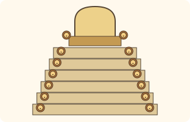

# 2 Chronicles 9 — The queen of Sheba asks Solomon hard questions

**About this chapter**

The queen of Sheba has heard about Solomon’s wisdom. She travels to Jerusalem to find out for herself. Later, other rulers also come to hear what God has taught Solomon.

## The queen meets Solomon

## 2 Chronicles 9:1

The queen of Sheba heard how famous Solomon was.

She came to Jerusalem to test him with hard questions.

Many people traveled with her.

Camels carried spices, plenty of gold, and precious stones.

She told Solomon everything on her mind.

## 2 Chronicles 9:2

Solomon answered every question.

He could explain even the hardest one.

## 2 Chronicles 9:3

The queen saw how wise Solomon was.

She saw the palace he had built.

## 2 Chronicles 9:4

She saw the food on his table and where his servants sat.

She watched the attendants serve and saw their clothes.

She saw what the men who served his drinks wore.

She also saw his burnt offerings at the LORD’s house.

It all took her breath away.

## 2 Chronicles 9:5

She told Solomon, “Back home I heard about your words and wisdom.

What I heard was true.

## 2 Chronicles 9:6

I could hardly believe it until I saw it for myself.

People told me less than half the story.

You are even wiser than they said.

## 2 Chronicles 9:7

How fortunate your people are!

Your servants get to stand near you and hear your wisdom every day.

## 2 Chronicles 9:8

Praise the LORD your God!

He was glad to seat you on his throne to rule for him.

Your God loves Israel and wants his people to last forever.

He made you king to do what is right and treat people fairly.”

**Pause and answer**

Why did the queen want to speak to Solomon herself?

## The queen and the king exchange gifts

## 2 Chronicles 9:9

The queen gave Solomon 120 talents of gold.

A talent was a large measure of weight.

She also gave him precious stones and a great supply of spices.

No one had brought Solomon spices like those before.

## 2 Chronicles 9:10

Servants of Hiram and Solomon also brought gifts from Ophir.

They brought gold, precious stones, and wood from trees called algum trees.

## 2 Chronicles 9:11

Solomon used the wood for steps at the LORD’s house and at his palace.

He also used it for lyres and harps, stringed instruments for the singers.

No one in Judah had seen anything like them.

## 2 Chronicles 9:12

Solomon gave the queen everything she asked for.

He gave her far more than she had brought him.

Then she and her servants went home.

## Gold shields and a royal throne

## 2 Chronicles 9:13

Each year Solomon received 666 talents of gold.

## 2 Chronicles 9:14

That was in addition to what traders brought in.

The kings of Arabia and the governors of the land also brought him gold and silver.

## 2 Chronicles 9:15

Solomon had workers hammer gold into two hundred large shields.

Each shield took six hundred shekels of gold.

A shekel was a small measure of weight.

## 2 Chronicles 9:16

They made three hundred smaller shields too.

Each took three hundred shekels of gold.

Solomon kept the shields in a building called the House of the Forest of Lebanon.

## 2 Chronicles 9:17

Solomon had a great throne made of ivory.

The workers covered it with pure gold.

## 2 Chronicles 9:18

Six steps led up to the throne.

A gold footstool was fastened to it.

A carved lion stood beside each of the two armrests.

## 2 Chronicles 9:19

Twelve more lions stood on the steps, one at each end of every step.

No other kingdom had a throne like it.

## 2 Chronicles 9:20

Solomon’s drinking cups were gold.

Even the utensils in the House of the Forest of Lebanon were pure gold.

In those days people attached little value to silver.

## 2 Chronicles 9:21

The king’s ships of Tarshish sailed with Hiram’s servants.

Every three years they brought back gold, silver, ivory, apes, and peacocks.

## Other kings come to hear Solomon

## 2 Chronicles 9:22

Solomon had more wealth and wisdom than any other king on earth.

## 2 Chronicles 9:23

Kings everywhere wanted to meet him.

They wanted to hear the wisdom God had given him.

## 2 Chronicles 9:24

Year after year the visitors brought gifts to honor him.

They brought silver and gold objects, clothes, weapons, spices, horses, and mules.

## 2 Chronicles 9:25

Solomon had four thousand stalls for horses and chariots.

He had twelve thousand horses.

He kept some in towns set aside for the chariots and some with him in Jerusalem.

## 2 Chronicles 9:26

Kings obeyed him from the Euphrates River to the land of the Philistines and the border of Egypt.

## 2 Chronicles 9:27

In Jerusalem silver became as common as stones.

Cedar wood became as plentiful as the sycamore trees in the low hills.

## 2 Chronicles 9:28

People brought Solomon horses from Egypt and other lands.

## Solomon’s son becomes king

## 2 Chronicles 9:29

Three writings tell more about Solomon’s life.

Nathan the prophet kept a record.

Ahijah from Shiloh wrote a prophecy, a message from God.

Iddo the seer recorded visions about Jeroboam son of Nebat.

A seer was someone who received messages from God.

## 2 Chronicles 9:30

Solomon ruled all Israel from Jerusalem for forty years.

## 2 Chronicles 9:31

When Solomon died, his people buried him in the City of David, his father.

His son Rehoboam became king.

**Pause and answer**

Who gave Solomon the wisdom that other kings came to hear?
