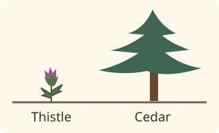

# 2 Kings 14 — Amaziah ignores a warning

**About this chapter**

Amaziah of Judah challenges Jehoash of Israel to a battle. Jehoash warns him with a story. Later, the chapter tells how Israel gets back land it had lost.

## Amaziah rules Judah

## 2 Kings 14:1

Jehoash, son of Jehoahaz, was in his second year as king of Israel.

That year Amaziah, son of Joash, became king of Judah.

## 2 Kings 14:2

Amaziah was 25 when he became king.

He ruled in Jerusalem for 29 years.

His mother was Jehoaddan from Jerusalem.

## 2 Kings 14:3

Amaziah did what the LORD said was right.

His ancestor David had followed the LORD more fully.

Amaziah followed the example of his father Joash.

## 2 Kings 14:4

The places of worship on the hills remained.

People still offered sacrifices and burned incense there.

## Amaziah follows the law of Moses

## 2 Kings 14:5

Once Amaziah had firm control of Judah, he punished his father’s killers.

He put those servants to death.

## 2 Kings 14:6

Amaziah let their sons live. He obeyed the LORD’s command in the Book of the Law of Moses.

Fathers must not die for their children’s sins.

Children must not die for their fathers’ sins.

Each person must answer with their life only for their own sin.

**Pause and answer**

Why did Amaziah let the sons live?

## 2 Kings 14:7

Amaziah defeated and killed 10,000 men of Edom in the Valley of Salt.

He captured Sela and named it Joktheel.

It still had that name when this account was written.

## Jehoash tells a story about a thistle

## 2 Kings 14:8

Amaziah sent messengers to Jehoash, king of Israel.

Jehoash was the son of Jehoahaz and grandson of Jehu.

Amaziah challenged him, “Come and face me in battle.”

## 2 Kings 14:9

Jehoash answered Amaziah with a story.

“A thistle in Lebanon sent a message to a cedar tree.

‘Let my son marry your daughter.’

Then a wild animal walked by and crushed the thistle.

## 2 Kings 14:10

You defeated Edom. Now you are proud.

Enjoy your victory and stay home.

Why bring trouble on yourself? Judah will fall with you.”

**Reading help**

A thistle is a small, prickly plant. A cedar is a large tree. Jehoash compares Amaziah to the thistle. He warns that Amaziah could easily be crushed in battle.

## Judah loses the battle

## 2 Kings 14:11

Amaziah refused to listen. So Jehoash marched out.

The two kings met in battle at Beth-shemesh in Judah.

## 2 Kings 14:12

Israel defeated Judah. The soldiers of Judah ran home.

## 2 Kings 14:13

At Beth-shemesh, Jehoash captured Amaziah, son of Joash and grandson of Ahaziah.

Jehoash went to Jerusalem and broke down part of its wall.

From the Ephraim Gate to the Corner Gate, he destroyed about 180 metres of wall.

## 2 Kings 14:14

Jehoash took all the gold, silver, and other treasures he found in the LORD’s temple and the palace stores.

He took people away as hostages too.

Then he returned to Samaria.

**Reading help**

Hostages are people held prisoner to put pressure on others.

## Jehoash’s son rules Israel

## 2 Kings 14:15

The Book of the Chronicles of the Kings of Israel tells more about Jehoash.

It records his deeds, his strength, and his war with Amaziah of Judah.

## 2 Kings 14:16

Jehoash died. His people buried him with Israel’s kings in Samaria.

His son Jeroboam became king in his place.

## 2 Kings 14:17

Amaziah of Judah lived 15 more years after Jehoash of Israel died.

## 2 Kings 14:18

The Book of the Chronicles of the Kings of Judah tells about the other things Amaziah did.

## Azariah becomes king of Judah

## 2 Kings 14:19

Men in Jerusalem made a plan against Amaziah.

Amaziah fled to Lachish. They sent men after him.

Those men killed him in Lachish.

## 2 Kings 14:20

They brought Amaziah’s body back on horses.

They buried him with his ancestors in Jerusalem, in the City of David.

## 2 Kings 14:21

The people of Judah chose Amaziah’s son Azariah as king.

He was 16 years old.

## 2 Kings 14:22

After his father died, Azariah rebuilt the city of Elath.

It became part of Judah again.

**Pause and answer**

Which city did Azariah rebuild?

## Jeroboam takes back land for Israel

## 2 Kings 14:23

Jeroboam, son of Jehoash, became king of Israel in Amaziah’s fifteenth year as king of Judah.

Jeroboam ruled in Samaria for 41 years.

## 2 Kings 14:24

The LORD saw Jeroboam do evil.

An earlier king, also named Jeroboam, had led Israel into sin.

This Jeroboam kept doing those same things.

## 2 Kings 14:25

Jeroboam took back Israel’s land from Lebo-hamath to the Sea of the Arabah.

The LORD, Israel’s God, had said this would happen.

He had spoken through his prophet Jonah.

Jonah was Amittai’s son and came from Gath-hepher.

**Reading help**

The Sea of the Arabah is also called the Dead Sea.

## The LORD sees Israel’s suffering

## 2 Kings 14:26

The LORD saw how badly Israel’s people suffered.

Slaves and free people alike suffered. No one helped them.

## 2 Kings 14:27

The LORD had said he would keep Israel from disappearing from the earth.

So he used Jeroboam, son of Jehoash, to save Israel.

**Pause and answer**

Why did the LORD help Israel?

## 2 Kings 14:28

The Book of the Chronicles of the Kings of Israel tells more about Jeroboam.

It records his deeds, his strength, and his wars.

It tells how he won Damascus and Hamath back from Judah for Israel.

## 2 Kings 14:29

Jeroboam died, as the kings before him had died.

His son Zechariah became king of Israel.
