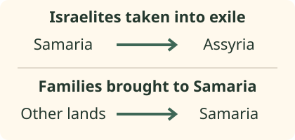

# 2 Kings 17 — Assyria takes the people of Israel into exile

**About this chapter**

Assyria captures Samaria, the capital of Israel. The chapter explains why Israel lost its land. Then it tells who came to live in Samaria.

## Hoshea stops paying Assyria

## 2 Kings 17:1

Hoshea, son of Elah, became king of Israel.

Ahaz was in his twelfth year as king of Judah.

Hoshea ruled in Samaria for nine years.

## 2 Kings 17:2

The LORD saw Hoshea do evil.

Even so, his wrongdoing differed from that of Israel’s earlier kings.

## 2 Kings 17:3

Shalmaneser, king of Assyria, attacked Hoshea.

Hoshea had to obey Shalmaneser and pay him each year.

## 2 Kings 17:4

Then Hoshea secretly sent messengers to So, king of Egypt.

Hoshea also stopped paying the king of Assyria.

When Shalmaneser found out, he put Hoshea in prison.

## Assyria captures Samaria

## 2 Kings 17:5

Assyria’s king invaded the whole land of Israel.

His army surrounded Samaria for three years.

## 2 Kings 17:6

In Hoshea’s ninth year, Assyria’s king captured Samaria.

He forced the Israelites to leave their homes.

He settled them in Halah, in Gozan by the Habor River, and in the cities of the Medes.

**Reading help**

Exile means having to leave your own land and live somewhere else.

## Israel worshiped other gods

## 2 Kings 17:7

This happened because Israel had sinned against the LORD their God.

He had freed them from Pharaoh, king of Egypt.

He had brought them out of Egypt. Yet they worshiped other gods.

## 2 Kings 17:8

They copied the nations the LORD had driven out before them.

They also followed customs their own kings had started.

## 2 Kings 17:9

The Israelites secretly did things the LORD said were wrong.

They built places of worship everywhere they lived, from lonely watchtowers to walled cities.

## 2 Kings 17:10

They set up stone pillars and poles for worshiping Asherah.

They put them on every high hill and under every leafy tree.

## 2 Kings 17:11

They burned incense there, just as the nations before them had done.

The LORD had driven those nations out.

The evil things Israel did made the LORD angry.

## 2 Kings 17:12

The people served idols.

The LORD had told them, “You must not do this.”

## The prophets warned the people

## 2 Kings 17:13

The LORD sent prophets and seers to warn Israel and Judah.

“Turn away from evil. Obey my commands and my laws.

I gave this law to your ancestors.

My servants the prophets brought it to you.”

**Reading help**

A seer is someone God shows things to. Here the seers and prophets bring God’s warning.

## 2 Kings 17:14

The people refused to listen. They were as stubborn as their ancestors.

Their ancestors had refused to trust the LORD their God.

**Pause and answer**

What did the LORD ask Israel and Judah to turn away from?

## 2 Kings 17:15

They rejected the LORD’s laws, his warnings, and his covenant with their ancestors.

They followed worthless idols and became worthless themselves.

They copied the nations around them, even though the LORD had forbidden it.

## Israel refused to change

## 2 Kings 17:16

They left behind all the LORD’s commands.

They made two metal calves and a pole for worshiping Asherah.

They bowed down to the stars and served Baal.

## 2 Kings 17:17

They burned their sons and daughters as sacrifices.

They looked for hidden signs to tell the future.

They gave themselves to doing what the LORD saw was evil.

This made him angry.

## 2 Kings 17:18

The LORD was very angry with Israel.

He sent them away from his presence.

Only the tribe of Judah remained.

## 2 Kings 17:19

Even Judah disobeyed the LORD their God.

The people of Judah followed customs that Israel had started.

## 2 Kings 17:20

The LORD rejected all the descendants of Israel.

He made them suffer and let enemies rob them.

At last he sent them away from his presence.

## The warning about exile comes true

## 2 Kings 17:21

Long before, the LORD had separated Israel from the kings of David’s family.

Israel chose Jeroboam, son of Nebat, as king.

Jeroboam led Israel away from the LORD and into great sin.

## 2 Kings 17:22

Israel kept doing the wrong things Jeroboam had done.

They refused to stop.

## 2 Kings 17:23

At last the LORD sent Israel away from his presence.

His servants the prophets had warned that this would happen.

Assyria took the Israelites from their land into exile.

They still lived away from home when this account was written.

## Other families come to Samaria

## 2 Kings 17:24

Assyria’s king brought other people to the towns of Samaria.

They came from Babylon, Cuthah, Avva, Hamath, and Sepharvaim.

They took over the towns where the Israelites had lived.

## 2 Kings 17:25

At first the newcomers did not worship the LORD.

So the LORD sent lions among them. The lions killed some of them.

## 2 Kings 17:26

A report reached Assyria’s king.

“The people you moved to Samaria do not know what the God of that land requires.

That is why he has sent lions. The lions are killing people.”

## A priest returns to teach

## 2 Kings 17:27

Assyria’s king gave an order.

“Send back one of the priests you took from Samaria.

Let him live there and teach the people what the God of the land requires.”

## 2 Kings 17:28

One of the priests returned and settled in Bethel.

He taught the people how to worship the LORD.

**Pause and answer**

Why did the king send a priest back?

## 2 Kings 17:29

Yet each group still made images of its own gods.

They put the images in the hilltop places of worship that earlier residents had built.

## The settlers keep their own gods

## 2 Kings 17:30

The people from Babylon made Succoth-benoth.

The people from Cuth made Nergal.

The people from Hamath made Ashima.

## 2 Kings 17:31

The people from Avva made Nibhaz and Tartak.

The people from Sepharvaim worshiped Adrammelech and Anammelech.

They burned their children as offerings to these gods.

## 2 Kings 17:32

The newcomers worshiped the LORD.

They also chose all kinds of people as priests for their hilltop places of worship.

## 2 Kings 17:33

They worshiped the LORD and served their own gods too.

They kept the customs of their former homes.

## The LORD had made a covenant

## 2 Kings 17:34

They still kept these customs when this account was written.

None worshiped the LORD as he required.

They ignored the laws and commands he gave Jacob’s descendants.

The LORD had given Jacob the name Israel.

## 2 Kings 17:35

The LORD had made a covenant with the Israelites.

He told them, “Never worship other gods or bow down to them.

Never serve them or give them sacrifices.

**Reading help**

A covenant is a serious promise. The LORD reminded Israel how to live as his people.

## 2 Kings 17:36

Worship the LORD. He used his great power to bring you out of Egypt.

Bow down to him and offer him sacrifices.

## 2 Kings 17:37

Always obey the laws and commands he wrote for you.

Do not worship other gods.

## 2 Kings 17:38

Remember the covenant I made with you.

Do not worship other gods.

## 2 Kings 17:39

Worship the LORD your God.

He will rescue you from all your enemies.”

## Children follow their families’ example

## 2 Kings 17:40

But the people would not listen. They kept their old customs.

## 2 Kings 17:41

These nations worshiped the LORD and also served their idols.

Their children and grandchildren followed their example.

That still happened when this account was written.

**Pause and answer**

Whose example did the children and grandchildren follow?
