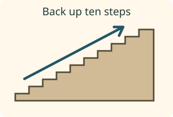

# 2 Kings 20 — The LORD hears Hezekiah’s prayer

**About this chapter**

Hezekiah prays when he is sick. The LORD answers and gives him a sign. Later, visitors from Babylon come to see the king.

## Hezekiah turns to the LORD

## 2 Kings 20:1

Hezekiah became so sick that he was dying.

Isaiah the prophet, son of Amoz, came to him.

Isaiah said, “The LORD says, ‘Put your house in order.

You will die from this illness.’”

**Reading help**

“Put your house in order” means to make arrangements for the people and things you will leave behind when you die.

## 2 Kings 20:2

Hezekiah turned his face to the wall.

He prayed to the LORD.

## 2 Kings 20:3

“Please, LORD, remember how faithfully I have served you.

I have loved you with my whole heart.

I have done what you say is good.”

Then Hezekiah cried bitterly.

## Isaiah brings a new message

## 2 Kings 20:4

Isaiah was still in the middle courtyard when the LORD spoke to him again.

## 2 Kings 20:5

“Go back to Hezekiah, the leader of my people.

Tell him what I, the LORD, the God of his ancestor David, say.

‘I have heard your prayer. I have seen your tears.

I will heal you. On the third day you will go up to my temple.

## 2 Kings 20:6

I will give you 15 more years to live.

I will rescue you and Jerusalem from the king of Assyria.

I will protect this city for my own sake and for my servant David.’”

**Pause and answer**

How many more years did the LORD promise Hezekiah?

## 2 Kings 20:7

Isaiah asked for a dressing made from figs.

They put it on Hezekiah’s painful lump, and he got well.

## A shadow moves back ten steps

## 2 Kings 20:8

Hezekiah had asked Isaiah for a sign.

“How will I know the LORD will heal me?

How will I know I will go to his temple on the third day?”

## 2 Kings 20:9

Isaiah answered, “The LORD will give you a sign that he will keep his promise.

Should the shadow move forward ten steps or back ten steps?”

## 2 Kings 20:10

Hezekiah answered, “It is easy for the shadow to grow longer by ten steps.

Let it go back ten steps.”

## 2 Kings 20:11

Isaiah called out to the LORD.

The shadow had moved down the stairway of Ahaz.

The LORD made it go back up ten steps.

**Pause and answer**

Which way did the shadow move when Isaiah prayed?

## Visitors come from Babylon

## 2 Kings 20:12

Merodach-baladan, son of Baladan, was king of Babylon.

He heard that Hezekiah had been sick.

He sent Hezekiah letters and a gift.

## 2 Kings 20:13

Hezekiah welcomed the king’s messengers and showed them his treasures.

They saw his silver, gold, spices, and valuable oil.

He showed them his weapons and everything in his storerooms.

He showed them everything in his palace and kingdom.

## 2 Kings 20:14

Isaiah asked Hezekiah, “Where did those men come from?

What did they say to you?”

Hezekiah answered, “They came from far away, from Babylon.”

## 2 Kings 20:15

Isaiah asked, “What did they see in your palace?”

Hezekiah answered, “They saw everything. I showed them all my treasures.”

## Isaiah tells what will happen to the royal family

## 2 Kings 20:16

Isaiah told Hezekiah, “Listen to what the LORD says.

## 2 Kings 20:17

‘One day people will carry everything in your palace to Babylon.

They will take all the treasures your ancestors saved.

Nothing will remain here,’ says the LORD.

## 2 Kings 20:18

‘They will even take away some of your own descendants.

Those men will become eunuchs in the palace of Babylon’s king.’”

**Reading help**

A eunuch was a man whose body had been changed so he could not father children. Some eunuchs served in royal palaces.

## 2 Kings 20:19

Hezekiah told Isaiah, “The message you brought from the LORD is good.”

He thought, “At least there will be peace and safety while I live.”

## Manasseh becomes king

## 2 Kings 20:20

Hezekiah built a pool and a tunnel to bring water into Jerusalem.

The Book of the Chronicles of the Kings of Judah records this work.

It also tells of his strength and his other deeds.

## 2 Kings 20:21

Hezekiah died, and his son Manasseh became king of Judah.

**Pause and answer**

What did Hezekiah build to bring water into Jerusalem?
