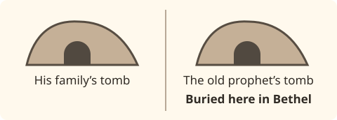

# 2 Kings 23 — Josiah and the people renew their promise

**About this chapter**

Josiah reads God’s law aloud. The people make a promise with him, and they celebrate Passover in Jerusalem. After Josiah dies, two of his sons rule Judah.

## The people hear the covenant

## 2 Kings 23:1

King Josiah called together all the leaders of Judah and Jerusalem.

## 2 Kings 23:2

He went to the LORD’s temple with the people of Judah and Jerusalem.

The priests and prophets came too.

People of every rank heard Josiah read aloud.

He read the whole Book of the Covenant that Hilkiah had found in the temple.

## 2 Kings 23:3

Josiah stood beside the pillar and made a covenant before the LORD.

He promised to follow the LORD with all his heart and soul.

He would obey the LORD’s commands and keep the promises in the book.

All the people joined in the covenant.

**Reading help**

A covenant is a serious promise. Here the people promise to live by the LORD’s commands.

**Pause and answer**

Who joined Josiah in making the promise?

## Josiah clears the temple

## 2 Kings 23:4

Josiah gave orders to Hilkiah the chief priest, the priests under him, and the doorkeepers.

They removed objects used to worship Baal, Asherah, and the stars from the LORD’s temple.

Josiah burned those objects outside Jerusalem in the fields of Kidron.

He took the ashes to Bethel.

## 2 Kings 23:5

Earlier kings of Judah had appointed priests to burn incense at hilltop places of worship.

These places stood throughout Judah and around Jerusalem.

The priests burned incense to Baal, the sun, the moon, and the stars.

Josiah removed those priests from their work.

## 2 Kings 23:6

Josiah took the Asherah pole out of the LORD’s temple.

He burned it in the Kidron Valley outside Jerusalem.

He ground the remains to powder and scattered it on the graves of ordinary people.

## 2 Kings 23:7

Josiah tore down the temple rooms where men had worked as prostitutes.

Women had woven cloth hangings for Asherah there.

## Places of worship across Judah

## 2 Kings 23:8

Josiah brought the priests in from Judah’s towns.

From Geba to Beersheba, he made the places where they burned incense unfit for worship.

He also tore down shrines near the gate of Joshua, the city governor.

They stood to the left of the city gate.

## 2 Kings 23:9

Those priests did not serve at the LORD’s altar in Jerusalem.

They still shared bread made without yeast with the other priests.

## 2 Kings 23:10

Josiah made Topheth in the Valley of Ben-hinnom unfit for worship.

No one could use it to burn a son or daughter as an offering to Molech.

## Josiah removes altars and shrines

## 2 Kings 23:11

At the temple entrance stood horses that Judah’s kings had dedicated to the sun.

They were near the room of Nathan-melech, a royal official.

Josiah removed the horses and burned the chariots dedicated to the sun.

## 2 Kings 23:12

Josiah tore down the altars on the roof near Ahaz’s upstairs room.

He also tore down Manasseh’s altars in both temple courtyards.

He crushed the altars and threw the dust into the Kidron Valley.

## 2 Kings 23:13

East of Jerusalem, south of the Mount of Corruption, Josiah made other shrines unfit for worship.

Solomon had built them for gods the LORD hated.

They were Ashtoreth of Sidon, Chemosh of Moab, and Milcom of Ammon.

## 2 Kings 23:14

Josiah smashed the sacred stone pillars and cut down the Asherah poles.

He covered the sites with human bones.

## Josiah sees a grave marker in Bethel

## 2 Kings 23:15

In Bethel, Josiah tore down the altar Jeroboam son of Nebat had built.

Jeroboam had led Israel into sin there.

Josiah burned the shrine and ground its remains to powder.

He burned the Asherah pole too.

## 2 Kings 23:16

Josiah saw tombs on the hillside. He had bones brought out of them.

He burned the bones on the altar, making it unfit for worship.

Long before, a man of God had said the LORD would do this.

## 2 Kings 23:17

Josiah asked, “What is that grave marker?”

The townspeople said, “A man of God came here from Judah.

He told us what you would do to this altar.

That is his tomb.”

## 2 Kings 23:18

Josiah said, “Let him rest. Leave his bones alone.”

They left his bones there, with those of the prophet from Samaria.

**Reading help**

The man from Judah had named Josiah long before Josiah came to Bethel. [Read the earlier story in 1 Kings 13.](../1kings/1kings13_1757414016.md)

## Josiah returns from Samaria

## 2 Kings 23:19

Earlier kings of Israel had angered the LORD by building hilltop shrines in Samaria’s towns.

Josiah removed them just as he had done in Bethel.

## 2 Kings 23:20

Josiah killed the priests of those shrines on their altars.

He burned human bones on the altars. Then he returned to Jerusalem.

## The people celebrate Passover

## 2 Kings 23:21

Josiah told all the people, “Celebrate the Passover for the LORD your God.

Do what this Book of the Covenant says.”

**Reading help**

At Passover, the people remembered how the LORD rescued their ancestors from Egypt.

## 2 Kings 23:22

No one had celebrated a Passover like this since the judges led Israel.

Even under the kings of Israel and Judah, there had been no Passover like it.

## 2 Kings 23:23

In Josiah’s eighteenth year as king, the people celebrated this Passover for the LORD in Jerusalem.

**Pause and answer**

Where did the people celebrate Passover?

## 2 Kings 23:24

Josiah removed people who claimed to speak with spirits.

He also removed household gods, idols, and other things the LORD hated from Judah and Jerusalem.

Josiah obeyed the law in the book Hilkiah had found in the temple.

## The LORD’s warning still stands

## 2 Kings 23:25

No king before or after Josiah turned to the LORD as he did.

He followed the whole Law of Moses with all his heart, soul, and strength.

## 2 Kings 23:26

Yet the LORD was still very angry with Judah.

Manasseh’s deeds had made him angry.

## 2 Kings 23:27

The LORD had said, “I will send Judah away from me, just as I sent Israel away.

I will reject Jerusalem, the city I chose.

I will reject the temple where I said my name would be.”

## 2 Kings 23:28

The Book of the Chronicles of the Kings of Judah records the other things Josiah did.

## Josiah dies at Megiddo

## 2 Kings 23:29

Neco, king of Egypt, marched to the Euphrates River to help Assyria’s king.

Josiah went to face Neco. Neco killed Josiah at Megiddo.

## 2 Kings 23:30

Josiah’s servants carried his body by chariot to Jerusalem.

They buried him in his own tomb.

The people poured oil on his son Jehoahaz and made him king.

## 2 Kings 23:31

Jehoahaz was 23 when he became king. He ruled in Jerusalem for three months.

His mother was Hamutal, daughter of Jeremiah, from Libnah.

## 2 Kings 23:32

Jehoahaz did what the LORD saw was evil, as his ancestors had done.

## Egypt’s king chooses a ruler for Judah

## 2 Kings 23:33

Pharaoh Neco imprisoned Jehoahaz at Riblah in Hamath.

Jehoahaz could no longer rule in Jerusalem.

Neco demanded 100 talents of silver and one talent of gold from Judah.

**Reading help**

A talent was a large unit of weight. People weighed silver and gold to make payments.

## 2 Kings 23:34

Neco made another son of Josiah king. His name was Eliakim.

Neco changed his name to Jehoiakim.

Neco took Jehoahaz away to Egypt, where Jehoahaz died.

## 2 Kings 23:35

Jehoiakim collected silver and gold from the people to pay Neco.

The more a person owned, the more that person paid.

## 2 Kings 23:36

Jehoiakim was 25 when he became king. He ruled in Jerusalem for eleven years.

His mother was Zebidah, daughter of Pedaiah, from Rumah.

## 2 Kings 23:37

Jehoiakim did what the LORD saw was evil, as his ancestors had done.

**Pause and answer**

What new name did Neco give Eliakim?
