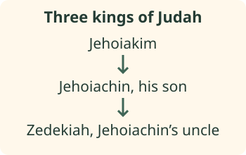

# 2 Kings 24 — Babylon takes Jehoiachin away

**About this chapter**

Babylon’s king takes control of Judah. Jehoiachin and many of his people must leave Jerusalem. His uncle stays behind to rule.

## Jehoiakim turns against Babylon

## 2 Kings 24:1

Nebuchadnezzar, king of Babylon, invaded Judah while Jehoiakim was king.

Jehoiakim served Nebuchadnezzar for three years.

Then he turned against him.

## 2 Kings 24:2

The LORD sent raiders to destroy Judah.

They came from Babylon, Aram, Moab, and Ammon.

The LORD had warned Judah through his servants the prophets.

## 2 Kings 24:3

The LORD ordered this to happen.

He would send Judah away from his presence because of all the wrong Manasseh had done.

## 2 Kings 24:4

Manasseh had killed innocent people throughout Jerusalem.

The LORD would not forgive this.

## Jehoiachin succeeds his father

## 2 Kings 24:5

The Book of the Chronicles of the Kings of Judah records the other things Jehoiakim did.

## 2 Kings 24:6

Jehoiakim died. His son Jehoiachin became king in his place.

**Reading help**

The names sound alike. Jehoiakim was the father. Jehoiachin was his son.

## 2 Kings 24:7

Egypt’s king no longer marched out of Egypt.

Babylon’s king had taken the lands Egypt once controlled between the Brook of Egypt and the Euphrates River.

## 2 Kings 24:8

Jehoiachin was 18 when he became king.

He ruled in Jerusalem for three months.

His mother was Nehushta, daughter of Elnathan, from Jerusalem.

## 2 Kings 24:9

Jehoiachin did what the LORD saw was evil, just as his father had done.

## Jerusalem surrenders

## 2 Kings 24:10

Nebuchadnezzar’s men marched to Jerusalem and surrounded the city.

## 2 Kings 24:11

While his men surrounded Jerusalem, Nebuchadnezzar came there himself.

## 2 Kings 24:12

Jehoiachin surrendered to Nebuchadnezzar. His mother, servants, commanders, and officials surrendered too.

Nebuchadnezzar took Jehoiachin prisoner in his eighth year as Babylon’s king.

**Pause and answer**

Who took Jehoiachin prisoner?

## 2 Kings 24:13

Nebuchadnezzar took all the treasures from the LORD’s temple and the palace.

He cut apart the gold objects King Solomon had made for the temple.

The LORD had said this would happen.

**Reading help**

Isaiah had warned Hezekiah that the palace treasures would go to Babylon. [Read Isaiah’s warning in 2 Kings 20.](2kings20_1757418034.md)

## Families leave for Babylon

## 2 Kings 24:14

Nebuchadnezzar forced 10,000 people from Jerusalem to leave their homes.

They included commanders, brave soldiers, skilled workers, and people who shaped metal.

Only the poorest people of the land remained.

## 2 Kings 24:15

Nebuchadnezzar took Jehoiachin from Jerusalem to Babylon.

He also took the king’s mother, wives, and officials, and the leaders of Judah.

## 2 Kings 24:16

Among the captives were 7,000 soldiers and 1,000 skilled workers, including metalworkers.

They were all strong enough to fight.

**Reading help**

These people went into exile. They had to leave their country and live in another land.

## Jehoiachin’s uncle becomes king

## 2 Kings 24:17

Nebuchadnezzar chose Jehoiachin’s uncle Mattaniah to rule Judah.

He gave Mattaniah a new name, Zedekiah.

## 2 Kings 24:18

Zedekiah was 21 when he became king.

He ruled in Jerusalem for eleven years.

His mother was Hamutal, daughter of Jeremiah, from Libnah.

## 2 Kings 24:19

Zedekiah did what the LORD saw was evil, just as Jehoiakim had done.

## 2 Kings 24:20

The LORD was angry with Jerusalem and Judah.

All this happened until he sent them away from his presence.

Zedekiah also turned against the king of Babylon.

**Pause and answer**

What new name did Babylon’s king give Mattaniah?
