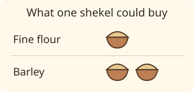

# 2 Kings 7 — Four men bring good news to Samaria

**About this chapter**

Samaria’s people are starving. Elisha says there will be food by tomorrow. That evening, four men go outside the city and find an empty camp.

## Elisha says there will be food

## 2 Kings 7:1

Elisha said, “Listen to the LORD’s message.

Tomorrow, about this time, food will sell at Samaria’s gate.

One silver shekel will buy one measure of fine flour.

One silver shekel will buy two measures of barley.”

**Reading help**

A shekel was a weight of silver used to pay for things. The measure for grain was called a seah. Barley is a grain people can use to make bread.

## 2 Kings 7:2

The king was leaning on an officer’s arm.

The officer asked Elisha, “Even if the LORD opened windows in the sky, could this happen?”

Elisha said, “You will see it yourself.

But you will never eat any of it.”

**Reading help**

The officer pictures food pouring down through openings in the sky. He doubts there could be so much food by tomorrow.

## Four men leave the city gate

## 2 Kings 7:3

Four men with a skin disease called leprosy sat at the city gate.

They asked each other, “Why sit here until we die?

## 2 Kings 7:4

There is no food in the city. We will die there.

We will die if we stay here too.

Let us go to the camp of Aram’s army.

If the soldiers spare us, we will live.

If they kill us, we will die.”

## 2 Kings 7:5

As daylight faded, the four men set out.

At the edge of the camp, they found no one.

**Pause and answer**

Who did the four men find at the camp?

## Why the camp was empty

## 2 Kings 7:6

Earlier, the Lord had made Aram’s soldiers hear a noise.

It sounded like horses, chariots, and a huge army.

The soldiers told each other, “Israel’s king must have hired other kings to attack us!

The Hittite kings and the kings of Egypt are coming!”

## 2 Kings 7:7

As daylight faded, the soldiers had run for their lives.

They left the whole camp as it was.

Their tents, horses, and donkeys were still there.

## The four men decide to tell the city

## 2 Kings 7:8

The four men entered a tent. They ate and drank.

They took silver, gold, and clothes and hid them.

Then they took things from another tent and hid those too.

## 2 Kings 7:9

Then they said to each other, “What we are doing is wrong.

We have good news today. We must share it.

If we keep quiet until morning, we will answer for it.

Let us tell the people at the king’s palace.”

## 2 Kings 7:10

They went back and called to the city gatekeepers.

“We went to Aram’s camp. We found no one there.

The horses and donkeys are still tied up.

The tents are still standing.”

## 2 Kings 7:11

The gatekeepers shouted the news.

Word reached the people at the king’s palace.

**Pause and answer**

Why did the four men go back to the city?

## The king checks the news

## 2 Kings 7:12

Israel’s king got up that night and told his servants, “Aram’s soldiers know we are starving.

I think they left their camp to hide in the fields.

They mean to catch us alive when we go out.

Then they can enter our city.”

## 2 Kings 7:13

One servant said, “Please send men to find out.

Let them take five of the horses still here.

Even if they stay, they face the same danger.

Everyone left in the city is dying.”

## 2 Kings 7:14

Men took two chariots and horses.

The king sent them after Aram’s army.

“Go and see,” he said.

## 2 Kings 7:15

The men followed the trail to the Jordan River.

Clothes and equipment lay all along the road.

Aram’s soldiers had dropped them in their hurry.

The men went back and told the king.

**Pause and answer**

What did the men see along the road?

## People find food

## 2 Kings 7:16

The people went out and took supplies from the camp.

One silver shekel bought one measure of fine flour.

One silver shekel bought two measures of barley.

It happened just as the LORD had said.

## 2 Kings 7:17

The king put the officer he leaned on in charge of the gate.

The crowd rushed through the gateway and trampled the officer.

He died, just as Elisha had warned when the king visited him.

## The officer sees Elisha’s words come true

## 2 Kings 7:18

Elisha’s words to the king had come true.

He had said, “Tomorrow, about this time, at Samaria’s gate, one silver shekel will buy two measures of barley.

One silver shekel will buy one measure of fine flour.”

## 2 Kings 7:19

The officer had asked, “Even if the LORD opened windows in the sky, could this happen?”

Elisha had answered, “You will see it yourself.

But you will never eat any of it.”

## 2 Kings 7:20

That is what happened to the officer.

People stepped on him in the crowded gateway, and he died.
