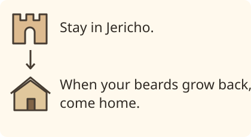

# 2 Samuel 10 — Hanun turns away David’s messengers

**About this chapter**

King David sends men to comfort a grieving king. The king’s leaders suspect the men are spies. War follows.

## David sends men to comfort Hanun

## 2 Samuel 10:1

Some time later, the king of the Ammonites died.

His son Hanun became king.

## 2 Samuel 10:2

David said, “Nahash was kind to me.

I will be kind to his son Hanun.”

David sent servants to comfort Hanun after his father’s death.

The servants reached the land of the Ammonites.

## 2 Samuel 10:3

The Ammonite leaders spoke to Hanun.

They asked, “Do you think David sent these men to honor your father?

What if David sent them to spy on our city so he can take it?”

**Reading help**

A spy secretly gathers information. The leaders suspect David’s servants are spies. David sent them because Hanun’s father had died.

## David’s men stay in Jericho

## 2 Samuel 10:4

Hanun seized David’s servants.

He shaved off half of each man’s beard.

He cut their clothes short at the hips.

Then he sent the men away.

## 2 Samuel 10:5

David heard what had happened.

The men felt deeply ashamed.

So David sent messengers to meet them.

David told them, “Stay in Jericho until your beards grow back.

Then come home.”

**Pause and answer**

Where did David tell his men to wait?

## The Ammonites hire soldiers

## 2 Samuel 10:6

The Ammonites knew how angry David was with them.

They hired 20,000 Aramean soldiers from Beth-rehob and Zoba.

These soldiers fought on foot.

They also hired 1,000 men from the king of Maacah.

They hired another 12,000 men from Tob.

## 2 Samuel 10:7

David heard the news.

He sent Joab with his whole army of strong fighters.

## 2 Samuel 10:8

The Ammonites gathered for battle at their city gate.

The other men gathered separately in the open country.

They came from Zobah, Rehob, Tob, and Maacah.

## Joab and Abishai promise to help each other

## 2 Samuel 10:9

Joab saw enemies ahead of him and behind him.

He chose some of Israel’s best soldiers.

Joab and these soldiers faced the Arameans.

## 2 Samuel 10:10

Joab’s brother Abishai led the rest of Israel’s soldiers.

Abishai and his men faced the Ammonites.

## 2 Samuel 10:11

Joab told Abishai, “If the Arameans are too strong for me, come help me.

If the Ammonites are too strong for you, I will help you.

## 2 Samuel 10:12

Be strong.

Let us fight bravely for our people.

Let us fight for the cities of our God.

May the LORD do what he sees is good.”

**Pause and answer**

Who promised to help Abishai?

## The Arameans and Ammonites run away

## 2 Samuel 10:13

Joab and his soldiers moved toward the Arameans.

The Arameans ran away.

## 2 Samuel 10:14

The Ammonites saw the Arameans run away.

So the Ammonites ran from Abishai into their city.

Then Joab left the Ammonites and returned to Jerusalem.

## The Arameans gather again

## 2 Samuel 10:15

The Arameans knew Israel had beaten them.

So they gathered their soldiers again.

## 2 Samuel 10:16

Hadadezer sent for more Arameans from beyond the Euphrates River.

Shobach led them to Helam.

Shobach was in charge of Hadadezer’s army.

## 2 Samuel 10:17

David heard the news and gathered the men of Israel.

They crossed the Jordan River and went to Helam.

There the Arameans lined up and fought David.

## The kings make peace with Israel

## 2 Samuel 10:18

The Arameans ran from Israel.

David and his men killed 700 chariot drivers.

They also killed 40,000 soldiers who fought on foot.

David struck down Shobach, the army commander.

Shobach died there.

**Reading help**

A chariot was a cart that horses pulled in battle.

## 2 Samuel 10:19

The kings under Hadadezer knew Israel had beaten them.

So they made peace with Israel.

They came under Israel’s rule.

After that, the Arameans were afraid to help the Ammonites.

**Pause and answer**

Who made peace with Israel?
