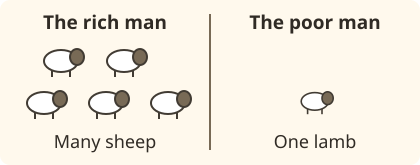

# 2 Samuel 12 — Nathan tells David a story

**About this chapter**

Nathan tells David about a poor man who loved his lamb. Listen to what David says when he hears the story.

## The poor man’s lamb

## 2 Samuel 12:1

The LORD sent Nathan to David.

Nathan told David a story.

“Two men lived in the same city.

One was rich. The other was poor.

## 2 Samuel 12:2

The rich man owned many sheep and cattle.

## 2 Samuel 12:3

The poor man owned only one little lamb.

He had bought her and raised her.

She grew up with him and his children.

She ate his food and drank from his cup.

She slept in his arms.

She was like a daughter to him.

## 2 Samuel 12:4

One day a traveler visited the rich man.

The rich man wanted to keep all his own animals.

So he took the poor man’s lamb.

He cooked the lamb for his guest.”

## David judges the rich man

## 2 Samuel 12:5

David was very angry with the rich man.

He told Nathan, “As surely as the LORD lives, that man deserves to die!

## 2 Samuel 12:6

He took the lamb and showed no pity.

He must pay back four times what it was worth.”

**Pause and answer**

Whose lamb did the rich man take?

## Nathan speaks to David about Uriah

## 2 Samuel 12:7

Nathan told David, “You are that man!

Listen to what the LORD, Israel’s God, says to you.

‘I chose you to be king over Israel.

I saved you from Saul.

## 2 Samuel 12:8

I gave you your master Saul’s household and his wives.

I gave you Israel and Judah to rule.

If you needed more, I would have given you more.

## 2 Samuel 12:9

Why did you treat my command as worthless?

I saw the evil you did.

You used the Ammonites to kill Uriah the Hittite.

You took his wife for yourself.

## 2 Samuel 12:10

You treated me with contempt.

You took Uriah’s wife as your own.

So violence will never leave your family.’

**Reading help**

Nathan’s story helps David see what he did. David already had much. He took Uriah’s wife and caused Uriah’s death.

## David admits his sin

## 2 Samuel 12:11

The LORD says, ‘I will bring trouble on you from within your own family.

You will see me take your wives and give them to another man.

He will have sex with them in broad daylight.

## 2 Samuel 12:12

You acted in secret.

I will do this where all Israel can see.’”

## 2 Samuel 12:13

David told Nathan, “I have sinned against the LORD.”

Nathan answered, “The LORD has forgiven your sin.

You will not die.

## 2 Samuel 12:14

But what you did showed no respect for the LORD’s word.

Because of this, your son will die.”

## David asks God to let the child live

## 2 Samuel 12:15

Nathan went home.

Bathsheba, Uriah’s wife, had given birth to David’s son.

The LORD made the child sick.

## 2 Samuel 12:16

David begged God to let the boy live.

David fasted. He went inside his house.

He spent the night on the ground in rough cloth.

**Reading help**

To fast means to go without food for a time. David wore rough cloth to show his sorrow.

## 2 Samuel 12:17

The leaders of David’s household came to help him up.

David refused to get up.

He would eat nothing with them.

## The servants tell David the child has died

## 2 Samuel 12:18

On the seventh day the child died.

David’s servants were afraid to tell him.

They said, “He would not listen while the child lived.

How can we tell him the child has died?

He might hurt himself.”

## 2 Samuel 12:19

David saw his servants whispering to each other.

He realized the child had died.

David asked, “Has the child died?”

They answered, “Yes, he has.”

## 2 Samuel 12:20

David got up from the ground.

He washed and put oil on his skin.

He changed his clothes.

He went to the LORD’s house to worship.

Then he went home and asked for food.

His servants brought food, and David ate.

## David explains why he fasted

## 2 Samuel 12:21

His servants asked, “Why did you do this?

While the child lived, you fasted and cried.

When he died, you got up and ate.”

## 2 Samuel 12:22

David answered, “While the child lived, I fasted and cried.

I thought the LORD might show me kindness.

He might let the child live.

## 2 Samuel 12:23

Now my child is dead.

Why should I fast?

Can I bring him back?

I will go to him one day.

He will never come back to me.”

**Pause and answer**

What had David hoped God would do for the child?

## Bathsheba gives birth to Solomon

## 2 Samuel 12:24

David comforted his wife Bathsheba.

David had sex with her.

Later Bathsheba gave birth to a son.

They named him Solomon.

The LORD loved Solomon.

## 2 Samuel 12:25

The LORD sent a message through Nathan the prophet.

He said to name Solomon Jedidiah because he loved him.

**Reading help**

A prophet brings people a message from God. Solomon and Jedidiah are names for the same child.

## Joab sends news from Rabbah

## 2 Samuel 12:26

Meanwhile, Joab fought against the Ammonite city of Rabbah.

Joab captured the king’s fort there.

## 2 Samuel 12:27

Joab sent David this message.

“I have fought against Rabbah.

I have taken the place that supplies its water.

## 2 Samuel 12:28

Gather the rest of the soldiers.

Come and surround the city.

Capture it, or I will capture it.

Then it will bear my name.”

## David captures Rabbah

## 2 Samuel 12:29

David gathered all his soldiers and went to Rabbah.

They fought and captured the city.

## 2 Samuel 12:30

David took the crown from the king’s head.

The gold in it weighed one talent.

Valuable stones decorated the crown.

They placed it on David’s head.

David took many valuable things from the city.

**Reading help**

Here a talent is a measure of weight. It tells us the crown was very heavy.

## 2 Samuel 12:31

David brought the people out of Rabbah.

He made them work with saws, iron picks, and axes.

He also made them work at ovens for baking bricks.

David did this in all the Ammonite cities.

Then David and his soldiers returned to Jerusalem.
