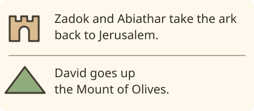

# 2 Samuel 15 — Absalom seeks the throne and David leaves Jerusalem

**About this chapter**

Absalom wants to become king. When David hears how many people support his son, David leaves Jerusalem.

## Absalom meets people at the gate

## 2 Samuel 15:1

Some time later, Absalom got a chariot and horses.

Fifty men ran ahead of him.

## 2 Samuel 15:2

Absalom got up early each morning.

He stood beside the road to the city gate.

People came there to ask the king to settle arguments.

Absalom would ask each person, “Which city are you from?”

The person would name one of the tribes of Israel.

## 2 Samuel 15:3

Absalom would say, “You have a good case.

You are right.

But the king has no one to hear you.”

## 2 Samuel 15:4

Absalom would add, “I wish someone would make me judge.

Anyone with a complaint could come to me.

I would give them a fair decision.”

## 2 Samuel 15:5

People came near to bow to Absalom.

Absalom would reach out, take hold of them, and kiss them.

## 2 Samuel 15:6

Absalom did this whenever Israelites came to the king for justice.

In this way Absalom won the people’s loyalty.

**Reading help**

The Bible says Absalom “stole the hearts” of the people. They began to trust Absalom to rule them.

**Pause and answer**

What did Absalom promise people who had a complaint?

## Absalom goes to Hebron

## 2 Samuel 15:7

Four years passed.

Absalom said to King David, “Please let me go to Hebron.

I made a promise to the LORD.

I want to keep it.

## 2 Samuel 15:8

I made that promise in Geshur, in Aram.

I said, ‘If the LORD brings me back to Jerusalem, I will worship him in Hebron.’”

## 2 Samuel 15:9

David said, “Go in peace.”

So Absalom went to Hebron.

## More people support Absalom

## 2 Samuel 15:10

Absalom secretly sent men throughout the tribes of Israel.

They carried a message about the sound of a horn.

When it sounded, people were to announce, “Absalom is king in Hebron!”

## 2 Samuel 15:11

Absalom had invited 200 men from Jerusalem to come along.

They went as guests.

They knew nothing about his plan.

## 2 Samuel 15:12

While offering sacrifices, Absalom sent for Ahithophel from Giloh.

Ahithophel used to give David advice.

Absalom’s plan to take power grew stronger.

More and more people joined him.

## David leaves Jerusalem

## 2 Samuel 15:13

A messenger told David, “The men of Israel now support Absalom.”

## 2 Samuel 15:14

David spoke to his servants in Jerusalem.

“Quick! We must leave or Absalom will catch us.

He will bring disaster on us.

He will kill the people of the city.”

## 2 Samuel 15:15

The servants answered, “You are our king.

We will do whatever you decide.”

## 2 Samuel 15:16

David left with his household.

Ten women stayed behind to care for the palace.

These women were David’s concubines.

**Reading help**

A concubine lived with a man as his partner. She had less standing in the household than a wife.

## 2 Samuel 15:17

David and his people set out.

David stopped at the last house.

## 2 Samuel 15:18

All his servants marched past him.

The Cherethites and the Pelethites marched past.

So did 600 men who had followed David from Gath.

## Ittai stays with David

## 2 Samuel 15:19

David spoke to Ittai, a man from Gath.

“Why come with us?

Go back and stay with the new king.

You are a foreigner here, far from your own land.

## 2 Samuel 15:20

You only arrived yesterday.

Why should I make you wander with us today?

I do not even know where I am going.

Go back and take your people with you.

May the LORD always show you faithful love.”

## 2 Samuel 15:21

Ittai answered, “As surely as the LORD lives, and as surely as you live, I will stay with you.

Wherever you go, my king, I will go.

I will stay even if I die.”

## 2 Samuel 15:22

David told Ittai, “Then march on.”

Ittai went past with all his men.

The little children with them went too.

**Pause and answer**

Who promised to stay with David even if he died?

## 2 Samuel 15:23

People throughout the countryside cried loudly as the group passed.

David crossed the Kidron Valley.

His people followed the road toward the wilderness.

## David sends the ark back

## 2 Samuel 15:24

Zadok was there with the Levites.

The Levites carried the ark of God’s covenant.

They put the ark down.

Abiathar offered sacrifices until everyone had left the city.

**Reading help**

The ark was a sacred chest. It reminded Israel of the covenant, the solemn agreement God made with them.

## 2 Samuel 15:25

David told Zadok, “Take God’s ark back to the city.

If the LORD is pleased with me, he will bring me back.

I will see the ark and his dwelling place again.

## 2 Samuel 15:26

But the LORD may say he is displeased with me.

Here I am.

Let him do what he thinks is good.”

## The priests return to Jerusalem

## 2 Samuel 15:27

David also said to Zadok the priest, “You are a seer.

Go back to the city in peace with your son Ahimaaz.

Abiathar and his son Jonathan should go too.

**Reading help**

A seer is someone who receives messages from God.

## 2 Samuel 15:28

I will wait where people cross the water in the wilderness.

I will stay there until you send me news.”

## 2 Samuel 15:29

Zadok and Abiathar took God’s ark back to Jerusalem.

Both priests stayed there.

## David climbs the Mount of Olives

## 2 Samuel 15:30

David climbed the Mount of Olives.

He covered his head and walked barefoot.

He cried as he climbed.

The people with him covered their heads and cried too.

## 2 Samuel 15:31

Someone told David, “Ahithophel has joined Absalom against you.”

David prayed, “LORD, please turn Ahithophel’s advice into foolishness.”

## 2 Samuel 15:32

David reached the hilltop where he used to worship God.

Hushai the Archite met him there.

Hushai had torn his robe and put dust on his head.

## David asks Hushai to return

## 2 Samuel 15:33

David told Hushai, “If you come with me, it will be hard for me to look after you.

## 2 Samuel 15:34

Go back to the city.

Tell Absalom, ‘My king, I served your father before.

Now I will serve you.’

Then you can help keep Ahithophel’s advice from succeeding.

## 2 Samuel 15:35

The priests Zadok and Abiathar will be there.

Tell them whatever you hear in the king’s palace.

## 2 Samuel 15:36

Their sons are there too.

Ahimaaz is Zadok’s son.

Jonathan is Abiathar’s son.

Send them to me with the news you hear.”

## 2 Samuel 15:37

Hushai was David’s friend.

He reached Jerusalem just as Absalom entered the city.

**Pause and answer**

Where did Hushai meet David before returning to Jerusalem?
