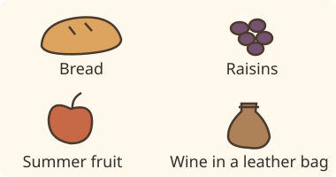

# 2 Samuel 16 — David meets Ziba and Shimei

**About this chapter**

On the road, David meets a man with supplies. Another man shouts curses at David. Meanwhile, Absalom arrives in Jerusalem.

## Ziba brings supplies

## 2 Samuel 16:1

Just past the hilltop, David met Ziba.

Ziba served Mephibosheth.

Ziba brought two donkeys with saddles.

They carried 200 loaves of bread and 100 bunches of raisins.

They also carried 100 summer fruits and a leather bag of wine.

## 2 Samuel 16:2

David asked, “Why have you brought these things?”

Ziba said, “Your household can ride the donkeys.

The young men can eat the bread and fruit.

Anyone worn out in the wilderness can drink the wine.”

**Pause and answer**

Who did Ziba say could ride the donkeys?

## David asks about Mephibosheth

## 2 Samuel 16:3

David asked, “Where is Mephibosheth, your master Saul’s grandson?”

Ziba answered, “He stayed in Jerusalem.

He said, ‘Today the people of Israel will give me back my grandfather’s kingdom.’”

## 2 Samuel 16:4

David told Ziba, “Everything Mephibosheth owns is yours now.”

Ziba answered, “I bow before you, my king.

May you be pleased with me!”

## Shimei curses David

## 2 Samuel 16:5

David came near Bahurim.

Shimei, a man from Saul’s family, came out.

His father was Gera.

Shimei kept shouting curses as he came toward David.

## 2 Samuel 16:6

Shimei threw stones at David and his servants.

David’s soldiers and his strongest fighters walked on both sides of him.

## 2 Samuel 16:7

Shimei shouted, “Get out! Get out!

You worthless man! You have killed people!

## 2 Samuel 16:8

You took Saul’s place as king.

Now the LORD is paying you back for killing people in Saul’s family.

The LORD has given your kingdom to your son Absalom.

You killed people, and now disaster has come on you!”

## David tells Abishai to leave Shimei alone

## 2 Samuel 16:9

Abishai, Zeruiah’s son, spoke to David.

“Why should this dead dog curse you, my king?

Let me go over and cut off his head!”

**Reading help**

Abishai calls Shimei a “dead dog.” He says it as an insult.

## 2 Samuel 16:10

David answered, “You sons of Zeruiah, what does this have to do with you?

Suppose the LORD told Shimei to curse me.

Who could ask him why he did it?”

## 2 Samuel 16:11

David told Abishai and his other servants, “My own son wants to kill me.

Why be surprised at this man from Benjamin?

Leave Shimei alone. Let him curse me.

The LORD has told him to do it.

## 2 Samuel 16:12

Perhaps the LORD will see how I suffer.

Perhaps he will give me something good for the curses I hear today.”

## David and his people travel on

## 2 Samuel 16:13

David and his men went on down the road.

Shimei walked on the ridge across from them.

He shouted curses and threw stones and dust at David.

## 2 Samuel 16:14

David and his people were worn out when they arrived.

David rested there and regained his strength.

**Pause and answer**

What did David tell Abishai to do about Shimei?

## Hushai greets Absalom

## 2 Samuel 16:15

Meanwhile, Absalom and the men of Israel came to Jerusalem.

Ahithophel came with Absalom.

## 2 Samuel 16:16

Hushai the Archite was David’s friend.

Hushai went to Absalom and called out, “Long live the king!

Long live the king!”

## 2 Samuel 16:17

Absalom asked, “Is this how you treat your friend?

Why didn’t you go with David?”

## 2 Samuel 16:18

Hushai answered, “I belong to the man the LORD and all the people of Israel choose.

I will stay with him.

## 2 Samuel 16:19

Who should I serve now but my friend’s son?

I served your father.

Now I will serve you.”

## Absalom asks Ahithophel for advice

## 2 Samuel 16:20

Then Absalom asked Ahithophel, “What should we do?

Give me your advice.”

## 2 Samuel 16:21

Ahithophel said, “Your father left his concubines to care for the palace.

Have sex with them.

All Israel will hear that you have made your father hate you.

Then the people on your side will be braver.”

**Reading help**

A concubine lived with a man as his partner. She had less standing in the household than a wife.

## 2 Samuel 16:22

People set up a tent for Absalom on the roof.

There Absalom had sex with his father’s concubines.

He did this openly, in the sight of all Israel.

## 2 Samuel 16:23

In those days, people listened closely to Ahithophel’s advice.

To them, asking him was like asking God for an answer.

Both David and Absalom valued his advice that much.

**Pause and answer**

Whose advice did both David and Absalom value?
