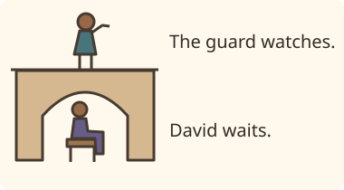

# 2 Samuel 18 — David hears the news about Absalom

**About this chapter**

David stays in the city while his soldiers go to battle. He waits for news of his son Absalom.

## David sends out his soldiers

## 2 Samuel 18:1

David looked over his soldiers.

He chose leaders for groups of 1,000 and groups of 100.

## 2 Samuel 18:2

David sent the army out in three groups.

Joab led one group.

Joab’s brother Abishai, Zeruiah’s son, led another.

Ittai from Gath led the third.

David told his soldiers, “I will go with you.”

## 2 Samuel 18:3

The soldiers begged him, “Please stay here!

Our enemies will not care if we run away.

They will not care even if half of us die.

But you are worth 10,000 of us.

You can help us more from the city.”

## 2 Samuel 18:4

David answered, “I will do what you think best.”

He stood beside the city gate.

His soldiers marched out in groups of hundreds and thousands.

## David asks the leaders to protect Absalom

## 2 Samuel 18:5

David gave Joab, Abishai, and Ittai an order.

“For my sake, be gentle with young Absalom.”

All the soldiers heard David tell each leader this.

**Pause and answer**

What did David ask the three leaders to do for Absalom?

## 2 Samuel 18:6

David’s soldiers went out to fight the Israelites who followed Absalom.

They fought in the forest of Ephraim.

## 2 Samuel 18:7

David’s soldiers defeated the Israelites there.

That day 20,000 men died.

## 2 Samuel 18:8

The fighting spread across the countryside.

More men died because of the forest than by the sword.

## A soldier finds Absalom

## 2 Samuel 18:9

Absalom met David’s soldiers while riding his mule.

The mule passed under the thick branches of a large oak tree.

Absalom’s head got caught in the branches.

His mule kept going, leaving him hanging above the ground.

## 2 Samuel 18:10

A man saw Absalom and told Joab, “I just saw Absalom hanging in an oak tree!”

## 2 Samuel 18:11

Joab said, “You saw him?

Why didn’t you strike him down?

I would have given you ten shekels of silver and a soldier’s belt!”

**Reading help**

People weighed silver in units called shekels.

## 2 Samuel 18:12

The man said, “Even for 1,000 shekels of silver, I would never harm the king’s son.

We heard the king tell you, Abishai, and Ittai to protect Absalom for his sake.

## 2 Samuel 18:13

I would have risked my life.

The king finds out everything.

You would have left me on my own.”

## Absalom dies in the forest

## 2 Samuel 18:14

Joab said, “I will not stand here waiting with you!”

Absalom was still alive in the tree.

Joab stabbed Absalom with three spears.

## 2 Samuel 18:15

Ten young men carried Joab’s armor.

They surrounded Absalom, struck him, and killed him.

## 2 Samuel 18:16

Joab blew a ram’s horn to stop his soldiers.

They stopped chasing the Israelites.

## 2 Samuel 18:17

David’s men threw Absalom’s body into a deep pit in the forest.

They piled a great heap of stones over him.

The Israelites who had followed Absalom fled home.

## 2 Samuel 18:18

While he was alive, Absalom had set up a pillar in the King’s Valley.

He had said, “I have no son to keep my name alive.”

He gave the pillar his own name.

People still called it Absalom’s Monument when this account was written.

**Reading help**

A pillar is a tall post. Absalom wanted people who saw it to remember his name.

## Joab sends a runner to David

## 2 Samuel 18:19

Ahimaaz, Zadok’s son, spoke to Joab.

“Please let me run to the king with good news.

The LORD has punished his enemies for what they did to him.”

## 2 Samuel 18:20

Joab answered, “You can carry good news another day.

You must not carry it today.

The king’s son is dead.”

## 2 Samuel 18:21

Joab told a man from Cush, “Go and tell the king what you saw.”

The man bowed to Joab and ran.

## Ahimaaz runs too

## 2 Samuel 18:22

Ahimaaz asked again, “Please let me run after him, whatever happens.”

Joab said, “My son, why do you want to run?

You will get no reward.”

## 2 Samuel 18:23

Ahimaaz answered, “I still want to run!”

Joab said, “Then run!”

Ahimaaz ran across the flat land.

He passed the man from Cush.

## The guard sees the runners

## 2 Samuel 18:24

David sat between the two city gates.

A guard climbed onto the roof above the gateway.

He looked out and saw one man running alone.

## 2 Samuel 18:25

The guard called down to David about the runner.

David said, “If he is alone, he brings good news.”

The runner came closer.

## 2 Samuel 18:26

The guard saw another man running.

He called to the gatekeeper, “Another man is running alone!”

David said, “He brings good news too.”

## 2 Samuel 18:27

The guard said, “I think the first man is Ahimaaz, Zadok’s son.

He runs like Ahimaaz.”

David said, “He is a good man.

He brings good news.”

## David asks Ahimaaz about Absalom

## 2 Samuel 18:28

Ahimaaz called to David, “All is well!”

He bowed with his face to the ground.

He said, “Praise the LORD your God!

He has given you victory over the men who fought against you.”

## 2 Samuel 18:29

David asked, “Is young Absalom safe?”

Ahimaaz said, “When Joab sent us, I saw people rushing about.

I do not know what happened.”

## 2 Samuel 18:30

David told Ahimaaz, “Step aside and stand here.”

Ahimaaz stepped aside.

## The second messenger answers David

## 2 Samuel 18:31

Just then the man from Cush arrived.

He said, “My king, hear the good news!

Today the LORD has punished everyone who rose against you.”

## 2 Samuel 18:32

David asked him, “Is young Absalom safe?”

The messenger answered, “May all who rise against you to hurt you suffer the same end as that young man.”

**Reading help**

The messenger answers David indirectly. His words tell David that Absalom has died.

## 2 Samuel 18:33

David shook with grief.

He went up to the room over the gate and wept.

As he walked, he cried, “My son Absalom!

My son, my son Absalom!

If only I had died in your place!

Absalom, my son, my son!”

**Pause and answer**

What did David wish had happened instead?
