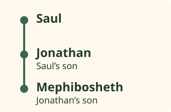

# 2 Samuel 19 — David returns across the Jordan

**About this chapter**

David grieves for Absalom. As David returns home, several people meet him. Each has something different to ask.

## David weeps for Absalom

## 2 Samuel 19:1

Joab heard that King David was crying over Absalom’s death.

## 2 Samuel 19:2

The soldiers had won the battle.

But when they heard that David was grieving for his son, they grieved too.

## 2 Samuel 19:3

That day the soldiers slipped quietly into the city.

They acted like men ashamed of running from battle.

## 2 Samuel 19:4

David covered his face and cried out loudly.

“My son Absalom! Absalom, my son, my son!”

## Joab asks David to speak to his soldiers

## 2 Samuel 19:5

Joab went into the house and spoke to David.

“Today you have made your servants feel ashamed.

They saved your life and the lives of your children.

They saved your wives and your concubines too.

**Reading help**

A concubine was a partner who had less standing in the household than a wife.

## 2 Samuel 19:6

You love those who hate you!

You hate those who love you!

Today you make your officers and soldiers feel worthless.

I think you would be pleased if Absalom were alive and all of us were dead.

## 2 Samuel 19:7

Get up and speak kindly to your servants.

I swear by the LORD that if you stay here, everyone will leave you tonight.

That would be worse than anything you have suffered since you were young.”

## 2 Samuel 19:8

David got up and sat at the city gate.

Word spread that the king was there.

All his people came to him.

Meanwhile, the Israelites who had fought against him had fled home.

## The tribes discuss David’s return

## 2 Samuel 19:9

People argued throughout the tribes of Israel.

They said, “David rescued us from our enemies.

He saved us from the Philistines.

Then he had to leave because of Absalom.

## 2 Samuel 19:10

We chose Absalom as king, but he died in battle.

Why is no one asking David to come back as king?”

## David sends word to Judah

## 2 Samuel 19:11

David sent a message through the priests Zadok and Abiathar.

They were to ask the leaders of Judah, “Why should you be last to bring the king back to his palace?

The king has already heard what the other Israelites are saying.

## 2 Samuel 19:12

You are my brothers, my own flesh and blood.

Why should you be last to bring me back?”

**Reading help**

David calls the people of Judah his “flesh and blood.” He means they belong to the same family.

## 2 Samuel 19:13

David also sent Amasa this message.

“You are my own relative.

You will lead my army in Joab’s place from now on.

May God punish me severely if I break this promise.”

## 2 Samuel 19:14

David won the support of all the men of Judah.

Together they sent word to David, “Come back.

Bring all your servants with you.”

## 2 Samuel 19:15

David set out for home and reached the Jordan River.

The men of Judah came to Gilgal to meet him.

They wanted to help him cross the river.

## Shimei comes to meet David

## 2 Samuel 19:16

Shimei hurried to meet David with the men of Judah.

Shimei was Gera’s son, from Bahurim in Benjamin.

## 2 Samuel 19:17

A thousand men from Benjamin came with Shimei.

Ziba, who managed Saul’s household, came too.

With Ziba were his 15 sons and 20 servants.

They hurried to the Jordan ahead of David.

## 2 Samuel 19:18

They crossed at a shallow place in the river.

They came to help David’s household cross and do whatever he wanted.

Shimei crossed the Jordan and bowed down before David.

## Shimei asks David to forgive him

## 2 Samuel 19:19

Shimei said, “My king, please forgive me.

Please put aside the wrong I did when you left Jerusalem.

Do not hold it against me.

## 2 Samuel 19:20

I know I sinned.

Today I am the first of Joseph’s people to come and meet you.”

## 2 Samuel 19:21

Abishai, Zeruiah’s son, said, “Shimei cursed the king the LORD chose.

Shouldn’t he die for that?”

## 2 Samuel 19:22

David answered, “You sons of Zeruiah, why oppose me today?

Should anyone in Israel die today?

I know that today I am king over Israel.”

## 2 Samuel 19:23

David made Shimei a solemn promise.

He said, “You will not die.”

**Pause and answer**

What did David promise Shimei?

## Mephibosheth tells David why he stayed

## 2 Samuel 19:24

Saul’s grandson Mephibosheth came to meet David.

Ever since David left, Mephibosheth had left his feet untended.

He had neither trimmed his mustache nor washed his clothes.

He stayed that way until David returned safely.

## 2 Samuel 19:25

Mephibosheth came from Jerusalem.

David asked him, “Mephibosheth, why didn’t you come with me?”

## 2 Samuel 19:26

Mephibosheth answered, “My king, I have a disability in my feet.

I planned to have my donkey saddled so I could ride with you.

But my servant Ziba tricked me.

## 2 Samuel 19:27

Ziba told you lies about me.

My king, you are like an angel of God.

Do what you think is right.

## 2 Samuel 19:28

My grandfather’s whole family deserved death at your hands.

Yet you gave me a place at your table.

What right do I have to ask you for more?”

## David makes a decision about the land

## 2 Samuel 19:29

David answered, “You have said enough.

You and Ziba will divide the land.”

## 2 Samuel 19:30

Mephibosheth said, “Let Ziba have it all!

My king has come home safely.”

**Pause and answer**

Why was Mephibosheth willing to let Ziba have the land?

## David invites Barzillai to Jerusalem

## 2 Samuel 19:31

Barzillai came down from Rogelim in Gilead.

He wanted to cross the Jordan with David.

Then he would say goodbye.

## 2 Samuel 19:32

Barzillai was 80 years old and very wealthy.

He had cared for David at Mahanaim.

## 2 Samuel 19:33

David told Barzillai, “Cross the river with me.

Stay with me in Jerusalem, and I will care for you.”

## 2 Samuel 19:34

Barzillai answered, “How many years do I have left?

Why should I go to Jerusalem with the king?

## 2 Samuel 19:35

I am 80 years old.

Can I still tell what is good and what is bad?

Can I taste my food or drink?

Can I still hear the men and women singing?

Why should you have to care for me too?

## 2 Samuel 19:36

I will go a short way past the Jordan with you.

Why should you give me such a great reward?

## Chimham goes with David

## 2 Samuel 19:37

Please let me go back to my own town.

I want to die near my parents’ tomb.

Here is your servant Chimham.

Let him go with you.

Do for him what you think is good.”

## 2 Samuel 19:38

David replied, “Chimham will cross with me.

I will do for him what you think is best.

And I will do whatever you ask for yourself.”

## 2 Samuel 19:39

The people crossed the Jordan. Then David crossed.

David kissed Barzillai and blessed him.

Barzillai went home.

**Pause and answer**

Where did Barzillai want to spend the rest of his life?

## 2 Samuel 19:40

David went on to Gilgal with Chimham.

All the soldiers of Judah went with David.

Half the soldiers of Israel went with him too.

## Israel and Judah argue

## 2 Samuel 19:41

The men of Israel came to David.

They asked, “Why did our relatives from Judah take you away secretly?

They brought you, your household, and all your men across the Jordan.”

## 2 Samuel 19:42

The men of Judah answered, “The king is our relative.

Why are you angry?

Has the king paid for our food?

Has he given us anything for ourselves?”

## 2 Samuel 19:43

The men of Israel replied, “We have ten shares in the king.

We have more claim to David than you do.

Why do you treat us with so little respect?

We were the first to talk about bringing our king back!”

The men of Judah answered with even harsher words.

**Reading help**

The men of Israel speak of “ten shares” because they speak for ten tribes. They want a say in bringing David home.
