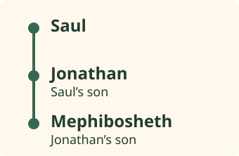

# 2 Samuel 21 — Rizpah keeps watch

**About this chapter**

David asks why his people have so little food. After seven men from Saul’s family die, Rizpah watches over their bodies. Later, David needs help in battle.

## David asks about the years of hunger

## 2 Samuel 21:1

While David was king, food was scarce for three years in a row.

David asked the LORD why.

The LORD answered, “Saul and his family are guilty of shedding blood.

Saul killed the Gibeonites.”

## 2 Samuel 21:2

David called the Gibeonites to speak with him.

They were survivors of the Amorite people.

Israel had made a solemn promise to spare them.

But Saul had tried to kill them for the sake of Israel and Judah.

## 2 Samuel 21:3

David asked them, “What can I do for you?

How can I make up for this wrong so you will bless the LORD’s people?”

## The Gibeonites answer David

## 2 Samuel 21:4

The Gibeonites answered, “We want no silver or gold from Saul’s family.

We do not ask you to kill anyone in Israel for us.”

David said, “Tell me what you want me to do.

I will do it.”

## 2 Samuel 21:5

They said, “Saul destroyed so many of our people.

He planned to leave none of us alive anywhere in Israel.

## 2 Samuel 21:6

Give us seven men from his family.

We will hang them before the LORD at Gibeah.

That was the town of Saul, whom the LORD chose.”

David said, “I will give them to you.”

## David keeps his promise to Jonathan

## 2 Samuel 21:7

David spared Mephibosheth, the son of Saul’s son Jonathan.

David and Jonathan had made a solemn promise before the LORD.

David kept that promise.

## 2 Samuel 21:8

David took two sons of Saul and Rizpah.

Their names were Armoni and Mephibosheth.

Rizpah was Aiah’s daughter.

David also took the five sons of Saul’s daughter Merab.

Their father was Adriel, son of Barzillai the Meholathite.

**Reading help**

Two men here have the name Mephibosheth. Jonathan’s son was Saul’s grandson. Rizpah’s son was Saul’s son.

## 2 Samuel 21:9

David handed the seven men over to the Gibeonites.

The Gibeonites hanged them on a hill before the LORD.

All seven died together as the barley harvest began.

## Rizpah stays with the bodies

## 2 Samuel 21:10

Rizpah spread rough cloth on a rock for herself.

She kept watch over the bodies from harvest until rain fell on them.

During the day she kept birds away.

At night she kept wild animals away.

**Pause and answer**

What did Rizpah do for the seven men after they died?

## 2 Samuel 21:11

David heard what Rizpah had done.

Rizpah was Aiah’s daughter and had been Saul’s concubine.

**Reading help**

A concubine lived with a man as his partner. She had less standing in the household than a wife.

## David brings back the bones of Saul and Jonathan

## 2 Samuel 21:12

David went to the men of Jabesh-gilead for the bones of Saul and Jonathan.

The Philistines had defeated Saul at Gilboa.

They had hung the bodies of Saul and Jonathan in the town square at Beth-shan.

The men of Jabesh-gilead had secretly taken them from there.

## 2 Samuel 21:13

David had the bones of Saul and Jonathan brought back.

His men also gathered the bones of the seven men who had died.

## 2 Samuel 21:14

They buried Saul and Jonathan in the tomb of Saul’s father Kish.

The tomb was in Zela, in the land of Benjamin.

The people did everything David had ordered.

Then God answered their prayers for the land.

## Abishai comes to help David

## 2 Samuel 21:15

War broke out again between the Philistines and Israel.

David went with his men to fight the Philistines.

David grew very tired.

## 2 Samuel 21:16

Ishbi-benob, a man from Rapha’s family, wanted to kill David.

He carried a new sword.

His bronze spear weighed 300 shekels.

**Reading help**

A shekel was a unit of weight.

## 2 Samuel 21:17

Abishai, the son of Zeruiah, came to help David.

Abishai killed Ishbi-benob.

David’s men made a solemn promise to David.

“You must never go into battle with us again.

The lamp of Israel must keep burning.”

**Reading help**

David’s men call him Israel’s lamp. A lamp helps people see their way. The men want David to live and keep leading Israel.

## Three more battles with the Philistines

## 2 Samuel 21:18

Later, Israel fought the Philistines at Gob.

Sibbecai the Hushathite killed Saph, another man from Rapha’s family.

## 2 Samuel 21:19

Israel fought the Philistines at Gob again.

Elhanan, son of Jair from Bethlehem, killed the brother of Goliath from Gath.

The wooden pole of the man’s spear was as thick as the bar on a weaver’s loom.

**Reading help**

A loom is a frame for making cloth. The comparison tells us how large the spear was.

## 2 Samuel 21:20

Another battle took place at Gath.

A very tall man there came from Rapha’s family too.

He had six fingers on each hand and six toes on each foot.

That made 24 in all.

## 2 Samuel 21:21

He shouted insults at Israel.

David’s nephew Jonathan killed him.

This Jonathan was the son of David’s brother Shimei.

## 2 Samuel 21:22

These four men at Gath all came from Rapha’s family.

David and his men defeated them, and all four died.

**Pause and answer**

Who helped David when he grew tired in battle?
