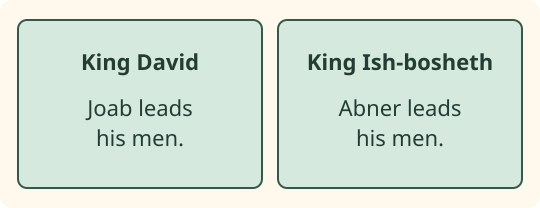

# 2 Samuel 2 — Judah makes David king

**About this chapter**

Judah chooses David as king. Abner makes Saul’s son king over Israel. Men serving the two kings meet at Gibeon, where a contest turns into a battle.

## David settles in Hebron

## 2 Samuel 2:1

Some time later David asked the LORD, “Should I go to a town in Judah?”

The LORD said, “Go.”

David asked, “Which town?”

The LORD answered, “Hebron.”

## 2 Samuel 2:2

David went to Hebron with his two wives.

Ahinoam came from Jezreel.

Abigail was the widow of Nabal from Carmel.

## 2 Samuel 2:3

David’s men and their families came too.

They settled in the towns near Hebron.

## 2 Samuel 2:4

The men of Judah came to Hebron.

They poured oil on David to make him their king.

Then they told him who had buried Saul.

It was the men of Jabesh-gilead.

**Reading help**

Pouring oil on someone to show that he is king is called anointing.

## David thanks the people who buried Saul

## 2 Samuel 2:5

David sent them this message: “May the LORD bless you.

You showed kindness to your king Saul by burying him.

## 2 Samuel 2:6

May the LORD love you and stay faithful to you.

I too will show you kindness for what you did.

## 2 Samuel 2:7

Be strong and brave.

Your king Saul has died.

The people of Judah have made me their king.”

**Pause and answer**

Why did David thank the people of Jabesh-gilead?

## Abner makes Saul’s son king

## 2 Samuel 2:8

Abner, son of Ner, had led Saul’s army.

He took Saul’s son Ish-bosheth to Mahanaim.

## 2 Samuel 2:9

Abner made Ish-bosheth king over Gilead, Asher, Jezreel, Ephraim, and Benjamin.

He ruled over Israel.

## 2 Samuel 2:10

Ish-bosheth was forty when he became king.

He ruled for two years.

The people of Judah followed David.

## 2 Samuel 2:11

David ruled Judah from Hebron for seven years and six months.

**Pause and answer**

Whom did the people of Judah follow?

## Two groups meet at Gibeon

## 2 Samuel 2:12

Abner and the men who served Ish-bosheth marched from Mahanaim to Gibeon.

## 2 Samuel 2:13

Joab, son of Zeruiah, led David’s men to meet them.

The two groups stopped on opposite sides of the pool at Gibeon.

## 2 Samuel 2:14

Abner said, “Let the young men compete in front of us.”

Joab agreed.

## 2 Samuel 2:15

Twelve men from Benjamin stepped forward for Ish-bosheth.

Twelve others stepped forward for David.

## 2 Samuel 2:16

Each man fought the man facing him with a sword.

They all fell together and died.

That place in Gibeon came to be called Helkath-hazzurim.

## 2 Samuel 2:17

The fighting that day was fierce.

David’s men defeated Abner and the men of Israel.

## Asahel chases Abner

## 2 Samuel 2:18

Zeruiah’s three sons were there: Joab, Abishai, and Asahel.

Asahel ran as fast as a wild gazelle.

**Reading help**

A gazelle is a wild animal that can run very fast. The comparison tells us how fast Asahel could run.

## 2 Samuel 2:19

Asahel ran straight after Abner.

He kept chasing him.

## 2 Samuel 2:20

Abner looked back. “Is that you, Asahel?”

“Yes,” Asahel said.

## 2 Samuel 2:21

Abner told him, “Turn aside.

Take one of the other young men and keep his equipment.”

Asahel kept chasing Abner.

## 2 Samuel 2:22

Abner warned him again, “Stop chasing me!

Why make me strike you down?

How could I face your brother Joab?”

## 2 Samuel 2:23

Asahel refused to turn away.

Abner struck him with the back end of his spear.

Asahel fell and died there.

Everyone who came to that spot stopped.

**Pause and answer**

Who was Asahel’s brother in charge of David’s men?

## Abner calls for the fighting to stop

## 2 Samuel 2:24

Joab and Abishai kept chasing Abner.

At sunset they reached the hill of Ammah across from Giah.

It was on the road to the wilderness of Gibeon.

## 2 Samuel 2:25

The men of Benjamin gathered around Abner.

They stood together on top of a hill.

## 2 Samuel 2:26

Abner called to Joab, “Must the sword keep eating people forever?

Think how bitter this will be in the end.

Tell your men to stop chasing their own brothers!”

**Reading help**

Abner pictures the sword eating people. He means that more men will die if the fighting continues. He calls the other men brothers because both groups belong to the people of Israel.

## 2 Samuel 2:27

Joab answered, “As surely as God lives, if you had kept quiet, my men would have chased their brothers until morning.”

## 2 Samuel 2:28

Joab blew a ram’s horn.

His men stopped chasing Israel’s men.

The fighting ended.

**Pause and answer**

What happened when Joab blew the horn?

## The men go home

## 2 Samuel 2:29

Abner and his men walked through the Arabah all night.

They crossed the Jordan River.

They walked all morning and reached Mahanaim.

## 2 Samuel 2:30

Joab came back and gathered his men.

Besides Asahel, nineteen of David’s men were missing.

## 2 Samuel 2:31

David’s men had killed 360 men of Benjamin who fought with Abner.

## 2 Samuel 2:32

Joab’s men buried Asahel in his father’s tomb in Bethlehem.

Then Joab and his men walked all night.

They reached Hebron as the sun came up.

**Pause and answer**

Where did the men bury Asahel?
