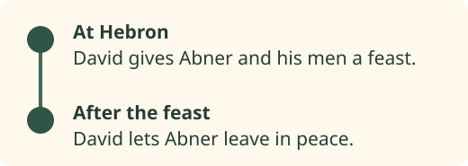

# 2 Samuel 3 — David mourns for Abner

**About this chapter**

Abner offers to bring Israel over to David. David welcomes him, but Joab still grieves for his brother Asahel. Joab’s anger costs Abner his life.

## David’s family in Hebron

## 2 Samuel 3:1

Saul’s family and David’s family fought a long war.

David grew stronger, and Saul’s family grew weaker.

## 2 Samuel 3:2

David had sons in Hebron.

His first son was Amnon.

Amnon’s mother was Ahinoam from Jezreel.

## 2 Samuel 3:3

His second son was Chileab.

Chileab’s mother was Abigail, the widow of Nabal from Carmel.

David’s third son was Absalom.

Absalom’s mother was Maacah, daughter of King Talmai of Geshur.

## 2 Samuel 3:4

David’s fourth son was Adonijah. His mother was Haggith.

His fifth son was Shephatiah. His mother was Abital.

## 2 Samuel 3:5

David’s sixth son was Ithream. His mother was David’s wife Eglah.

All six sons were born in Hebron.

**Pause and answer**

Where were these six sons born?

## Abner argues with Ish-bosheth

## 2 Samuel 3:6

As the war continued, Abner gained more power among Saul’s people.

## 2 Samuel 3:7

Rizpah, daughter of Aiah, had been Saul’s concubine.

Saul’s son Ish-bosheth asked Abner, “Why did you sleep with my father’s concubine?”

**Reading help**

A concubine was a partner who had a lower standing than a wife. The question is Ish-bosheth’s accusation.

## 2 Samuel 3:8

The accusation made Abner furious.

“Do you think I am a dog serving Judah?” he asked.

“I have stood by your father Saul’s family, his brothers, and his friends.

I kept you safe from David.

Yet you accuse me of doing wrong with this woman!

## 2 Samuel 3:9

The LORD made David a promise.

May God punish me severely if I fail to help David receive what the LORD promised.

## 2 Samuel 3:10

I will help take the kingdom from Saul’s family.

David will rule Israel and Judah, from Dan to Beersheba.”

**Reading help**

Dan was in the north and Beersheba in the south. Together the names describe the whole land.

## 2 Samuel 3:11

Ish-bosheth was so afraid of Abner that he said nothing more.

## David asks for Michal

## 2 Samuel 3:12

Abner sent David a message. “Whose land is this?

Make a covenant with me.

I will help bring all Israel over to your side.”

**Reading help**

A covenant is a solemn agreement.

## 2 Samuel 3:13

David answered, “Yes, I will make a covenant with you.

But when you come, you must bring Saul’s daughter Michal.”

**Pause and answer**

Whom did David ask Abner to bring?

## 2 Samuel 3:14

David also sent this message to Ish-bosheth: “Give me back my wife Michal.

The price I agreed to pay to marry her was a hundred Philistine foreskins.”

**Reading help**

Saul had set this marriage price years earlier. He wanted proof that David had killed Philistines.

## 2 Samuel 3:15

Ish-bosheth sent men to take Michal from her husband Paltiel, son of Laish.

## 2 Samuel 3:16

Paltiel followed Michal all the way to Bahurim, crying as he went.

Abner told him to go back, and Paltiel went home.

## Abner speaks for David

## 2 Samuel 3:17

Abner told the leaders of Israel, “You have wanted David as your king for a long time.

## 2 Samuel 3:18

Now act on it. Remember the LORD’s promise.

He said, ‘Through my servant David I will rescue Israel from the Philistines and all their other enemies.’”

## 2 Samuel 3:19

Abner also spoke with the people of Benjamin.

Then he went to Hebron to tell David what Israel and Benjamin had agreed to.

## 2 Samuel 3:20

Abner brought twenty men to Hebron.

David held a feast for them.

## 2 Samuel 3:21

Abner told David, “Let me gather all Israel to you, my king.

Then they can make a covenant with you.

You can rule over all you wish.”

David let Abner go, and Abner left in peace.

**Pause and answer**

What did Abner want the people of Israel to do?

## Joab learns that Abner came in peace

## 2 Samuel 3:22

Joab and David’s soldiers returned from a raid with many goods.

Abner had already left Hebron in peace.

## 2 Samuel 3:23

Someone told Joab, “Abner son of Ner came to see the king.

The king let him go in peace.”

## 2 Samuel 3:24

Joab went to David and asked, “What have you done?

Why did you let Abner get away?

## 2 Samuel 3:25

Abner came to fool you.

He wanted to learn where you go and what you do.”

## Abner returns to Hebron

## 2 Samuel 3:26

After leaving David, Joab sent messengers to bring Abner back.

They found him at the well of Sirah.

David knew nothing about this.

## 2 Samuel 3:27

Abner returned to Hebron.

Joab took him aside at the gate as though to speak privately.

There Joab stabbed and killed him.

Joab wanted revenge for the death of his brother Asahel.

## David speaks about the murder

## 2 Samuel 3:28

When David heard what had happened, he said, “The LORD knows that my kingdom and I are innocent of Abner’s death.

That will always be true.

## 2 Samuel 3:29

May the guilt fall on Joab and his father’s family.

May someone in his family always suffer illness or hardship.

May one have a lasting flow of fluid from the body or a skin disease.

May another need a walking stick, die by the sword, or go hungry.”

## 2 Samuel 3:30

Joab and his brother Abishai were responsible for Abner’s murder.

Abner had killed their brother Asahel at the battle of Gibeon.

**Pause and answer**

Why did Joab want revenge?

## David walks with the mourners

## 2 Samuel 3:31

David told Joab and everyone with him, “Tear your clothes.

Put on rough sackcloth and walk ahead of Abner’s body in grief.”

David himself walked behind the men carrying the body.

**Reading help**

Sackcloth was rough cloth. Wearing it showed that someone was grieving.

## 2 Samuel 3:32

They buried Abner in Hebron.

David wept aloud at the grave, and all the people wept.

## 2 Samuel 3:33

David sang a song of grief for Abner.

“Should Abner have died like a fool?

## 2 Samuel 3:34

No one tied your hands or put chains on your feet.

Yet wicked men killed you.”

The people wept even more for Abner.

## Israel sees David’s grief

## 2 Samuel 3:35

While it was still day, the people urged David to eat.

But David swore, “May God punish me severely if I eat anything before sunset.”

## 2 Samuel 3:36

The people saw what David did, and it pleased them.

Indeed, everything the king did pleased them.

## 2 Samuel 3:37

That day all the soldiers and all Israel understood.

King David had no part in the murder of Abner.

**Pause and answer**

What did the people come to understand about David?

## 2 Samuel 3:38

David told his servants, “A great leader has died in Israel today.

Do you understand what we have lost?

## 2 Samuel 3:39

Though I have been anointed king, I feel weak today.

Joab and Abishai, the sons of Zeruiah, are too fierce for me.

May the LORD repay the one who does evil for what he has done.”
