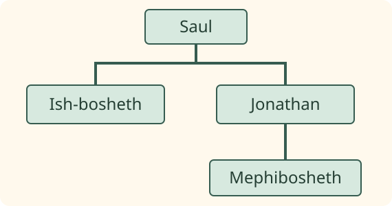

# 2 Samuel 4 — David hears of Ish-bosheth’s murder

**About this chapter**

Two brothers kill Ish-bosheth, Saul’s son. They bring the news to David. David tells them why he holds them responsible.

## News of Abner’s death

## 2 Samuel 4:1

Ish-bosheth heard that Abner had died in Hebron.

Ish-bosheth lost courage. People throughout Israel were afraid.

## 2 Samuel 4:2

Two brothers led groups of soldiers on raids for Ish-bosheth.

Their names were Baanah and Rechab.

Their father was Rimmon, from the tribe of Benjamin.

He came from Beeroth, a town people counted as part of Benjamin.

## 2 Samuel 4:3

The people of Beeroth had fled to Gittaim.

When this account was written, they still lived there as foreigners.

## Jonathan’s son Mephibosheth

## 2 Samuel 4:4

Saul’s son Jonathan had a son named Mephibosheth.

Mephibosheth was five when news came from Jezreel.

His father Jonathan and his grandfather Saul had died.

The woman who cared for him picked him up and ran.

In her hurry, he fell. After that, he had difficulty walking.

**Pause and answer**

Who was Mephibosheth’s father?

## The brothers kill Ish-bosheth

## 2 Samuel 4:5

Rechab and Baanah went to Ish-bosheth’s house.

They arrived in the heat of the day.

The king was taking his midday rest.

## 2 Samuel 4:6

The brothers came inside as though they wanted wheat.

They stabbed Ish-bosheth and slipped away.

## 2 Samuel 4:7

Ish-bosheth had been lying on his bed when the brothers killed him.

They cut off his head and took it with them.

They traveled all night through the Arabah.

## 2 Samuel 4:8

The brothers brought Ish-bosheth’s head to David at Hebron.

They said, “Here is the head of Saul’s son Ish-bosheth.

Saul was your enemy and tried to kill you.

Today the LORD has taken revenge on Saul and his family for you, our king.”

**Pause and answer**

Where did the brothers go to find David?

## David answers the brothers

## 2 Samuel 4:9

David answered Rechab and Baanah with a solemn promise.

He said, “As surely as the LORD lives, he has rescued me from every trouble.

## 2 Samuel 4:10

A man once came to tell me Saul had died.

He thought he was bringing me good news.

I had him arrested and put to death at Ziklag.

That was the reward he got for his news!

## 2 Samuel 4:11

You have done something even worse.

You killed an innocent man in his own home, on his own bed.

I will hold you responsible for his death.

You will die for what you have done.”

## 2 Samuel 4:12

At David’s order, his men killed Rechab and Baanah.

They cut off the brothers’ hands and feet.

They hung their bodies by the pool in Hebron.

Then they buried Ish-bosheth’s head in Abner’s tomb in Hebron.

**Reading help**

A tomb is a place to bury the dead.

**Pause and answer**

Why did David hold the two brothers responsible?
