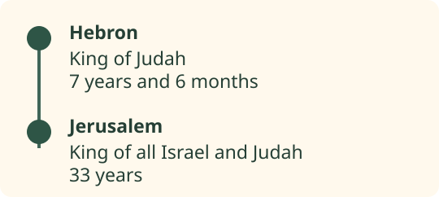

# 2 Samuel 5 — David becomes king over all Israel

**About this chapter**

David already rules Judah. Now leaders from the other tribes come to him. David makes his home in Jerusalem and asks the LORD for help when the Philistines come.

## Israel’s leaders come to Hebron

## 2 Samuel 5:1

People from every tribe of Israel came to David at Hebron.

They said, “We are your own family.

## 2 Samuel 5:2

Even when Saul was king, you led Israel’s men into battle and brought them home.

The LORD told you, ‘You will be a shepherd to my people Israel.

You will rule over them.’”

**Reading help**

A shepherd guides and cares for sheep. God wanted David to guide and care for Israel’s people.

## 2 Samuel 5:3

All Israel’s leaders came to David at Hebron.

David made a covenant with them before the LORD.

The leaders poured oil on David to make him king over Israel.

**Reading help**

A covenant is a solemn agreement.

**Pause and answer**

What did the leaders do to show that David was their king?

## David rules from two cities

## 2 Samuel 5:4

David was thirty years old when he became king.

He ruled for forty years.

## 2 Samuel 5:5

At Hebron he ruled Judah for seven years and six months.

At Jerusalem he ruled all Israel and Judah for thirty-three years.

**Pause and answer**

Where did David rule over all Israel and Judah?

## David takes Jerusalem

## 2 Samuel 5:6

David and his men went to Jerusalem to fight the Jebusites who lived there.

The Jebusites thought David could never get inside.

They mocked him, saying, “Even people who cannot see or walk could keep you out!”

## 2 Samuel 5:7

Yet David captured the fortress of Zion.

It became known as the City of David.

## 2 Samuel 5:8

That day David spoke about the water shaft and the Jebusites he despised.

He used their own words about people who could not walk or see.

From this came the saying, “The blind and the lame will never enter the palace.”

## 2 Samuel 5:9

David lived in the fortress and called it the City of David.

He built up the city all around, from the terraces inward.

**Reading help**

Terraces are level steps built into a hillside. Here they supported the city.

## 2 Samuel 5:10

David grew more powerful because the LORD, the God who commands armies, was with him.

## David’s home and family grow

## 2 Samuel 5:11

King Hiram of Tyre sent messengers to David.

He also sent cedar logs and workers skilled with wood and stone.

The workers built David a palace.

## 2 Samuel 5:12

David understood that the LORD had made him king over Israel.

The LORD had made his kingdom great for the good of his people Israel.

**Pause and answer**

Who was meant to benefit from David’s strong kingdom?

## 2 Samuel 5:13

After David moved from Hebron, he took more concubines and wives in Jerusalem.

His family grew. He had more sons and daughters.

**Reading help**

A concubine was a partner who had lower standing than a wife.

## 2 Samuel 5:14

Among David’s children born in Jerusalem were Shammua, Shobab, Nathan, and Solomon.

## 2 Samuel 5:15

There were also Ibhar, Elishua, Nepheg, and Japhia.

## 2 Samuel 5:16

The list ends with Elishama, Eliada, and Eliphelet.

## David asks the LORD for help

## 2 Samuel 5:17

The Philistines heard that Israel had made David king.

They came looking for him.

David heard about this and went down to a place of safety.

## 2 Samuel 5:18

The Philistines spread out in the Valley of Rephaim.

## 2 Samuel 5:19

David asked the LORD, “Should I fight the Philistines?

Will you give me victory over them?”

The LORD answered, “Go. I will give you victory.”

## 2 Samuel 5:20

David went to Baal-perazim and defeated the Philistines there.

He said, “The LORD broke through my enemies like a flood breaking through a barrier.”

That is why David named the place Baal-perazim.

**Reading help**

David compares the LORD’s power to rushing water. The name Baal-perazim recalls that breakthrough.

## 2 Samuel 5:21

The Philistines left behind the images they worshiped.

David and his men carried them away.

## The Philistines return

## 2 Samuel 5:22

The Philistines came back to the Valley of Rephaim.

Again they spread out across the valley.

## 2 Samuel 5:23

David asked the LORD what to do.

This time the LORD directed David to approach the balsam trees from a different direction.

## 2 Samuel 5:24

The LORD told David he would hear marching in the treetops.

That sound would mean the LORD had gone ahead of him against the Philistine camp.

Then David was to act quickly.

**Pause and answer**

What did the sound in the treetops mean for David?

## 2 Samuel 5:25

David did what the LORD told him.

He defeated the Philistines all the way from Gibeon to Gezer.
