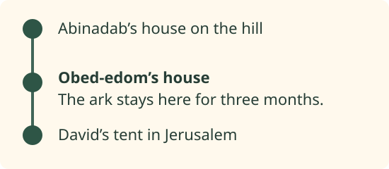

# 2 Samuel 6 — David brings the ark to Jerusalem

**About this chapter**

David sets out to bring the ark to Jerusalem. The journey stops after Uzzah dies. Three months later, David hears good news from the house where the ark has stayed.

## Abinadab’s sons guide the cart

## 2 Samuel 6:1

David gathered Israel’s chosen men again.

There were 30,000 of them.

## 2 Samuel 6:2

David and his men went to Baale in Judah to bring back the ark of God.

The ark bears the name of the LORD who commands armies.

He rules as king between the cherubim on its cover.

**Reading help**

The ark was a sacred chest. Two gold figures with wings stood on its cover. These figures represented heavenly beings called cherubim.

## 2 Samuel 6:3

They put the ark on a new cart.

They took it from Abinadab’s house on the hill.

Abinadab’s sons Uzzah and Ahio guided the cart.

## 2 Samuel 6:4

The cart carried the ark of God.

Ahio walked in front of the ark.

## 2 Samuel 6:5

David and all Israel celebrated before the LORD.

They played wooden instruments, harps, and other instruments with strings.

They shook tambourines and rattles and clashed cymbals.

## The oxen stumble

## 2 Samuel 6:6

They reached Nacon’s threshing floor, where people separated grain from its stalks.

The oxen pulling the cart stumbled.

Uzzah reached out and took hold of the ark.

**Pause and answer**

Why did Uzzah reach for the ark?

## 2 Samuel 6:7

The LORD was angry because Uzzah had treated the ark without respect.

God struck Uzzah down, and he died there beside the ark.

## 2 Samuel 6:8

David was angry because the LORD had struck Uzzah down.

David called the place Perez-uzzah.

It still had that name when this account was written.

## David leaves the ark with Obed-edom

## 2 Samuel 6:9

That day David was afraid of the LORD.

He asked, “How can I bring the LORD’s ark to me now?”

## 2 Samuel 6:10

David would not take the ark into the City of David.

He took it to the home of Obed-edom, a man from Gath.

**Reading help**

The City of David was David’s stronghold in Jerusalem.

## 2 Samuel 6:11

The ark stayed in Obed-edom’s house for three months.

The LORD blessed him and everyone in his house.

**Pause and answer**

How long did the ark stay with Obed-edom?

## David dances before the LORD

## 2 Samuel 6:12

Someone told David, “Because of the ark, the LORD has blessed Obed-edom’s family and all he owns.”

So David went to Obed-edom’s house.

With great joy they brought the ark to the City of David.

## 2 Samuel 6:13

The men carrying the ark took six steps.

Then David offered the LORD an ox and a fattened calf.

## 2 Samuel 6:14

David wore a linen ephod.

He danced before the LORD with all his strength.

**Reading help**

An ephod was a garment worn for worship. Linen is a kind of cloth.

## 2 Samuel 6:15

David and the people of Israel brought the ark up together.

They shouted for joy and blew a ram’s horn.

## 2 Samuel 6:16

As the ark entered the city, Michal looked down from a window.

Michal was Saul’s daughter.

She saw King David jumping and dancing before the LORD.

She looked down on him for it.

**Pause and answer**

What did Michal see from the window?

## The people set the ark in its tent

## 2 Samuel 6:17

The people set the ark inside the tent David had put up for it.

David gave burnt offerings and peace offerings to the LORD.

## 2 Samuel 6:18

After the offerings, David blessed the people in the name of the LORD who commands armies.

## 2 Samuel 6:19

David gave food to every man and woman there.

Each received a loaf of bread, a date cake, and a raisin cake.

Then the people went home.

**Pause and answer**

What food did each person receive?

## Michal speaks to David

## 2 Samuel 6:20

David went home to bless his family.

Michal came outside and mocked him.

“What an honor for Israel to have a king like you today!

You uncovered yourself in front of your people’s servant women.

You acted like a shameless man.”

**Reading help**

Michal is David’s wife. Her words sound like praise, but she means that David has brought shame on himself.

## 2 Samuel 6:21

David answered, “I was dancing for the LORD.

The LORD chose me over your father and his family to rule his people Israel.

I will celebrate before the LORD.

## 2 Samuel 6:22

I am willing to humble myself even more.

The servant women you spoke about will honor me.”

**Pause and answer**

Who did David say he was dancing for?

## 2 Samuel 6:23

Michal, Saul’s daughter, had no children for the rest of her life.
