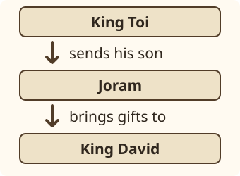

# 2 Samuel 8 — David wins battles and rules Israel

**About this chapter**

David defeats several armies. One king sends his son to greet David. At home, David has people to help him rule.

## The Philistines and Moabites come under David’s rule

## 2 Samuel 8:1

Some time later, David defeated the Philistines.

David brought them under his rule.

He took Metheg-ammah from them.

## 2 Samuel 8:2

David also defeated the Moabites.

He made them lie on the ground.

David measured along the people with a cord.

He had the people within two lengths of cord killed.

He let those within one length live.

The Moabites came under David’s rule.

They had to bring him payments called tribute.

## David fights the king of Zobah

## 2 Samuel 8:3

Hadadezer was the king of Zobah.

His father was Rehob.

Hadadezer marched out to regain control along the Euphrates River.

David defeated Hadadezer.

## 2 Samuel 8:4

David captured 1,000 chariots and 7,000 chariot drivers.

He also captured 20,000 soldiers who fought on foot.

David kept 100 horses for the chariots.

He injured the other horses’ legs so they could no longer pull chariots.

**Reading help**

A chariot was a cart that horses pulled in battle.

## 2 Samuel 8:5

The Arameans from Damascus came to help King Hadadezer.

David and his men killed 22,000 of those Arameans.

## 2 Samuel 8:6

David stationed groups of soldiers in Aram of Damascus.

The Arameans came under David’s rule.

They brought him tribute.

Wherever David went, the LORD helped him win.

**Pause and answer**

Who helped David win?

## David brings gold shields to Jerusalem

## 2 Samuel 8:7

David took gold shields from Hadadezer’s officers.

He brought the shields to Jerusalem.

## 2 Samuel 8:8

Betah and Berothai were two of Hadadezer’s cities.

David took a large amount of bronze from them.

**Reading help**

Bronze is a metal.

## King Toi sends gifts

## 2 Samuel 8:9

Toi was the king of Hamath.

He heard that David had defeated Hadadezer’s whole army.

## 2 Samuel 8:10

Hadadezer had fought against Toi.

So Toi sent his son Joram to greet David.

Joram congratulated David on defeating Hadadezer.

Joram brought him things made of silver, gold, and bronze.

## 2 Samuel 8:11

David set these gifts apart for the LORD.

He had already set apart silver and gold for the LORD.

Those things came from the peoples David had defeated.

## 2 Samuel 8:12

Some came from Edom and Moab.

Some came from the Ammonites, the Philistines, and the Amalekites.

Others came from King Hadadezer of Zobah, Rehob’s son.

David had taken those things after the battle.

**Pause and answer**

Who brought King Toi’s gifts to David?

## David rules over Edom

## 2 Samuel 8:13

David and his men killed 18,000 Edomites in the Valley of Salt.

When David returned, people knew him for this victory.

## 2 Samuel 8:14

David stationed groups of soldiers throughout Edom.

All the Edomites came under David’s rule.

Wherever David went, the LORD helped him win.

## David and the people who help him rule

## 2 Samuel 8:15

David ruled over all Israel.

He did what was right.

He treated all his people fairly.

## 2 Samuel 8:16

Joab led the army.

His mother was Zeruiah.

Jehoshaphat kept the king’s records.

His father was Ahilud.

## 2 Samuel 8:17

Zadok and Ahimelech served as priests.

Zadok’s father was Ahitub.

Ahimelech’s father was Abiathar.

Seraiah was the king’s scribe.

**Reading help**

Priests led people in worship. A scribe wrote documents.

## 2 Samuel 8:18

Benaiah led the Cherethites and the Pelethites.

His father was Jehoiada.

David’s sons served as priestly leaders.

**Pause and answer**

Who led David’s army?
