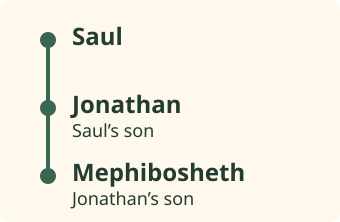

# 2 Samuel 9 — David shows kindness to Mephibosheth

**About this chapter**

David remembers his friend Jonathan. He asks how he can care for someone in Jonathan’s family.

## David asks about Saul’s family

## 2 Samuel 9:1

David asked, “Is anyone from Saul’s family still alive?

I want to show them kindness because of Jonathan.”

## 2 Samuel 9:2

Ziba had served Saul’s family.

People brought Ziba to King David.

David asked, “Are you Ziba?”

Ziba answered, “Yes. I am your servant.”

## 2 Samuel 9:3

David asked, “Is anyone from Saul’s family still alive?

I want to show them the kindness God shows.”

Ziba said, “Jonathan has a son who is still alive.

He has a disability in both feet.”

## David sends for Jonathan’s son

## 2 Samuel 9:4

David asked, “Where is Jonathan’s son?”

Ziba answered, “He lives in Lo-debar with Machir.

Machir is Ammiel’s son.”

## 2 Samuel 9:5

King David sent people to Lo-debar.

They brought Jonathan’s son from Machir’s house.

## 2 Samuel 9:6

Jonathan’s son was Mephibosheth.

Saul was his grandfather.

Mephibosheth bowed with his face to the ground to honor David.

David called, “Mephibosheth!”

Mephibosheth answered, “I am your servant.”

## David gives Mephibosheth land and a place at his table

## 2 Samuel 9:7

David said, “Do not be afraid.

I will show you kindness because of your father Jonathan.

I will give you back all your grandfather Saul’s land.

You will always eat at my table.”

## 2 Samuel 9:8

Mephibosheth bowed down.

He asked, “Who am I to receive such kindness?

Why would you care about a dead dog like me?”

**Reading help**

Mephibosheth compares himself to a dead dog. He is telling David how unimportant he feels. David has welcomed him to share his meals.

**Pause and answer**

Whose land did David promise to give back to Mephibosheth?

## David asks Ziba to farm the land

## 2 Samuel 9:9

David called for Ziba, Saul’s servant.

David said, “I have given Saul’s grandson everything Saul owned.

I have also given him everything Saul’s family owned.

## 2 Samuel 9:10

You, your sons, and your servants must farm his land.

Gather the crops so that Mephibosheth has food.

Mephibosheth himself will always eat at my table.”

Ziba had 15 sons and 20 servants.

## 2 Samuel 9:11

Ziba told David, “My king, I am your servant.

I will do everything you have told me.”

Mephibosheth ate with David like one of David’s own sons.

## Mephibosheth lives in Jerusalem

## 2 Samuel 9:12

Mephibosheth had a young son named Mica.

Everyone in Ziba’s household served Mephibosheth.

## 2 Samuel 9:13

Mephibosheth lived in Jerusalem because he always ate at the king’s table.

Mephibosheth had a disability in both feet.

**Pause and answer**

Who shared meals with King David?
