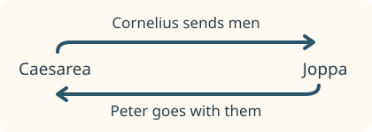

# Acts 10 — Peter visits Cornelius

**About this chapter**

Cornelius sends for Peter.

Peter learns why he can enter Cornelius’s home and share the good news.

## Cornelius sends for Peter

## Acts 10:1

Cornelius lived in Caesarea.

He was a Roman army officer called a centurion.

His group of soldiers was called the Italian Regiment.

## Acts 10:2

Cornelius and everyone in his home honoured God.

Cornelius often prayed to God.

He gave generously to people in need.

## Acts 10:3

One day, about three in the afternoon, Cornelius had a vision.

He clearly saw an angel from God come to him.

The angel called, “Cornelius!”

**Help with these words**

In a vision, God shows someone something. An angel is a messenger from God.

## Acts 10:4

Cornelius stared at the angel in fear.

He asked, “What is it, Lord?”

The angel said, “God remembers your prayers.

He remembers the gifts you gave to poor people.

## Acts 10:5

Send men to Joppa for a man named Simon.

People also call him Peter.

## Acts 10:6

Peter is staying with another man named Simon.

This Simon makes leather from animal skins.

His house is by the sea.”

## Acts 10:7

The angel left.

Cornelius called two servants and a soldier who served him.

The soldier also honoured God.

## Acts 10:8

Cornelius told them what had happened.

Then he sent them to Joppa.

**Pause and answer**

Who did Cornelius send his men to find?

## Peter sees a sheet come down

## Acts 10:9

About noon the next day, the men were nearing Joppa.

Peter went up on the roof to pray.

## Acts 10:10

Peter felt hungry and wanted to eat.

While someone prepared the meal, Peter began to see a vision.

## Acts 10:11

Peter saw heaven open.

Something like a large sheet came down to earth.

It hung by its four corners.

## Acts 10:12

Inside were all kinds of animals with four legs.

Peter also saw reptiles and birds.

## Acts 10:13

A voice said, “Get up, Peter.

Kill and eat.”

## Acts 10:14

Peter answered, “No, Lord!

I have never eaten anything impure or unclean.”

**Help with these words**

Peter was talking about food his religious law forbade him to eat. He called that food “unclean.”

## Acts 10:15

The voice spoke again.

“When God makes something clean, do not call it unclean.”

## Acts 10:16

This happened three times.

Then the sheet went straight back up into heaven.

**Pause and answer**

How many times did this happen?

## Three men arrive at the gate

## Acts 10:17

Peter wondered what the vision meant.

Meanwhile, the men from Cornelius found Simon’s house.

They came to the gate.

## Acts 10:18

They called out, “Is Simon Peter staying here?”

## Acts 10:19

Peter was still thinking about the vision.

The Holy Spirit said, “Three men are looking for you.

## Acts 10:20

Get up and go downstairs.

Go with them without holding back.

I sent them.”

## Acts 10:21

Peter went down to the men.

He said, “I am the man you want.

Why have you come?”

## Acts 10:22

They answered, “Cornelius the army officer sent us.

He does what is right and honours God.

Jewish people everywhere speak well of him.

A holy angel told him to invite you home.

Cornelius wants to hear your message.”

## Acts 10:23

Peter invited the men in as his guests.

The next day Peter went with them.

Some believers from Joppa went too.

**Pause and answer**

Who told Peter to go with the men?

## Peter enters Cornelius’s home

## Acts 10:24

The following day they reached Caesarea.

Cornelius was waiting for them.

He had gathered his relatives and close friends.

## Acts 10:25

As Peter was about to enter, Cornelius met him.

Cornelius fell at Peter’s feet to worship him.

## Acts 10:26

Peter helped Cornelius up.

“Stand up,” Peter said.

“I am a man just like you.”

## Acts 10:27

Peter went inside, still talking with Cornelius.

He found many people gathered there.

## Acts 10:28

Peter said, “You know our Jewish law.

It forbids me to mix with or visit a foreigner.

But God has shown me something.

I must never call any person impure or unclean.

## Acts 10:29

So when you sent for me, I came willingly.

Why did you send for me?”

**Pause and answer**

What did God show Peter about calling people unclean?

## Cornelius explains why he sent for Peter

## Acts 10:30

Cornelius answered, “Four days ago I was praying at home.

It was about three in the afternoon, just like now.

Suddenly a man in shining clothes stood before me.

## Acts 10:31

He said, ‘Cornelius, God has heard your prayer.

God remembers your gifts to poor people.

## Acts 10:32

Send to Joppa for Simon, also called Peter.

He is staying with Simon, who makes leather.

Simon’s house is by the sea.’

## Acts 10:33

So I sent for you at once.

It was kind of you to come.

Now we are all here before God.

We want to hear everything the Lord told you to say.”

**Pause and answer**

What did the people in the house want to hear?

## Peter tells them about Jesus

## Acts 10:34

Peter said, “Now I understand.

God does not choose favourites.

## Acts 10:35

God welcomes people from every nation who honour him and do what is right.

## Acts 10:36

God sent the people of Israel good news.

Jesus Christ brings peace.

He is Lord of all.

## Acts 10:37

You know what happened across Judea.

It began in Galilee after John told people about baptism.

## Acts 10:38

God gave Jesus of Nazareth the Holy Spirit and power.

Jesus went from place to place doing good.

He healed everyone the devil held in his power.

God was with Jesus.”

**Pause and answer**

Why was Jesus able to help people the devil held in his power?

## Peter tells them Jesus is alive

## Acts 10:39

Peter continued, “We saw what Jesus did in the Jewish homeland and in Jerusalem.

People killed Jesus by hanging him on a wooden cross.

## Acts 10:40

On the third day God raised Jesus from the dead.

God let people see him alive.

## Acts 10:41

Only the witnesses God had already chosen saw him.

We were those witnesses.

We ate and drank with Jesus after he rose.

## Acts 10:42

Jesus told us to speak to the people.

We must tell them that God chose Jesus as judge.

Jesus will judge both the living and the dead.

## Acts 10:43

All the prophets spoke about Jesus.

They said God forgives the sins of everyone who trusts in Jesus.

God does this through Jesus.”

**Help with these words**

Witnesses tell others what they saw. Prophets spoke to people for God. Sins are the wrong things we do.

**Pause and answer**

What did the witnesses do with Jesus after he rose?

## God gives the Holy Spirit to everyone listening

## Acts 10:44

While Peter was still speaking, the Holy Spirit came upon everyone listening.

## Acts 10:45

The Jewish believers who came with Peter were amazed.

God had given the Holy Spirit to Gentiles too.

**Help with these words**

Gentiles are people who are not Jewish.

## Acts 10:46

The Jewish believers heard the Gentiles speaking in other languages.

They heard them praising God.

Then Peter spoke.

## Acts 10:47

Peter said, “These people have received the Holy Spirit just as we have.

Can anyone keep them from baptism in water?”

## Acts 10:48

So Peter told the believers to baptise them in the name of Jesus Christ.

Then the people asked Peter to stay a few days.

**Help with these words**

In baptism, believers use water to show that someone belongs to Jesus.

**Pause and answer**

What gift did the Gentiles receive while Peter spoke?
