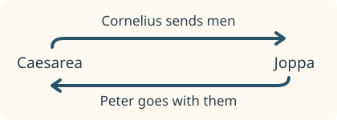

# Acts 11 — Peter explains his visit, and believers in Antioch send help

**About this chapter**

Peter explains why he ate with Gentiles.

In Antioch, people hear about Jesus and help other believers.

## Believers ask about Peter’s visit

## Acts 11:1

The apostles and other believers throughout Judea heard the news.

Gentiles had accepted God’s message too.

**Help with these words**

Gentiles are people who are not Jewish. The apostles were men Jesus sent to speak for him.

## Acts 11:2

Peter went to Jerusalem.

Some Jewish believers there objected to what Peter had done.

## Acts 11:3

They said, “You visited men who were not circumcised.

You even ate with them.”

**Help with these words**

Circumcision means cutting away a small piece of skin from a boy’s or man’s penis. For Jewish men, it was a sign of their people’s agreement with God.

## Acts 11:4

Peter explained what had happened.

He started at the beginning.

**Pause and answer**

What did Peter do when he visited the Gentiles?

## Peter describes the vision

## Acts 11:5

Peter said, “I was praying in Joppa.

In a vision I saw something like a large sheet.

It hung by its four corners.

It came down from heaven right to me.

**Help with these words**

In a vision, God shows someone something.

## Acts 11:6

I looked closely and saw animals with four legs.

I saw wild animals, reptiles and birds.

## Acts 11:7

Then I heard a voice say, ‘Get up, Peter.

Kill and eat.’

## Acts 11:8

I answered, ‘No, Lord!

I have never eaten anything impure or unclean.’

**Help with these words**

Peter called food “unclean” if his religious law forbade him to eat it.

## Acts 11:9

The voice spoke from heaven again.

‘When God makes something clean, do not call it unclean.’

## Acts 11:10

This happened three times.

Then everything went back up into heaven.”

**Pause and answer**

What did the voice tell Peter about things God makes clean?

## Peter explains why he went

## Acts 11:11

Peter continued, “Just then, three men arrived where I was staying.

Someone in Caesarea had sent them to find me.

## Acts 11:12

The Holy Spirit told me to go with them without holding back.

These six believers here went with me too.

We went into the home of Cornelius.

## Acts 11:13

Cornelius told us about an angel he had seen.

The angel stood in his house and said, ‘Send to Joppa for Simon.

People also call him Peter.

## Acts 11:14

He will bring you a message.

Through that message God will save you and everyone in your home.’”

**Pause and answer**

Who told Peter to go with the three men?

## God gives the same gift

## Acts 11:15

Peter said, “As I began speaking, the Holy Spirit came upon them.

That was how the Holy Spirit came upon us at the beginning.

## Acts 11:16

Then I remembered what the Lord Jesus said.

‘John baptised people with water.

But God will baptise you with the Holy Spirit.’

**Help with these words**

Here Jesus promised that his followers would receive the Holy Spirit.

## Acts 11:17

God gave them the same gift he gave us when we believed in the Lord Jesus Christ.

How could I stand in God’s way?”

## Acts 11:18

When the believers heard this, they stopped objecting.

They praised God and said, “God has given Gentiles this gift too.

They can turn away from sin and receive life from God.”

**Pause and answer**

What gift did both groups receive?

## People in Antioch hear about Jesus

## Acts 11:19

After Stephen died, people attacked the believers.

Many believers fled to other places.

Some went as far as Phoenicia, Cyprus and Antioch.

They told only Jewish people the message about Jesus.

## Acts 11:20

Some believers from Cyprus and Cyrene came to Antioch.

They told Greek people the good news about the Lord Jesus too.

## Acts 11:21

The Lord helped those who shared the news.

Many people believed and began to follow the Lord.

## Acts 11:22

The church in Jerusalem heard the news.

They sent Barnabas to Antioch.

## Acts 11:23

Barnabas saw how kind God had been to the people.

This made him glad.

He urged them all to keep following the Lord with their whole hearts.

**Help with these words**

To follow the Lord with your whole heart means to trust him fully and stay faithful to him.

## Acts 11:24

Barnabas was a good man.

He trusted the Lord deeply.

The Holy Spirit filled him.

Many more people began to follow the Lord.

**Pause and answer**

Why was Barnabas glad when he reached Antioch?

## Barnabas brings Saul to Antioch

## Acts 11:25

Barnabas went to Tarsus to look for Saul.

## Acts 11:26

Barnabas found Saul and brought him back to Antioch.

For a whole year they met with the church.

Together they taught many people.

Antioch was the first place people called Jesus’ followers Christians.

**Pause and answer**

What name did people in Antioch give the followers of Jesus?

## The believers send help to Judea

## Acts 11:27

During that time some prophets came to Antioch from Jerusalem.

**Help with these words**

Prophets speak God’s messages to people.

## Acts 11:28

One prophet, Agabus, stood up.

The Holy Spirit showed him what would happen.

Agabus said a great famine would spread across the world.

This happened when Claudius ruled as emperor.

**Help with these words**

A famine is a time when many people cannot get enough food.

## Acts 11:29

The believers in Antioch decided to help the believers in Judea.

Each person gave what they could.

## Acts 11:30

Barnabas and Saul took their gifts to the elders in Judea.

**Help with these words**

The elders were leaders who cared for the believers.

**Pause and answer**

Who carried the gifts to Judea?
