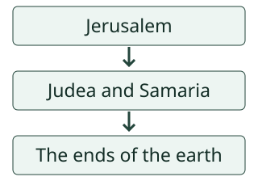

# Acts 1 — Jesus goes to heaven and Matthias joins the apostles

**About this chapter**

Jesus tells his followers where to wait and what they will do.

Later, the followers pray about who will take Judas’s place.

## Jesus shows the apostles he is alive

## Acts 1:1

Theophilus, in my first book I wrote about everything Jesus began to do and teach.

## Acts 1:2

That book tells what happened up to the day God took Jesus into heaven.

Before Jesus left, he gave instructions to the apostles he had chosen.

He did this through the Holy Spirit.

**Help with these words**

An apostle is someone Jesus chose and sent to speak for him.

## Acts 1:3

After Jesus suffered, he showed the apostles he was alive.

He gave them many reasons to be sure of this.

Over forty days they saw him again and again.

He spoke to them about God’s kingdom.

**Pause and answer**

What did Jesus speak about during those forty days?

## Jesus tells them to wait in Jerusalem

## Acts 1:4

While they were together, Jesus gave them this command.

“Stay in Jerusalem.

Wait for the gift my Father promised.

You have heard me speak about it.

## Acts 1:5

“John baptized people with water.

In a few days you will be baptized with the Holy Spirit.”

## Acts 1:6

When they met together, the apostles asked, “Lord, is this the time when you will give Israel its kingdom back?”

## Acts 1:7

Jesus answered, “My Father has decided when these things will happen.

Those times are his to decide and are not for you to know.

## Acts 1:8

“But the Holy Spirit will come upon you and give you power.

You will be my witnesses in Jerusalem.

You will tell people about me throughout Judea and Samaria, and to the ends of the earth.”

**Help with these words**

A witness tells others what they know from what they have seen or heard.

**About the picture**

Start at Jerusalem.

Follow the arrows to the other places Jesus names.

**Pause and answer**

Who will give the apostles power to speak about Jesus?

## Jesus goes up into heaven

## Acts 1:9

The apostles watched as God took Jesus up.

Then a cloud hid him from their sight.

## Acts 1:10

They kept looking up as Jesus went.

Suddenly two men in white clothes stood beside them.

## Acts 1:11

The men said, “Men of Galilee, why stand looking into the sky?

You saw God take Jesus into heaven.

This same Jesus will come back the way you saw him go.”

**Pause and answer**

What did the two men say Jesus would do?

## The followers pray together

## Acts 1:12

The apostles walked back to Jerusalem from the Mount of Olives.

It was close enough to walk there on the Sabbath.

**Help with these words**

The Sabbath is the Jewish day of rest.

## Acts 1:13

They went upstairs to the room where they were staying.

Peter, John, James, and Andrew were there.

So were Philip, Thomas, Bartholomew, and Matthew.

The others were James son of Alphaeus, Simon the Zealot, and Judas son of James.

## Acts 1:14

All of them kept praying together.

The women joined them, including Mary, the mother of Jesus.

Jesus’ brothers prayed with them too.

**Pause and answer**

What did the followers do together in the upstairs room?

## Peter speaks about Judas

## Acts 1:15

During those days about 120 believers gathered together.

Peter stood up to speak.

## Acts 1:16

Peter said, “Brothers, what the Holy Spirit said in the Scriptures had to come true.

The Spirit spoke through David about Judas.

Judas led the men who arrested Jesus.

**Help with these words**

Here Peter is speaking about Judas Iscariot, who handed Jesus over.

Judas son of James, who prayed upstairs, was a different man.

## Acts 1:17

“Judas was one of us.

He shared in our work.”

## Acts 1:18

Judas bought a field with the money he got for handing Jesus over.

There he fell headfirst.

His body split open, and his insides spilled out.

## Acts 1:19

Everyone in Jerusalem heard what happened.

In their own language they called the field Akeldama.

That means Field of Blood.

**Pause and answer**

What did Judas do when people came to arrest Jesus?

## Peter explains who can take Judas’s place

## Acts 1:20

Peter said, “The book of Psalms says, ‘Let his home stand empty.

Let no one live there.’

It also says, ‘Let someone else take his place.’

## Acts 1:21

“So we must choose a man who was with us the whole time the Lord Jesus lived among us.

## Acts 1:22

“He must have been there from the time John baptized people until God took Jesus up from us.

He must join us in telling people that Jesus rose from the dead.”

**Pause and answer**

What must the new apostle tell people about Jesus?

## Matthias joins the eleven apostles

## Acts 1:23

They put forward two men.

One was Joseph, called Barsabbas and also known as Justus.

The other was Matthias.

## Acts 1:24

Then they prayed, “Lord, you know what is in every person’s heart.

Show us which of these two men you have chosen.

## Acts 1:25

“Show us who will serve as an apostle in Judas’s place.

Judas left this work and went to the place that belonged to him.”

## Acts 1:26

Then they cast lots.

The lot fell to Matthias.

Matthias joined the eleven apostles.

**Help with these words**

Casting lots was a way of making a choice by drawing or tossing marked objects.

**Pause and answer**

Who joined the eleven apostles?
