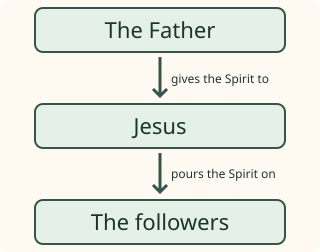

# Acts 2 — The Holy Spirit comes and Peter speaks to the crowd

**About this chapter**

People hear about God in languages they know.

Peter tells them about Jesus.

Many believe and begin a new life together.

## The Holy Spirit comes at Pentecost

## Acts 2:1

On the day of Pentecost, Jesus’ followers were all together.

**Help with these words**

Pentecost was a Jewish feast.

## Acts 2:2

Suddenly they heard a sound from heaven.

It sounded like a strong wind rushing past.

The sound filled the house where they sat.

## Acts 2:3

They saw what looked like flames of fire.

The flames separated and rested on each person.

## Acts 2:4

The Holy Spirit filled them all.

They began to speak in other languages.

The Spirit gave them the words to say.

**Pause and answer**

Who gave the followers words to say?

## The crowd hears familiar languages

## Acts 2:5

Jewish people from every nation were staying in Jerusalem.

They honoured God.

## Acts 2:6

When people heard the sound, a crowd gathered.

Each person heard the followers speaking their own language.

How could this be?

## Acts 2:7

The people were amazed.

They asked, “Aren’t all these speakers from Galilee?

## Acts 2:8

“How can each of us hear the language we grew up speaking?

**Pause and answer**

What surprised the people about the languages they heard?

## People from many places hear about God

## Acts 2:9

“Some of us are Parthians, Medes, and Elamites.

Some live in Mesopotamia, Judea, Cappadocia, Pontus, and Asia.

## Acts 2:10

“Others come from Phrygia, Pamphylia, Egypt, and the parts of Libya near Cyrene.

Some are visiting from Rome.

## Acts 2:11

“Some were born Jewish and others joined the Jewish faith.

Some of us are Cretans or Arabs.

In our own languages, we hear about the wonderful things God has done!”

## Acts 2:12

Amazed and puzzled, they asked each other, “What does this mean?”

## Acts 2:13

Others made fun of the followers.

They said, “They have drunk too much new wine!”

**Pause and answer**

What did people hear about in their own languages?

## Peter explains what the crowd heard

## Acts 2:14

Peter stood up with the other eleven apostles.

He spoke loudly to the crowd.

“People of Judea and everyone staying in Jerusalem, listen carefully.

## Acts 2:15

“These people are not drunk, as you think.

It is only nine in the morning!

## Acts 2:16

“What you see is what the prophet Joel spoke about.

**Help with these words**

A prophet speaks a message from God.

**Pause and answer**

Which prophet did Peter name?

## Joel speaks of God’s promise

## Acts 2:17

“Joel gave this message from God.

‘In the last days I will pour out my Spirit on all people.

Your sons and daughters will speak my messages.

Your young men will see visions.

Your old men will have dreams.

## Acts 2:18

“‘In those days I will pour out my Spirit even on my servants, both men and women.

They too will speak my messages.

**Help with these words**

God speaks of pouring out his Spirit as a picture of giving freely and generously.

## Acts 2:19

“‘I will show wonders in the sky and signs on earth.

There will be blood, fire, and clouds of smoke.

## Acts 2:20

“‘The sun will go dark, and the moon will turn to blood.

Then the great and glorious day of the Lord will come.

## Acts 2:21

“‘The Lord will save everyone who calls on his name.’”

**Pause and answer**

Whom does the Lord promise to save?

## Peter speaks about Jesus of Nazareth

## Acts 2:22

Peter continued, “People of Israel, listen.

You know what God did among you through Jesus of Nazareth.

God showed you who Jesus was through miracles, wonders, and signs.

## Acts 2:23

“God knew beforehand that people would hand Jesus over.

It was part of his plan.

You had men who broke the law nail Jesus to a cross and kill him.

## Acts 2:24

“But God raised Jesus from the dead.

God freed Jesus from the pain of death.

Death could not hold on to him.

**Pause and answer**

What did God do after Jesus died?

## David speaks about hope

## Acts 2:25

“David said about Jesus, ‘I always saw the Lord before me.

He is beside me at my right hand.

So I will stand firm.

## Acts 2:26

“‘My heart is glad, and I speak with joy.

Even my body can rest in hope.

## Acts 2:27

“‘You will not leave me in the place of the dead.

You will not let the body of your Holy One decay.

## Acts 2:28

“‘You have shown me the paths that lead to life.

Being with you will fill me with joy.’”

**Pause and answer**

What did David say would fill him with joy?

## Peter explains David’s words

## Acts 2:29

Peter said, “Brothers, we know that our ancestor David died.

People buried him, and his tomb is still here.

## Acts 2:30

“David was a prophet.

God had given David his solemn promise.

Someone from David’s family would sit on David’s throne.

**Help with these words**

To sit on a king’s throne means to rule as king.

## Acts 2:31

“David saw what was coming and spoke about the Christ rising from the dead.

God did not leave him in the place of the dead.

His body did not decay.

## Acts 2:32

“God raised Jesus to life.

We are all witnesses of this.

**Pause and answer**

Whose return to life did Peter and the apostles tell people about?

## Jesus sends the promised Spirit

## Acts 2:33

“God gave Jesus the place of honour at his right hand.

Jesus received the Holy Spirit his Father had promised.

Jesus poured out the Spirit.

That is why you see and hear these things.

**About the picture**

Follow the arrows from the Father to Jesus and then to the followers.

Jesus had told his followers to wait for this gift from the Father.

## Acts 2:34

“David himself did not go up to heaven.

But David said that the Lord spoke to the one David called ‘my Lord.’

God said, ‘Sit at my right hand

## Acts 2:35

“‘until I make your enemies a footstool for your feet.’

**Help with these words**

A footstool is a low stand for someone’s feet.

Here it pictures God putting enemies under the King’s rule.

## Acts 2:36

“People of Israel, you can be sure of this.

You put Jesus on a cross.

God has made this same Jesus both Lord and Christ!”

**Help with these words**

Christ means the King God chose.

**Pause and answer**

What gift did Jesus receive from his Father?

## The people ask what to do

## Acts 2:37

Peter’s words filled the people with sorrow.

They asked Peter and the other apostles, “Brothers, what should we do?”

## Acts 2:38

Peter answered, “Turn away from sin and turn to God.

Let each of you be baptized in the name of Jesus Christ for the forgiveness of your sins.

You will receive God’s gift, the Holy Spirit.

## Acts 2:39

“God’s promise is for you and your children.

It is also for people far away.

It is for everyone the Lord our God calls to himself.”

## Acts 2:40

Peter said much more about what he knew.

He urged them, “Let God save you from the wrongdoing of this generation.”

## Acts 2:41

People who accepted Peter’s message were baptized.

About three thousand people joined the believers that day.

**Pause and answer**

Who else did Peter say the promise was for?

## The believers share their lives

## Acts 2:42

The believers kept learning from the apostles.

They spent time together, broke bread, and prayed.

**Help with these words**

Breaking bread means taking bread, breaking it, and sharing it.

## Acts 2:43

Everyone was filled with wonder.

The apostles did many wonders and signs.

## Acts 2:44

All the believers stayed together.

They shared everything they had.

## Acts 2:45

They sold things they owned.

They gave the money to anyone who needed help.

## Acts 2:46

Each day they met together in the temple courts.

They broke bread in one another’s homes.

They gladly shared meals with sincere hearts.

## Acts 2:47

They praised God, and the people thought well of them.

Every day the Lord saved more people and added them to the group.

**Pause and answer**

How did the believers help people in need?
