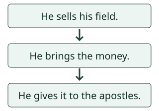

# Acts 4 — Peter and John speak before the council

**About this chapter**

The council tells Peter and John to stop speaking about Jesus.

The believers pray for courage and share what they own.

## Peter and John spend the night under guard

## Acts 4:1

Peter and John were speaking to the people.

Priests, the captain of the temple guard, and some Sadducees came up to them.

**Help with these words**

The Sadducees were a Jewish religious group who did not believe the dead would rise again.

## Acts 4:2

These men were upset by what Peter and John were teaching.

The two apostles said that through Jesus the dead would rise to life.

## Acts 4:3

They arrested Peter and John.

It was already evening, so they kept them under guard until the next day.

## Acts 4:4

Many people who heard the message trusted it.

The number of men who believed grew to about five thousand.

**Pause and answer**

What did many people do when they heard the apostles’ message?

## The council asks how the man was healed

## Acts 4:5

The next day the rulers, elders, and teachers of God’s law met in Jerusalem.

## Acts 4:6

Annas the high priest was there.

Caiaphas, John, Alexander, and many others from the high priest’s family joined them.

## Acts 4:7

The council had Peter and John brought before them.

They asked, “What power did you use to heal this man?

In whose name did you do it?”

**Pause and answer**

What did the council want to know about the healing?

## Peter speaks about Jesus

## Acts 4:8

The Holy Spirit filled Peter.

Peter answered, “Rulers and elders of our people, listen.

## Acts 4:9

“Today you are asking about a good thing we did for a man who could not walk.

You want to know how he became well.

## Acts 4:10

“Here is the answer for you and everyone in Israel.

This man stands before you well because of Jesus Christ of Nazareth.

You put Jesus on a cross, but God raised him from the dead.

It was in Jesus’ name that this man was healed.

## Acts 4:11

“Jesus is the stone you builders threw away.

That stone has become the cornerstone.

**Help with these words**

A cornerstone is an important stone at the corner of a building.

Peter compares the leaders to builders who threw that stone away.

They rejected Jesus, but God gave him the place of honour.

## Acts 4:12

“Only Jesus can save us.

God has given us no other name anywhere in the world by which we can be saved.”

**Pause and answer**

Who did Peter say could save them?

## The council talks in private

## Acts 4:13

The council saw how boldly Peter and John spoke.

They were ordinary men without special schooling.

The council was amazed and recognised that they had been with Jesus.

## Acts 4:14

The man who could now walk stood beside Peter and John.

The council had nothing to say in reply.

## Acts 4:15

The council told them to leave the room.

Then the council members talked among themselves.

## Acts 4:16

They asked, “What shall we do with these men?

Everyone in Jerusalem knows that a great miracle happened through them.

We cannot deny it.

## Acts 4:17

“We must stop this message from spreading.

Let us warn them never to speak to anyone in Jesus’ name.”

**Pause and answer**

Why could the council members not deny the miracle?

## Peter and John answer the council

## Acts 4:18

The council called Peter and John back in.

They ordered them never to speak or teach in Jesus’ name.

## Acts 4:19

Peter and John answered, “You decide.

Would it be right in God’s eyes to obey you instead of God?

## Acts 4:20

“We cannot stop telling people what we have seen and heard.”

## Acts 4:21

The council threatened them again, then let them go.

Everyone was praising God for what had happened.

So the council could find no way to punish them.

## Acts 4:22

The man who had been healed was over forty years old.

**Pause and answer**

What did Peter and John say they would keep talking about?

## The believers pray together

## Acts 4:23

Peter and John went back to the other believers.

They repeated everything the chief priests and elders had said.

## Acts 4:24

The believers prayed aloud together.

“Lord, you rule over all.

You made the sky, the earth, the sea, and everything in them.

## Acts 4:25

“Through the Holy Spirit you spoke through our ancestor David, your servant.

He said, ‘Why are the nations so angry?

Why do the people make plans that will fail?

## Acts 4:26

“‘Kings take their stand, and rulers join together.

They stand against the Lord and the King he chose.’

**Pause and answer**

Whose words did the believers remember as they prayed?

## The believers ask for courage

## Acts 4:27

“Here in this city, Herod and Pontius Pilate joined together with Gentiles and people of Israel.

They turned against Jesus, your holy servant, the one you chose.

**Help with these words**

Gentiles are people who are not Jewish.

## Acts 4:28

“They did what you, by your power and your will, had decided beforehand.

## Acts 4:29

“Lord, you hear their threats.

Help us, your servants, to speak your message without fear.

## Acts 4:30

“Reach out your hand to heal.

Do signs and wonders in the name of your holy servant Jesus.”

## Acts 4:31

After they prayed, the place where they met shook.

The Holy Spirit filled them all.

They spoke God’s message boldly.

**Pause and answer**

What did the believers ask God to help them do?

## The believers share what they own

## Acts 4:32

The believers were one in heart and soul.

No one kept their belongings just for themselves.

They shared everything they owned.

**Help with these words**

Being one in heart and soul means the believers were united.

They showed this by sharing what they had.

## Acts 4:33

With great power the apostles kept telling people that the Lord Jesus had risen from the dead.

God showed great kindness to them all.

## Acts 4:34

Everyone had what they needed.

People who owned land or houses sold property and brought the money.

## Acts 4:35

They put the money at the apostles’ feet.

Each person received what they needed.

## Acts 4:36

One of these people was Joseph, a Levite from Cyprus.

The apostles called him Barnabas.

The name means “Son of Encouragement.”

**Help with these words**

To encourage someone means to help them take heart.

## Acts 4:37

Barnabas sold a field he owned.

He brought the money and put it at the apostles’ feet.

**About the picture**

Follow the arrows to tell what Barnabas did.

**Pause and answer**

What did Barnabas do with the money from his field?
