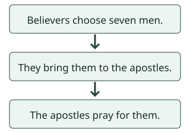

# Acts 6 — Seven men are chosen and Stephen faces the council

**About this chapter**

Some widows miss out when the believers share food.

Stephen is one of seven men chosen to help.

Later he faces people who tell lies about him.

## Some widows miss their share of food

## Acts 6:1

More people were following Jesus.

The Greek-speaking Jewish believers complained to the Hebrew-speaking Jewish believers.

When people gave out food each day, they missed the widows in the Greek-speaking group.

**Help with these words**

A widow is a woman whose husband has died.

## Acts 6:2

The twelve apostles called all the followers together.

They said, “If we take charge of serving meals, we will neglect our work of teaching God’s word.

## Acts 6:3

“Brothers, choose seven men from among you.

Choose men you know are wise and full of the Holy Spirit.

We will put them in charge of this work.

## Acts 6:4

“Then we can give our time to prayer and to teaching God’s word.”

**Pause and answer**

What work did the apostles ask the seven men to take charge of?

## The believers choose seven men

## Acts 6:5

Everyone was pleased with the plan.

They chose Stephen, who was full of faith and the Holy Spirit.

They also chose Philip, Prochorus, Nicanor, Timon, Parmenas, and Nicolas.

Nicolas came from Antioch and had joined the Jewish faith.

## Acts 6:6

The believers brought the seven men to the apostles.

The apostles prayed and laid their hands on the seven.

**Help with these words**

Here the apostles put their hands on the seven men as they pray for them to begin their work.

**About the picture**

Follow the arrows to tell what happened after the believers agreed on a plan.

## Acts 6:7

More and more people heard God’s word.

The number of followers in Jerusalem grew quickly.

Many priests also came to believe and obey the message about Jesus.

**Pause and answer**

What did the apostles do when the seven men came to them?

## Some men argue with Stephen

## Acts 6:8

God filled Stephen with grace and power.

Stephen did great wonders and signs among the people.

## Acts 6:9

Some men from the Synagogue of the Freedmen argued with Stephen.

They came from Cyrene, Alexandria, Cilicia, and Asia.

**Help with these words**

A synagogue is a Jewish meeting place for worship.

Freedmen were people who had once been slaves and were now free.

## Acts 6:10

The Holy Spirit gave Stephen wisdom as he spoke.

The men could not answer him.

## Acts 6:11

Then those men persuaded others to accuse Stephen.

The accusers said, “We heard Stephen speak against Moses and insult God.”

**Pause and answer**

Who helped Stephen speak with wisdom?

## False witnesses speak to the council

## Acts 6:12

Stephen’s opponents stirred up the people, the elders, and the teachers of God’s law.

They seized Stephen and brought him before the council.

## Acts 6:13

They brought in people who told lies about Stephen.

These false witnesses said, “This man keeps speaking against this holy place and against our law.

## Acts 6:14

“We heard him say that Jesus of Nazareth will destroy this place.

He says Jesus will change the customs Moses gave us.”

**Help with these words**

The witnesses called the temple in Jerusalem “this holy place.”

## Acts 6:15

Everyone on the council looked closely at Stephen.

His face looked like the face of an angel.

**Pause and answer**

How did Stephen’s face look to the council?
