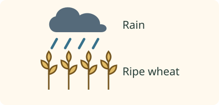

# Amos 4 — Still you did not come back to Me

**About this chapter**

Amos speaks to people who have plenty while their neighbors suffer. The LORD reminds Israel of times when food and water ran short. Again and again He says that the people did not come back to Him.

## A warning for women who hurt the poor

## Amos 4:1

Amos says, “Listen, you women on Mount Samaria!

You are like the well-fed cows of Bashan.

You mistreat poor people and crush those who need help.

Then you tell your husbands, ‘Bring us more to drink!’”

## Amos 4:2

The Lord GOD makes this promise by His own holiness.

“The day will come when others lead you away with hooks.

They will take your children away with fishhooks.

## Amos 4:3

“Each of you will go straight through a gap in the broken city wall.

They will force you out toward Harmon,” says the LORD.

## Gifts people boast about

## Amos 4:4

The LORD speaks sharply about Israel’s worship.

“Go on, sin at Bethel!

Go to Gilgal and sin even more!

Bring your sacrifices every morning.

Every three days bring a tenth of what you have.

## Amos 4:5

“Bring bread made with yeast as a gift of thanks.

When you give extra gifts, announce them to everyone.

People of Israel, you love to do that!” says the Lord GOD.

## Hunger and thirst

## Amos 4:6

The LORD says, “I left you with clean teeth in every city.

Your teeth stayed clean because you had nothing to eat.

There was no bread in any town.

Still you did not come back to Me.

## Amos 4:7

“Three months before harvest, I held back the rain.

I sent rain to one city and none to another.

Rain fell on one field.

In another field the crops dried up.

## Amos 4:8

“People stumbled from town to town looking for water.

They could not get enough to drink.

Still you did not come back to Me.

## Amos 4:9

“I sent diseases that damaged your gardens and grapevines.

Locusts ate your fig trees and olive trees.

Still you did not come back to Me.

## Israel still refuses to return

## Amos 4:10

“I sent terrible diseases like those I sent to Egypt.

Your young men and the captured horses died in battle.

I made you smell the foul air of your camp.

Still you did not come back to Me.

## Amos 4:11

“I brought some of you down as I brought down Sodom and Gomorrah.

Those who escaped were like a burning stick pulled from a fire.

Still you did not come back to Me,” says the LORD.

## Get ready to meet your God

## Amos 4:12

“People of Israel, I will act against you.

Since I am going to do this, get ready to meet your God.”

## Amos 4:13

God shapes the mountains and makes the wind.

He tells people His thoughts.

He turns the light of dawn into darkness.

He walks on the highest places of the earth.

His name is the LORD, the God who leads heaven’s armies.

**Pause and answer**

What did people look for as they went from town to town?
