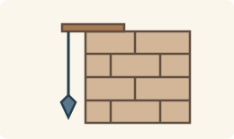

# Amos 7 — Amos sees a plumb line

**About this chapter**

The Lord GOD shows Amos three visions.

A vision is something God lets a person see.

Later a priest tells Amos to leave Bethel.

## Amos sees insects eating the crops

## Amos 7:1

I am Amos.

The Lord GOD showed me a swarm of locusts.

Locusts are insects that eat plants.

God was getting the locusts ready just after the king’s harvest.

The late spring crop had just begun to grow.

## Amos 7:2

In the vision, the locusts ate every green plant in the land.

I cried out, “Lord GOD, please forgive your people!

How can Jacob’s people survive?

They are so small.”

Jacob’s people are the people of Israel.

## Amos 7:3

The LORD changed his plan.

He said, “This will not happen.”

## Amos sees a fire

## Amos 7:4

Then the Lord GOD showed me another vision.

He called for a fire to punish his people.

The fire dried up the deep waters.

Then it burned up the land.

## Amos 7:5

I cried out, “Lord GOD, please stop!

How can Jacob’s people survive?

They are so small.”

## Amos 7:6

The LORD changed this plan too.

The Lord GOD said, “This will not happen either.”

## A weight hangs beside a wall

## Amos 7:7

Next the Lord showed me a straight wall.

The Lord stood beside it holding a plumb line.

A plumb line is a cord with a weight at the end.

The weight makes the cord hang straight down.

Builders use it to check whether a wall stands straight.

## Amos 7:8

The LORD asked, “Amos, what do you see?”

I answered, “A plumb line.”

The Lord said, “I am setting a plumb line among my people Israel.

I will no longer spare them.”

The plumb line shows that God is judging his people.

## Amos 7:9

The Lord said, “Isaac’s people will leave their hilltop places of worship.

Israel’s places of worship will lie in ruins.

I will take up my sword against King Jeroboam’s family.”

Isaac was an ancestor of the people of Israel.

## A priest tells Amos to leave

## Amos 7:10

Amaziah was the priest at Bethel.

He sent a message to Jeroboam, king of Israel.

“Amos is plotting against you right here in Israel!

Our country cannot bear to hear all he says.

## Amos 7:11

“Amos says someone will kill Jeroboam with a sword.

He says enemies will certainly take Israel’s people away from their homeland.”

## Amos 7:12

Then Amaziah told Amos, “Go away, you man of visions!

Run to Judah.

Earn your living there.

Speak God’s messages there.

## Amos 7:13

“Never speak those messages at Bethel again.

This is where the king worships.

This is the temple for the kingdom.”

## Amos explains why he speaks

## Amos 7:14

I answered, “I was no prophet.

My father was no prophet either.

I looked after animals.

I also cared for sycamore-fig trees.”

A prophet speaks God’s message to the people.

## Amos 7:15

I told Amaziah, “I was tending my flock.

The LORD took me away from that work.

He said, ‘Go and speak my message to my people Israel.’

## Amos 7:16

“So listen to the LORD’s message.

You tell me to stop speaking against Israel.

You tell me to stop warning Isaac’s family.

## Amos 7:17

“Because of this, the LORD says your wife will become a prostitute in the city.

People will pay her for sex.

Enemies will kill your sons and daughters with swords.

They will measure your land and divide it up.

You will die in a land where people worship other gods.

Enemies will certainly take Israel’s people away from their homeland.”

**Pause and answer**

What did the Lord hold as he stood beside the wall?
