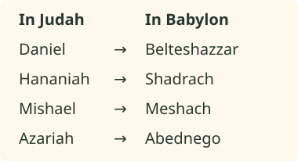

# Daniel 1 — Daniel asks for a ten-day test

**About this chapter**

Four young men from Judah train to serve the king of Babylon.

Daniel asks for different food for the four of them.

God helps them learn what they need to know.

## The king brings young men to his palace

## Daniel 1:1

Jehoiakim was in his third year as king of Judah.

Nebuchadnezzar, king of Babylon, came to Jerusalem.

His army surrounded the city.

## Daniel 1:2

The Lord gave Nebuchadnezzar power over Jehoiakim.

Nebuchadnezzar also took some objects from God’s temple.

He carried the objects to the land of Shinar.

He stored them in the treasure room of his own god’s temple.

## Daniel 1:3

Ashpenaz was in charge of the king’s palace officials.

The king told him to bring in some young Israelites.

They were to come from the royal family and other leading families.

## Daniel 1:4

The king wanted handsome young men without any physical defect.

They needed to know many things and learn quickly.

They needed good judgment to serve in the palace.

Ashpenaz was to teach them the language of the Chaldeans, the people of Babylon.

They would also study what the Chaldeans had written.

## Daniel 1:5

Each day the young men were to receive food and wine from the king’s table.

They would train for three years.

Then they would begin to serve the king.

## Daniel 1:6

Among the young men were four from Judah.

Their names were Daniel, Hananiah, Mishael, and Azariah.

## Daniel 1:7

Ashpenaz gave each of the four a new name.

He named Daniel Belteshazzar and Hananiah Shadrach.

He named Mishael Meshach and Azariah Abednego.

## Daniel asks for vegetables and water

## Daniel 1:8

Daniel decided to stay clean before God.

For him, that meant leaving the king’s food and wine alone.

He asked Ashpenaz to let him do this.

## Daniel 1:9

God moved Ashpenaz to look kindly on Daniel and care about him.

## Daniel 1:10

But Ashpenaz said, “I am afraid of the king.

He chose your food and drink.

What if he sees you looking thinner than the others your age?

The king could have me killed!”

## Daniel 1:11

Ashpenaz had put a guard in charge of the four young men.

Daniel spoke to that guard.

## Daniel 1:12

“Please test the four of us for ten days.

Give us only vegetables to eat and water to drink.

## Daniel 1:13

“Then look at us and the men eating the king’s food.

Decide what to do with us based on what you see.”

## Daniel 1:14

The guard agreed.

He tested them for ten days.

## Daniel 1:15

After ten days the guard saw how the four young men looked.

They looked healthier and better fed than anyone eating the king’s food.

## Daniel 1:16

So the guard kept giving the four young men vegetables.

He stopped giving them the king’s rich food and wine.

## God helps the four men learn

## Daniel 1:17

God helped all four understand many kinds of writing.

He gave them knowledge and wisdom.

Daniel could also understand all kinds of visions and dreams.

A vision is something a person sees that carries a message.

## Daniel 1:18

At the end of the training, Ashpenaz brought the young men before King Nebuchadnezzar.

## Daniel 1:19

The king spoke with them.

None of the others matched Daniel, Hananiah, Mishael, and Azariah.

So the four began to serve the king.

## Daniel 1:20

The king asked them questions that took wisdom and understanding.

He compared their answers with those of people throughout his kingdom who practiced magic or cast spells.

He found the four young men ten times better.

## Daniel 1:21

Daniel stayed there until the first year that Cyrus was king.

**Pause and answer**

What did Daniel ask the guard to give them during the ten days?
