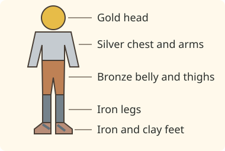

# Daniel 2 — God shows Daniel the king’s dream

**About this chapter**

King Nebuchadnezzar wants someone to tell him what he dreamed and what it means. Daniel asks his friends to pray. God shows Daniel the answer.

## The king asks for two things

## Daniel 2:1

In his second year as king, Nebuchadnezzar had dreams that upset him.

He could no longer sleep.

## Daniel 2:2

He sent for all his advisers who used magic or watched the stars.

They came and stood before him.

## Daniel 2:3

The king said, “I have had a dream.

I am troubled and want to understand it.”

## Daniel 2:4

The men who studied the stars answered in Aramaic, their language.

“May you live forever, O king!

Tell us your dream.

We will explain it.”

## Daniel 2:5

The king replied, “I have made up my mind.

Tell me the dream itself and what it means.

If you cannot, you will be cut to pieces.

Your houses will be torn down.

## Daniel 2:6

If you tell me both, I will give you gifts, rewards, and great honor.

Now tell me my dream and its meaning.”

## Daniel 2:7

Again they said, “Tell your servants the dream.

Then we will explain it.”

## Daniel 2:8

The king said, “You know I have made up my mind.

You are trying to gain time.

## Daniel 2:9

If you cannot tell me my dream, the same punishment awaits you all.

You have agreed to tell me lies and wait for things to change.

Tell me the dream.

Then I will know you can explain it.”

## Daniel 2:10

The advisers replied, “No one on earth can do that!

Even the most powerful kings have never asked advisers like us to do such a thing.

## Daniel 2:11

Only the gods could give you this answer, and they do not live among people.”

## Daniel 2:12

The king became furious.

He ordered the deaths of all the wise men in Babylon.

## Daniel 2:13

The order went out.

Guards looked for Daniel and his friends to kill them too.

## Daniel asks his friends to pray

## Daniel 2:14

Arioch commanded the king’s guards.

When he went out to kill the wise men, Daniel chose his words carefully.

## Daniel 2:15

Daniel asked, “Why has the king given such a harsh order?” Arioch told him what had happened.

## Daniel 2:16

Daniel went to the king and asked for time to explain the dream.

## Daniel 2:17

He went home and told his friends Hananiah, Mishael, and Azariah what had happened.

## Daniel 2:18

“Ask the God of heaven to show us mercy,” Daniel urged them.

They needed God to show them the secret so they would not die with the other wise men.

## Daniel 2:19

That night God showed Daniel the secret in a vision.

Daniel praised the God of heaven.

## Daniel 2:20

He said, “Praise God’s name forever!

Wisdom and power belong to him.

## Daniel 2:21

He changes times and seasons.

He takes kings from their thrones and puts others in their place.

He gives wisdom and helps people understand.

## Daniel 2:22

He shows us things that are deeply hidden.

He knows what is in the dark.

Light lives with him.

## Daniel 2:23

God of my ancestors, I thank you and praise you.

You gave me wisdom and strength.

You answered our prayer and showed us the king’s dream.”

**Pause and answer**

Whom did Daniel thank for showing him the dream?

## Daniel goes before the king

## Daniel 2:24

Daniel went to Arioch and said, “Spare the wise men of Babylon!

Take me to the king.

I will explain the dream.”

## Daniel 2:25

Arioch hurried Daniel to the king.

“I have found someone among the people taken from Judah.

He can explain your dream.”

## Daniel 2:26

Daniel also had the name Belteshazzar.

The king asked him, “Can you tell me what I dreamed and what it means?”

## Daniel 2:27

Daniel answered, “No adviser can tell you this secret by wisdom or magic.

## Daniel 2:28

But God in heaven makes secrets known.

King Nebuchadnezzar, he has shown you what will happen in days to come.

Let me tell you what you saw in your sleep.

## Daniel 2:29

As you lay in bed, you wondered about the future.

God, who makes secrets known, showed you what will happen.

## Daniel 2:30

I have no greater wisdom than anyone else.

God showed me this so you could understand the dream and the thoughts that troubled you.

## A stone strikes a statue

## Daniel 2:31

In your dream an enormous statue stood before you.

It shone so brightly that the sight filled you with awe.

## Daniel 2:32

Its head was pure gold.

Its chest and arms were silver.

Its belly and upper legs were bronze.

## Daniel 2:33

Its lower legs were iron.

Its feet were a mixture of iron and clay.

## Daniel 2:34

You saw a stone break free.

No human hands had cut it out.

It struck the statue’s feet and crushed them.

## Daniel 2:35

All the iron, clay, bronze, silver, and gold broke into little pieces.

They were like the dry husks farmers separate from grain in summer.

The wind blew them away.

Nothing remained of the statue.

The stone grew into a great mountain that filled the earth.

## Daniel explains the dream

## Daniel 2:36

That was your dream.

Now we will tell you what it means.

## Daniel 2:37

You are a king over kings.

The God of heaven gave you your kingdom, power, strength, and honor.

## Daniel 2:38

He gave you authority over people, wild animals, and birds, wherever they live.

You are the head of gold.

## Daniel 2:39

After you, another kingdom will rise.

It will be less great than yours.

Then a third kingdom, pictured by the bronze, will rule the whole earth.

## Daniel 2:40

A fourth kingdom will be as strong as iron.

It will crush the others as iron crushes things to pieces.

## Daniel 2:41

The feet and toes were partly baked clay and partly iron.

That kingdom will be divided.

It will still have some of the strength of iron.

## Daniel 2:42

The iron and clay toes show that parts of the kingdom will be strong.

Other parts will break easily.

## Daniel 2:43

Its peoples will mix with one another.

Yet they will fail to hold together, just as iron and clay do.

## Daniel 2:44

While those kings rule, the God of heaven will set up a kingdom.

No one will destroy it or take it over.

It will break those kingdoms to pieces and outlast them all.

God’s kingdom will stand forever.

## Daniel 2:45

You saw a stone come out of the mountain without anyone cutting it.

It broke every part of the statue.

The great God has shown you what will happen.

The dream is true.

You can trust its meaning.”

**Pause and answer**

Which kingdom does Daniel say will last forever?

## The king gives Daniel new work

## Daniel 2:46

Nebuchadnezzar bowed with his face to the ground to honor Daniel.

He ordered people to bring Daniel an offering and incense, which makes fragrant smoke.

## Daniel 2:47

The king told Daniel, “Truly your God is the God of gods and Lord of kings.

He makes secrets known.

That is how you could tell me this secret.”

## Daniel 2:48

The king gave Daniel many fine gifts and a higher position.

He made Daniel ruler over the province of Babylon and leader of all its wise men.

## Daniel 2:49

At Daniel’s request, the king gave Daniel’s three friends work managing the province.

Their Babylonian names were Shadrach, Meshach, and Abednego.

Daniel stayed at the king’s court.
