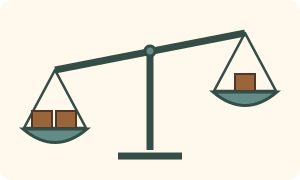

# Daniel 5 — Daniel reads the writing on the wall

**About this chapter**

At a feast, King Belshazzar sees a hand writing on the palace wall. His advisers cannot explain the words. The queen remembers someone who can help.

## A hand writes on the wall

## Daniel 5:1

King Belshazzar invited a thousand nobles to a great feast.

The nobles were important people in his kingdom.

Belshazzar drank wine with them.

## Daniel 5:2

As the wine took effect, Belshazzar called for the gold and silver cups.

His father Nebuchadnezzar had taken them from the temple in Jerusalem.

Belshazzar wanted to share them with his nobles, his wives, and his concubines.

Concubines were women who lived with the king as his partners.

## Daniel 5:3

Servants brought the gold cups from God’s house in Jerusalem.

The king and his guests drank from them.

## Daniel 5:4

As they drank wine, they praised gods made of gold and silver, bronze and iron, wood and stone.

## Daniel 5:5

Suddenly the fingers of a human hand appeared.

The king watched the hand write on the smooth wall near the palace lampstand.

## Daniel 5:6

His face turned pale.

He was so frightened that his legs gave way and his knees knocked together.

## Daniel 5:7

He shouted for the advisers who used magic or looked for signs in the stars and elsewhere.

“Read this writing and tell me what it means!

Whoever does this will wear purple clothes and a gold chain.

He will be the third highest ruler in my kingdom.”

## Daniel 5:8

All the wise men came in.

None could read the writing or explain it.

## Daniel 5:9

Belshazzar grew even more afraid.

His face turned paler still.

His nobles did not know what to think.

## The queen tells the king about Daniel

## Daniel 5:10

The queen heard the cries and entered the feast hall.

“May you live forever, O king!

Take heart.

You need not turn pale with fear.

## Daniel 5:11

A man in your kingdom has the spirit of the holy gods in him.

In your father’s day he showed understanding and wisdom like that of the gods.

Your father Nebuchadnezzar put him in charge of all his wise men.

## Daniel 5:12

His name is Daniel.

Your father called him Belteshazzar.

He has an extraordinary spirit and understands difficult things.

He explains dreams, answers riddles, and solves problems.

Call Daniel, and he will explain the writing.”

## Daniel 5:13

They brought Daniel to Belshazzar.

The king asked, “Are you Daniel, one of the people my father brought here from Judah?

## Daniel 5:14

I hear the spirit of the gods is in you.

People tell me you have understanding and unusual wisdom.

## Daniel 5:15

My advisers came to read these words to me.

None could tell me what they mean.

## Daniel 5:16

I hear you can explain such things and solve hard problems.

Read the words and tell me what they mean.

I will give you purple clothes and a gold chain.

You will be the third highest ruler in my kingdom.”

**Pause and answer**

Who told the king to send for Daniel?

## Daniel reminds Belshazzar what happened to his father

## Daniel 5:17

Daniel answered, “Keep your gifts.

Give your rewards to someone else.

I will still read the words and explain them to you.

## Daniel 5:18

King Belshazzar, God Most High gave your father Nebuchadnezzar power to rule.

God gave him greatness, glory, and honor.

## Daniel 5:19

Because of this power, people of every nation and language trembled before him.

He decided who would live and who would die.

He honored anyone he chose and brought others low.

## Daniel 5:20

Then he became proud and stubborn.

He lost his throne and his honor.

## Daniel 5:21

He had to live away from people.

His mind became like an animal’s.

He lived with wild donkeys and ate grass like an ox.

Dew soaked his body.

At last he admitted that God Most High rules over human kingdoms.

God chooses who will rule them.

## Daniel 5:22

You are his son.

You knew all this, Belshazzar.

Yet you held on to your pride.

## Daniel 5:23

You set yourself against the Lord of heaven.

You and your guests drank wine from the cups taken from his house.

You praised gods made of metal, wood, and stone.

Those gods cannot see, hear, or understand.

The God who gives you every breath holds your whole life in his hands.

You gave him no honor.

## Daniel 5:24

That is why God sent the hand that wrote these words.

## Daniel explains the words

## Daniel 5:25

This is what the hand wrote.

MENE, MENE, TEKEL, PARSIN.

## Daniel 5:26

MENE means ‘numbered.’ God has counted the days you would rule.

Now he has brought your rule to an end.

## Daniel 5:27

TEKEL means ‘weighed.’ Think of scales that weigh something to see if it is heavy enough.

God has weighed you and found that you fall short.

## Daniel 5:28

The word PARSIN has a form called PERES.

It means ‘divided.’ Your kingdom is divided.

God has given it to the Medes and Persians.”

## Babylon has a new king

## Daniel 5:29

Belshazzar gave the order.

His servants dressed Daniel in purple and put a gold chain around his neck.

They announced that Daniel was the third highest ruler in the kingdom.

## Daniel 5:30

That very night someone killed Belshazzar, king of the Chaldeans.

## Daniel 5:31

Darius the Mede took over the kingdom.

He was sixty-two years old.

**Pause and answer**

What did MENE tell Belshazzar about his time as king?
