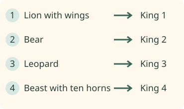

# Daniel 7 — Daniel sees four beasts and a kingdom that lasts

**About this chapter**

Daniel dreams about four strange beasts. Then he sees a court where God judges rulers. Someone in the dream helps Daniel understand what he saw.

## Four beasts rise from the sea

## Daniel 7:1

Belshazzar was in his first year as king of Babylon.

Daniel lay in bed and dreamed.

He saw visions, pictures that passed through his mind.

Daniel wrote down what he saw.

Here is his account.

## Daniel 7:2

That night I saw winds from all four directions.

They stirred the great sea into waves.

## Daniel 7:3

Four great beasts came up from the sea.

Each looked different.

## Daniel 7:4

The first looked like a lion with eagle’s wings.

As I watched, something tore off its wings and lifted it up.

It stood on two feet like a man.

It received a human mind.

## Daniel 7:5

The second looked like a bear, raised up on one side.

It held three ribs between its teeth.

A voice told it, “Get up!

Eat your fill of meat!”

## Daniel 7:6

The third looked like a leopard.

It had four bird wings on its back and four heads.

It received power to rule.

## Daniel 7:7

The fourth beast terrified me.

It was different from the others and terribly strong.

It ate and crushed with huge iron teeth.

It stamped on everything left over.

It had ten horns.

## Daniel 7:8

As I studied the horns, a little horn grew among them.

Three of the first horns were pulled out by the roots.

The little horn had eyes like human eyes.

Its mouth spoke proud, boastful words.

## The court sits in judgment

## Daniel 7:9

I saw thrones set in place.

The Ancient of Days sat down.

This name describes God, who has always lived.

His clothes were white as snow.

His hair looked like pure wool.

Flames covered his throne and its wheels.

## Daniel 7:10

A river of fire flowed out from before him.

Thousands upon thousands served him.

Countless others stood before him.

The court sat down to judge.

The books were opened.

## Daniel 7:11

I kept watching because the horn was still boasting.

I saw the fourth beast die.

Its body was destroyed in the blazing fire.

## Daniel 7:12

The other beasts lost their power to rule.

They could still live for a while.

## Daniel 7:13

That night I saw someone like the Son of Man.

He came with the clouds of heaven.

He came near the Ancient of Days.

Those there brought him before God.

## Daniel 7:14

He received honor and the power to rule as king.

People of every nation and language would serve him.

His rule will last forever.

No one will destroy his kingdom.

## Daniel asks what the beasts mean

## Daniel 7:15

What I saw upset me deeply.

The visions frightened me.

## Daniel 7:16

I went to someone standing there.

I asked, “What does all this really mean?” He explained the vision to me.

## Daniel 7:17

He said, “The four great beasts stand for four kings.

They will rise to power on earth.

## Daniel 7:18

But the holy people who belong to God Most High will receive the kingdom.

It will be theirs forever and ever.”

**Pause and answer**

What do the four beasts stand for?

## Daniel asks about the fourth beast

## Daniel 7:19

I wanted to understand the fourth beast.

It frightened me more than the others.

It ate and crushed with iron teeth and bronze claws.

Then it stamped on whatever remained.

## Daniel 7:20

I also wanted to understand its ten horns.

Another horn had grown, and three had fallen before it.

The new horn looked more powerful than the others.

It had eyes and a mouth that boasted.

## Daniel 7:21

I saw this horn fight against God’s holy people and win.

## Daniel 7:22

Then the Ancient of Days came.

He judged in favor of the holy people of God Most High.

Their time had come to receive the kingdom.

## The cruel ruler loses his power

## Daniel 7:23

The one who explained the vision said, “The fourth beast stands for a fourth kingdom on earth.

It will be different from every other kingdom.

It will swallow up the whole earth, stamp on it, and crush it.

## Daniel 7:24

The ten horns stand for ten kings from this kingdom.

After them, a different king will rise.

He will bring three kings under his rule.

## Daniel 7:25

He will speak against God Most High and wear down God’s holy people.

He will try to change the appointed times and the laws.

The holy people will be under his power for a time, times, and half a time.

## Daniel 7:26

Then the court will sit to judge him.

He will lose his power.

His rule will end forever.

## Daniel 7:27

The holy people of God Most High will receive the greatness and power of all the kingdoms on earth.

God’s kingdom will last forever.

All rulers will serve and obey him.”

## Daniel 7:28

That was the end of the vision.

I, Daniel, was so troubled that my face turned pale.

I kept what I had seen to myself.

**Pause and answer**

What happens to the cruel king’s power when the court judges him?
