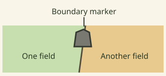

# Deuteronomy 27 — Write the law on stones

**About this chapter**

Moses tells Israel what to do after crossing the Jordan. The people will see the law written on stones and hear the Levites speak it aloud.

## Stones for writing

## Deuteronomy 27:1

Moses and Israel’s elders spoke to the people.

Israel must keep all the commands Moses gave that day.

## Deuteronomy 27:2

Israel would cross the Jordan River into the land the LORD was giving them.

On that day they must set up large stones.

They must cover the stones with plaster.

**Reading help**

Plaster is a soft coating that hardens. It gave the people a surface to write on.

## Deuteronomy 27:3

They must write all the words of the law on those stones.

The LORD had promised their ancestors this rich land.

Moses called it a land flowing with milk and honey.

**Reading help**

“Flowing with milk and honey” means the land had plenty of food.

## Deuteronomy 27:4

After crossing the Jordan, they must set up the stones on Mount Ebal.

There they must cover them with plaster.

**Pause and answer**

Where would Israel set up the plastered stones?

## An altar on Mount Ebal

## Deuteronomy 27:5

They must also build a stone altar there for the LORD.

They must never shape its stones with iron tools.

## Deuteronomy 27:6

They must build the altar with uncut stones.

On it they would give burnt offerings to the LORD.

## Deuteronomy 27:7

There they would also bring peace offerings.

They would eat and celebrate before the LORD their God.

## Deuteronomy 27:8

They must write every word of the law clearly on the stones.

**Pause and answer**

What would the people write on the stones?

## Listen to the LORD

## Deuteronomy 27:9

Moses and the priests from Levi’s tribe spoke to all Israel.

They asked everyone to be quiet and listen.

That day Israel had become the people of the LORD their God.

## Deuteronomy 27:10

So Israel must listen to the LORD and obey him.

They must follow the commands and laws Moses gave them that day.

## Two groups of tribes

## Deuteronomy 27:11

That same day Moses gave the people these instructions.

## Deuteronomy 27:12

After crossing the Jordan, six tribes would stand on Mount Gerizim to bless the people.

They were Simeon, Levi, Judah, Issachar, Joseph and Benjamin.

## Deuteronomy 27:13

Six tribes would stand on Mount Ebal for the curse.

They were Reuben, Gad, Asher, Zebulun, Dan and Naphtali.

**Pause and answer**

Which mountain was the place for the blessing?

## Deuteronomy 27:14

The Levites would speak loudly so all Israel could hear.

**Reading help**

A curse here warns that wrongdoing brings judgment. The people would answer “Amen.” Here that means “We agree.”

## The Levites speak and the people answer

## Deuteronomy 27:15

A curse falls on anyone who secretly sets up an idol they have carved or made from melted metal.

The LORD hates such handmade idols.

All the people would answer, “Amen!”

## Deuteronomy 27:16

A curse falls on anyone who dishonors their father or mother.

All the people would answer, “Amen!”

## Deuteronomy 27:17

A curse falls on anyone who moves a neighbor’s boundary stone.

All the people would answer, “Amen!”

The stone showed where each family’s land ended.

## Deuteronomy 27:18

A curse falls on anyone who lets a blind person lose their way on the road.

All the people would answer, “Amen!”

## Deuteronomy 27:19

A curse falls on anyone who denies justice to a foreigner, a child without a father or a widow.

All the people would answer, “Amen!”

## Warnings about sex within families and with animals

## Deuteronomy 27:20

A curse falls on a man who has sex with his father’s wife.

He has dishonored his father’s marriage.

All the people would answer, “Amen!”

## Deuteronomy 27:21

A curse falls on anyone who has sex with an animal.

All the people would answer, “Amen!”

## Deuteronomy 27:22

A curse falls on a man who has sex with his sister.

This includes a sister who shares only his father or only his mother.

All the people would answer, “Amen!”

## Deuteronomy 27:23

A curse falls on a man who has sex with his wife’s mother.

All the people would answer, “Amen!”

## Warnings about killing and disobedience

## Deuteronomy 27:24

A curse falls on anyone who secretly kills a neighbor.

All the people would answer, “Amen!”

## Deuteronomy 27:25

A curse falls on anyone who takes a bribe to kill an innocent person.

All the people would answer, “Amen!”

**Reading help**

A bribe is a payment someone offers to get another person to do wrong.

## Deuteronomy 27:26

A curse falls on anyone who fails to do what this law says.

All the people would answer, “Amen!”

**Pause and answer**

How would all the people answer the Levites?
