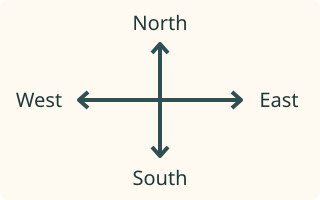

# Deuteronomy 2 — Israel travels past its neighbors

**About this chapter**

Moses remembers the lands Israel passed through. He tells how King Sihon answered Israel’s request to use his road.

## Israel turns north

## Deuteronomy 2:1

Moses remembered how Israel turned back toward the wilderness.

They took the Red Sea road, as the LORD had told Moses.

For many days they traveled around Mount Seir.

## Deuteronomy 2:2

Then the LORD spoke to Moses.

## Deuteronomy 2:3

Israel had spent enough time in those hills.

The LORD told them to turn north.

Point north to show the direction Israel would travel.

## Food and water in Seir

## Deuteronomy 2:4

Moses must tell Israel they would pass through Seir.

Their relatives lived there.

These relatives were the descendants of Esau.

They would fear Israel, so Israel must be careful.

**Reading help**

Descendants are someone’s children, grandchildren, and later family members.

## Deuteronomy 2:5

Israel must avoid starting a fight.

The LORD had given Mount Seir to Esau.

Israel would receive none of it, not even room for one foot.

## Deuteronomy 2:6

Israel must pay Esau’s people with silver for food and water.

## Deuteronomy 2:7

Moses reminded Israel how the LORD had blessed their work.

He had watched over them in the great wilderness.

For 40 years the LORD had been with them.

They had everything they needed.

**Pause and answer**

How would Israel pay for food and water?

## Israel passes Moab

## Deuteronomy 2:8

Israel passed by Esau’s people in Seir.

They left the Arabah road from Elath and Ezion-geber.

They took the road through the Wilderness of Moab.

## Deuteronomy 2:9

The LORD told Moses to leave the Moabites in peace.

Israel must not start a war with them.

The LORD had given Ar to Lot’s descendants.

Israel would receive none of their land.

## Deuteronomy 2:10

The Emites once lived there.

They were a large, powerful people, as tall as the Anakites.

## Deuteronomy 2:11

People counted both the Emites and the Anakites among the Rephaim.

The Moabites called the people who had lived there Emites.

## Deuteronomy 2:12

The Horites once lived in Seir.

Esau’s descendants drove them out and destroyed them.

Esau’s descendants then settled there.

Israel did the same in the land the LORD gave them.

## Israel crosses the stream

## Deuteronomy 2:13

The LORD told Israel to cross the Brook of Zered.

So the people crossed the stream.

## Deuteronomy 2:14

The journey from Kadesh-barnea to that stream took 38 years.

By then, all the fighting men of that generation had died.

The LORD had sworn this would happen.

**Pause and answer**

How long did the journey to the stream take?

## Deuteronomy 2:15

The LORD worked against those men until every one of them had died.

None of that generation of fighting men remained in the camp.

## Deuteronomy 2:16

All the fighting men from that generation were dead.

## The land of the Ammonites

## Deuteronomy 2:17

Then the LORD spoke to Moses again.

## Deuteronomy 2:18

That day Israel would cross Moab’s border at Ar.

## Deuteronomy 2:19

Israel would come near the Ammonites.

The LORD told Israel to leave them in peace.

He had given their land to Lot’s descendants.

Israel would receive none of it.

**Pause and answer**

Whose land must Israel leave alone near Ar?

## People who lived there before

## Deuteronomy 2:20

People also called this the land of the Rephaim.

The Rephaim used to live there.

The Ammonites called them Zamzummites.

## Deuteronomy 2:21

They were a large, powerful people, as tall as the Anakites.

But the LORD destroyed them before the Ammonites.

The Ammonites drove them out and settled there.

## Deuteronomy 2:22

The LORD had done the same for Esau’s descendants in Seir.

The LORD destroyed the Horites before them.

Esau’s people drove out the Horites and still lived there when Moses spoke.

## Deuteronomy 2:23

The Avvim once lived in villages as far as Gaza.

People from Caphtor, called Caphtorites, destroyed the Avvim.

The Caphtorites settled in their place.

## The LORD speaks about Sihon

## Deuteronomy 2:24

The LORD told Israel to cross the Arnon Valley.

Sihon was the Amorite king of Heshbon.

The LORD was giving Israel power over Sihon and his land.

Israel was to fight Sihon and begin taking the land.

**Reading help**

To give a king into someone’s hand means to give that person power over the king.

## Deuteronomy 2:25

That day the LORD would make nations everywhere fear Israel.

When they heard about Israel, they would shake with fear.

## Moses asks to use the road

## Deuteronomy 2:26

From the Wilderness of Kedemoth, Moses sent messengers to King Sihon.

They brought Sihon an offer of peace.

## Deuteronomy 2:27

Moses asked Sihon to let Israel pass through his land.

The people would stay on the main road the whole way.

## Deuteronomy 2:28

They offered silver for food and drinking water.

They only wanted to walk through the land.

**Pause and answer**

Which road did Moses promise to follow?

## Deuteronomy 2:29

Esau’s people in Seir and the Moabites in Ar had helped them this way.

Israel wanted to cross the Jordan River.

Beyond it lay the land the LORD was giving them.

## Deuteronomy 2:30

King Sihon refused to let Israel pass.

The LORD had made Sihon stubborn so Israel could defeat him.

Moses reminded Israel that this had happened.

## Israel defeats Sihon

## Deuteronomy 2:31

The LORD told Moses he had begun giving Israel Sihon and his land.

Israel could now begin taking the land for their own.

## Deuteronomy 2:32

Sihon and his whole army came to fight Israel at Jahaz.

## Deuteronomy 2:33

The LORD gave Israel victory over Sihon.

Israel defeated the king, his sons, and his whole army.

## Deuteronomy 2:34

Israel took all Sihon’s cities.

They killed everyone in each city, including women and children.

No one survived.

## Deuteronomy 2:35

Israel kept the animals for themselves.

They also took goods from the cities they had captured.

## Deuteronomy 2:36

Aroer stood on the edge of the Arnon Valley.

There was also a city down in the valley.

From there to Gilead, no city wall could keep Israel out.

The LORD gave Israel every one of those cities.

## Deuteronomy 2:37

Israel stayed away from the Ammonites’ land.

They stayed away from the Jabbok River banks and the hill towns.

They kept away from every place the LORD had forbidden.

**Pause and answer**

Which river did Israel stay away from?
