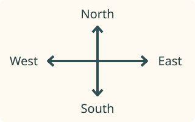

# Deuteronomy 3 — Moses prepares Joshua to lead

**About this chapter**

Moses remembers how Israel received land east of the Jordan River. He tells who will lead Israel across the river.

## Og comes to fight Israel

## Deuteronomy 3:1

Moses remembered how Israel took the road to Bashan.

Og, king of Bashan, came out with his whole army.

They came to fight Israel at Edrei.

## Deuteronomy 3:2

The LORD told Moses he need not fear Og.

The LORD was giving Israel power over Og, his people and his land.

Israel was to do what they had done to Sihon.

Sihon was the Amorite king who lived in Heshbon.

## Deuteronomy 3:3

The LORD gave Israel victory over Og and his army.

Israel killed them all.

## Israel takes the cities

## Deuteronomy 3:4

Israel took all 60 of Og’s cities.

These cities covered the whole region of Argob in Bashan.

## Deuteronomy 3:5

High walls protected all these cities.

Bars held their gates shut.

There were also many villages without walls.

## Deuteronomy 3:6

Israel destroyed the cities as they had done in Sihon’s kingdom.

They killed the men, women and children in every city.

## Deuteronomy 3:7

Israel kept the animals and the goods from the cities.

## The land of the two kings

## Deuteronomy 3:8

Israel took land east of the Jordan from the two Amorite kings.

It stretched from the Arnon Valley to Mount Hermon.

## Deuteronomy 3:9

The Sidonians called that mountain Sirion.

The Amorites called it Senir.

**Pause and answer**

What did the Amorites call Mount Hermon?

## Deuteronomy 3:10

Israel took every city on the high, flat land.

They took all of Gilead and all of Bashan.

Og’s land in Bashan reached as far as Salecah and Edrei.

## Deuteronomy 3:11

Og had been the last of the Rephaim.

His iron bed was nine cubits long and four cubits wide.

In Moses’ time it was still in Rabbah, a city of the Ammonites.

**Reading help**

A cubit was a measure of length, from elbow to fingertip.

## Moses gives land to the tribes

## Deuteronomy 3:12

Moses gave land to the tribes of Reuben and Gad.

They received land beyond Aroer along the Arnon Valley.

They also received half the hills of Gilead and the cities there.

## Deuteronomy 3:13

Moses gave the rest of Gilead to half the tribe of Manasseh.

They also received all of Bashan, Og’s kingdom.

People once called this whole area, including Argob, the land of the Rephaim.

## Deuteronomy 3:14

Jair came from Manasseh’s family.

He took Argob up to the border of the Geshurites and Maacathites.

Jair gave Bashan a name based on his own name, Havvoth-jair.

People still used that name when Moses spoke.

## The borders of the land

## Deuteronomy 3:15

Moses gave land in Gilead to Machir.

## Deuteronomy 3:16

The land of Reuben and Gad stretched from Gilead to the Arnon Valley.

One border ran down the middle of that valley.

Their land also reached the Jabbok River, the Ammonites’ border.

## Deuteronomy 3:17

The Jordan River formed a border in the Arabah.

It ran from Chinnereth to the Sea of the Arabah.

Another name for that sea was the Salt Sea.

The slopes of Pisgah lay to the east.

## The fighting men must help the other tribes

## Deuteronomy 3:18

Moses reminded these tribes that the LORD had given them this land.

Their fighting men must cross the Jordan ready for battle.

They must go ahead of the other Israelites.

## Deuteronomy 3:19

Their wives and children could stay in the cities Moses gave them.

Their many animals could stay there too.

## Deuteronomy 3:20

The men must wait until the LORD gave the other tribes rest too.

First the other tribes must receive their land across the Jordan.

Then the men could go back to their own land.

**Pause and answer**

When could the fighting men return home?

## Moses speaks to Joshua

## Deuteronomy 3:21

Moses told Joshua to remember what he had seen.

Joshua had seen what the LORD did to both kings.

The LORD would do the same to the kingdoms Joshua would enter.

## Deuteronomy 3:22

Moses told Joshua he need not fear those kingdoms.

The LORD their God would fight for Israel.

## Moses asks to cross the Jordan

## Deuteronomy 3:23

Moses also begged the LORD for something.

## Deuteronomy 3:24

Moses said the Lord GOD had begun to show him his greatness and power.

What god in heaven or on earth could do such mighty things?

## Deuteronomy 3:25

Moses asked to cross the Jordan and see the good land.

He wanted to see the beautiful hills and Lebanon.

**Pause and answer**

What did Moses ask the LORD to let him do?

## Deuteronomy 3:26

Moses said the LORD was angry with him because of the people.

The LORD refused his request.

He told Moses to stop asking about it.

## Joshua will lead the people

## Deuteronomy 3:27

The LORD told Moses to climb to the top of Pisgah.

Moses must look west, north, south and east.

He could see the land, but he would never cross the Jordan.

Point to each direction Moses was to look.

## Deuteronomy 3:28

The LORD told Moses to give Joshua the work of leading Israel.

Moses must encourage Joshua and help him grow strong.

Joshua would lead the people across the river.

He would help them receive the land Moses would see.

**Pause and answer**

Who would lead the people across the Jordan?

## Deuteronomy 3:29

So Israel stayed in the valley across from Beth-peor.
