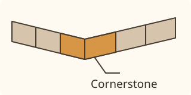

# Ephesians 2 — Christ brings us into one family

**About this chapter**

Paul reminds the believers how God gave them new life.

He explains how people who were once enemies can belong to one family.

## How we once lived

## Ephesians 2:1

You were dead because of your sins and the wrong you did.

**Help with these words**

Paul is writing to people who were physically alive.

He calls life cut off from God a kind of death.

## Ephesians 2:2

That was how you once lived.

You followed the ways of this world.

You followed the ruler of the powers of the air.

That spirit still works in those who disobey God.

## Ephesians 2:3

All of us once lived that way.

We did whatever our desires and thoughts urged us to do.

By nature, we deserved God’s anger like everyone else.

**Pause and answer**

Whose ways did the believers once follow?

## God gives us life with Christ

## Ephesians 2:4

But God has great mercy.

He loves us deeply.

## Ephesians 2:5

Even when sin held us in death, God gave us life with Christ.

God saved you because of his grace.

## Ephesians 2:6

God raised us up with Christ.

Because we belong to Christ Jesus, God seated us with him in heaven.

## Ephesians 2:7

In the ages to come, God will show how great his grace is.

People will see the kindness he has shown us in Christ Jesus.

**Pause and answer**

What did God give us when sin held us in death?

## God’s gift and the good we can do

## Ephesians 2:8

God saved you by grace through faith.

You could never do this for yourselves.

It is God’s gift to you.

**Help with these words**

Grace is kindness God gives freely.

Faith means trusting him.

## Ephesians 2:9

No one earns this gift by doing good works.

So no one can boast about earning it.

## Ephesians 2:10

We are God’s own work.

God created us in Christ Jesus to do good.

Long ago he prepared those good things for us to do each day.

**Pause and answer**

What did God prepare for us to do?

## Remember when you were far away

## Ephesians 2:11

Remember that you were born Gentiles.

People who call themselves “the circumcised” called you “the uncircumcised.”

They were speaking about a mark people make on the body.

**Help with these words**

Gentiles are people who are not Jewish.

Circumcision was a sign of God’s agreement with his people Israel.

## Ephesians 2:12

At that time you lived apart from Christ.

You did not belong to the people of Israel.

You had no share in the agreements that carried God’s promise.

You lived in this world without hope and without God.

## Ephesians 2:13

Once you were far away.

Now you belong to Christ Jesus.

Because Christ shed his blood, you have come near.

**Pause and answer**

What brought people who were far away near to God?

## Christ makes peace

## Ephesians 2:14

Christ himself is our peace.

He made Jews and Gentiles one people.

Their hatred was like a wall between them.

Christ tore that wall down.

## Ephesians 2:15

In his own body, Christ ended the law with its commands and rules.

He did this to make the two peoples one new people in himself.

That is how he made peace.

## Ephesians 2:16

Through his death on the cross, Christ brought both peoples back to God in one body.

At the cross he put their hatred to death.

## Ephesians 2:17

Christ came and announced peace to you who were far away.

He announced peace to those who were near too.

## Ephesians 2:18

Through Christ, both peoples can come to the Father.

The same Spirit brings us to him.

**Pause and answer**

Who can come to the Father through Christ?

## A home where God lives

## Ephesians 2:19

So you have a home here now.

You are fellow citizens with God’s people.

You belong to God’s family.

## Ephesians 2:20

Think of a building.

The apostles and prophets are its foundation.

Christ Jesus himself is its cornerstone.

**Help with these words**

A foundation supports a building from below.

A cornerstone guides how the walls fit together.

In Paul’s picture, the building is the people who belong to Christ.

## Ephesians 2:21

Christ joins every part of this building together.

In him it grows into a holy temple.

## Ephesians 2:22

You too belong to Christ.

God is building you together into a home where he lives by his Spirit.

**Pause and answer**

Who is the cornerstone in Paul’s picture?
