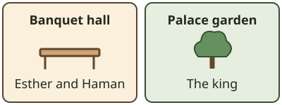

# Esther 7 — Esther asks the king to spare her people

**About this chapter**

At the second feast, Esther tells the king that her own life is in danger. Haman is there to hear her answer.

## Esther makes her request

## Esther 7:1

The king and Haman came to Queen Esther’s feast.

## Esther 7:2

This was the second day they had eaten together.

As they drank wine, the king asked Esther again.

“Queen Esther, what do you want me to give you?

I will give you even half my kingdom.”

## Esther 7:3

Esther answered, “My king, if you are pleased with me, please let me live.

Please let my people live too.

## Esther 7:4

“Someone has sold my people and me to our deaths.

They plan to kill every one of us.

If they had sold us as slaves, I would have kept quiet.

I would not have troubled you about that.”

**Pause and answer**

Whose lives did Esther ask the king to spare?

## Esther names the enemy

## Esther 7:5

King Xerxes asked Esther, “Who planned to do this?

Where is that person?”

## Esther 7:6

Esther answered, “Our enemy is this wicked man, Haman!”

Haman stood shaking with fear before the king and queen.

**Pause and answer**

Whom did Esther name as the enemy?

## The king goes into the garden

## Esther 7:7

The king was furious.

He left his wine and went into the palace garden.

Haman knew the king meant to punish him severely.

He stayed in the banquet hall and begged Esther to spare his life.

## Esther 7:8

Esther was resting on a couch in the banquet hall.

As the king returned from the garden, Haman fell onto her couch.

The king cried out, “Would he attack the queen here in my own palace?”

As soon as he spoke, the attendants covered Haman’s face.

**Pause and answer**

Why did Haman stay behind with Esther?

## Harbonah speaks up

## Esther 7:9

Harbonah, one of the king’s attendants, spoke up.

“Haman had gallows built at his house for Mordecai.

They stand fifty cubits high, about twenty-three metres.

Mordecai is the man whose report saved your life.”

The king ordered his attendants to hang Haman there.

## Esther 7:10

The attendants hanged Haman on the gallows he had prepared for Mordecai.

Then the king’s anger eased.

**Pause and answer**

For whom had Haman built the gallows?
