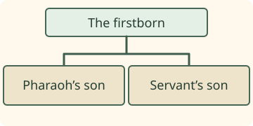

# Exodus 11 — Moses warns Pharaoh about midnight

**About this chapter**

The LORD tells Moses that one more plague will come to Egypt.

Moses warns Pharaoh about what will happen that night.

## The LORD tells Moses what to expect

## Exodus 11:1

The LORD told Moses, “I will send one more plague on Pharaoh and Egypt.

After that, Pharaoh will let you go.

He will even drive all of you out of Egypt.

## Exodus 11:2

Speak to the people now. Tell both men and women to ask their neighbors for things made of silver and gold.”

## Exodus 11:3

The LORD made the Egyptians look kindly on the Israelites.

Pharaoh’s officials and the people of Egypt had great respect for Moses.

**Pause and answer**

What did the LORD tell the Israelites to ask their neighbors for?

## Moses gives Pharaoh the warning

## Exodus 11:4

Moses said, “The LORD says, ‘About midnight I will go throughout Egypt.

## Exodus 11:5

Every firstborn son in Egypt will die.

This includes the firstborn of Pharaoh on his throne.

It includes the firstborn of the servant girl who grinds grain by hand.

The firstborn of all the cattle will die too.

Firstborn means the oldest child. Even the firstborn of the cattle were included.

**Reading help**

A firstborn son is the son born first. Pharaoh was the king. The servant used a small mill to grind grain into flour.

## Exodus 11:6

People will cry out across Egypt.

No one has ever heard a cry like it.

No one will ever hear such a cry again.

## Exodus 11:7

But among the Israelites, not even a dog will growl at a person or an animal.’

Then you will know that the LORD treats Egypt and Israel differently.

## Exodus 11:8

All these officials of yours will come and bow before me.

They will say, ‘Go! Take everyone who follows you!’

After that, I will leave.” Moses was very angry as he left Pharaoh.

| Place | What Moses said people would hear |
| --- | --- |
| Across Egypt | A great cry of grief |
| Among the Israelites | Not even a dog growling at a person or an animal |

**Pause and answer**

Who did Moses say would ask him to leave?

## Pharaoh still refuses to listen

## Exodus 11:9

The LORD told Moses, “Pharaoh will refuse to listen to you.

So I will show more of my wonders in Egypt.”

## Exodus 11:10

Moses and Aaron had shown Pharaoh all these wonders.

But the LORD hardened Pharaoh’s heart.

Pharaoh still refused to let the Israelites leave his land.

**Pause and answer**

What did Pharaoh refuse to let the Israelites do?
