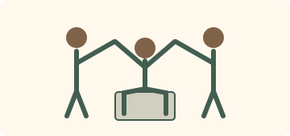

# Exodus 17 — Water from a rock and help on a hill

**About this chapter**

The Israelites need water at Rephidim. Later an army attacks their camp. Moses takes his walking stick up a hill.

## The camp has no water

## Exodus 17:1

All the Israelites left the Desert of Sin.

The LORD led them from place to place.

They camped at Rephidim.

There was no water to drink.

## Exodus 17:2

The people argued with Moses.

“Give us water to drink!” they said.

Moses asked, “Why are you arguing with me?

Why are you testing the LORD?”

## Exodus 17:3

The people were thirsty.

They complained to Moses, “Why did you bring us out of Egypt?

Did you bring us here to die of thirst?

Our children and our animals need water too!”

## Exodus 17:4

Moses called to the LORD for help.

“What shall I do with these people?

Soon they will throw stones at me to kill me!”

**Pause and answer**

What did the people ask Moses to give them?

## Water comes from the rock

## Exodus 17:5

The LORD told Moses, “Walk ahead of the people.

Take some of Israel’s leaders with you.

Take the walking stick you used to strike the Nile River.

## Exodus 17:6

I will stand before you by the rock at Horeb.

Strike the rock.

Water will come out for the people to drink.”

Moses struck the rock while the leaders watched.

## Exodus 17:7

Moses named the place Massah and Meribah.

The Israelites had argued with Moses there.

They had tested the LORD by asking, “Is the LORD here with us or not?”

**Reading help**

Massah means “testing.” Meribah means “arguing.” The names help people remember what happened there.

**Pause and answer**

Who watched Moses strike the rock?

## Joshua goes to fight

## Exodus 17:8

Then the Amalekites came to Rephidim.

They attacked the Israelites there.

## Exodus 17:9

Moses told Joshua, “Choose some of our men.

Go out and fight the Amalekites.

Tomorrow I will stand on top of the hill.

I will hold God’s walking stick in my hand.”

## Exodus 17:10

Joshua did what Moses said.

Joshua fought the Amalekites.

Moses, Aaron and Hur went up the hill.

**Pause and answer**

Who went up the hill with Moses?

## Aaron and Hur help Moses

## Exodus 17:11

When Moses held his hands up, Israel was winning.

When Moses lowered his hands, the Amalekites were winning.

## Exodus 17:12

Moses grew tired from holding his hands up.

Aaron and Hur brought a stone for him to sit on.

One stood on each side of Moses.

They held his hands up until the sun went down.

Moses sits on the stone. One helper stands on each side.

**Picture the hilltop**

| On one side | In the middle | On the other side |
| --- | --- | --- |
| One helper holds up a hand. | Moses sits on a stone. | The other helper holds up a hand. |

## Exodus 17:13

So Joshua and his men defeated the Amalekite army with their swords.

**Pause and answer**

How did Aaron and Hur help when Moses grew tired?

## Moses writes down what happened

## Exodus 17:14

The LORD told Moses, “Write this on a scroll to help people remember.

Say these words aloud to Joshua.

I will make the memory of Amalek disappear from the whole earth.”

**Reading help**

A scroll is a long sheet for writing. People roll it up to store it.

## Exodus 17:15

Moses built an altar.

He called it “The LORD Is My Banner.”

**Reading help**

An altar is a place to worship God. A banner is a flag people gather around. The altar’s name points to the LORD as Israel’s leader.

## Exodus 17:16

Moses said, “Someone raised a hand toward the LORD’s throne.

The LORD will fight Amalek generation after generation.”

**Pause and answer**

Who needed to hear the words Moses wrote down?
