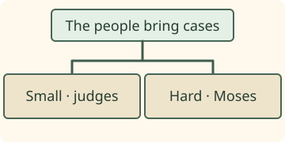

# Exodus 18 — Jethro helps Moses share the work

**About this chapter**

Jethro visits Moses and sees people waiting all day. He shows Moses how other leaders can help.

## Moses’ family comes to visit

## Exodus 18:1

Jethro was the father of Moses’ wife.

He was a priest in Midian.

Jethro heard what God had done for Moses and Israel.

He heard how the LORD had led Israel out of Egypt.

## Exodus 18:2

Earlier, Moses had sent his wife Zipporah back to Jethro.

Jethro had welcomed his daughter home.

## Exodus 18:3

Her two sons had come with her.

Moses had named one son Gershom.

Moses said, “I have lived as a stranger in another land.”

## Exodus 18:4

Moses had named his other son Eliezer.

Moses said, “My father’s God helped me.

He saved me from Pharaoh’s sword.”

**Reading help**

The names help tell the family’s story. Gershom reminds Moses of being a stranger. Eliezer reminds Moses that God helped him.

## Exodus 18:5

Jethro came to visit Moses in the desert.

Zipporah and the boys came with him.

Moses had set up camp at the mountain of God.

## Exodus 18:6

Jethro sent Moses a message.

“I am coming to see you.

I am bringing your wife and her two sons.”

**Pause and answer**

Who came with Jethro to visit Moses?

## Jethro hears how God helped Israel

## Exodus 18:7

Moses went out to meet Jethro.

Moses bowed down and kissed him.

They greeted each other and went into the tent.

## Exodus 18:8

Moses told Jethro what the LORD had done to Pharaoh and the Egyptians to help Israel.

Moses described the troubles the people faced on the way.

He told Jethro how the LORD had rescued them.

## Exodus 18:9

Jethro was glad to hear what the LORD had done for Israel.

The LORD had saved the people from the Egyptians.

## Exodus 18:10

Jethro said, “Praise the LORD!

He saved you from Pharaoh and the Egyptians.

He rescued the people from Egypt’s power.

## Exodus 18:11

The Egyptians thought they could treat Israel any way they liked.

Yet the LORD rescued Israel.

Now I know the LORD is greater than all other gods.”

## Exodus 18:12

Jethro brought God a burnt offering and other sacrifices.

Aaron and all Israel’s elders came to Jethro.

Together they ate bread in God’s presence.

**Reading help**

A sacrifice is a gift offered to God. A burnt offering was a gift burned on an altar. The elders were leaders of Israel.

**Pause and answer**

What made Jethro glad?

## People wait all day

## Exodus 18:13

The next day Moses sat down to serve as judge.

People stood around Moses from morning until evening.

## Exodus 18:14

Jethro saw what Moses was doing.

He asked, “Why do you do this for the people?

Why do you sit here as the only judge?

The people stand around you all day.”

## Exodus 18:15

Moses answered, “People come to me to ask what God wants.

## Exodus 18:16

When two people disagree, they come to me.

I decide between them.

I explain God’s rules and laws to them.”

**Pause and answer**

Why did people come to Moses?

## Jethro gives Moses advice

## Exodus 18:17

Jethro told Moses, “This way of working is no good.

## Exodus 18:18

You will wear yourself out.

The people will wear themselves out too.

This is too much work for one person.

## Exodus 18:19

Listen to my advice.

May God be with you.

Speak to God for the people.

Bring their problems to God.

## Exodus 18:20

Teach the people God’s rules and laws.

Show them how to live.

Show them what work to do.

**Pause and answer**

What did Jethro tell Moses to teach the people?

## Other leaders can help

## Exodus 18:21

Choose men from the people who can do this work.

Choose men who honor God and keep their word.

They must refuse to get money by cheating.

Put them in charge of groups of 1,000, 100, 50 and 10.

## Exodus 18:22

Let these men serve as judges whenever people need them.

They can bring the big problems to you.

They can settle small problems themselves.

Sharing the work will make your job easier.

The judges share the work with Moses.

## Exodus 18:23

If God directs you to do this, follow this advice.

Then you can keep doing your work.

All these people can go home in peace.”

**Pause and answer**

Which problems should the other leaders bring to Moses?

## Moses shares the work

## Exodus 18:24

Moses listened to Jethro.

He did everything Jethro advised.

## Exodus 18:25

Moses chose men from all Israel who could lead.

He put them in charge of groups of 1,000, 100, 50 and 10.

## Exodus 18:26

These leaders served as judges whenever people needed them.

They brought difficult problems to Moses.

They settled small problems themselves.

| When two people disagreed | Who settled the problem? |
| --- | --- |
| A small problem | The leaders Moses chose |
| A difficult problem | Moses |

## Exodus 18:27

Then Moses said goodbye to Jethro.

Jethro went back to his own land.

**Pause and answer**

In your own words, how did the leaders help Moses?
