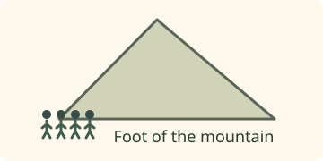

# Exodus 19 — The people meet God at Mount Sinai

**About this chapter**

The Israelites camp at Mount Sinai. Moses carries messages between the LORD and the people. The people get ready to meet God.

## Israel camps by the mountain

## Exodus 19:1

In the third month, the Israelites reached the wilderness of Sinai.

It was the same day of the month as the day they had left Egypt.

## Exodus 19:2

The Israelites had left Rephidim and entered the wilderness of Sinai.

They set up camp facing the mountain.

## Exodus 19:3

Moses went up the mountain to meet God.

The LORD called to Moses from the mountain.

“Give this message to Jacob’s family, the people of Israel.

**Pause and answer**

Where did the Israelites set up camp?

## The LORD makes a promise

## Exodus 19:4

Tell them, ‘You saw what I did to Egypt.

I carried you on eagles’ wings.

I brought you to myself.

**Reading help**

The eagle’s wings are a picture of the LORD’s care. He brought his people safely out of Egypt.

## Exodus 19:5

The whole earth belongs to me.

Listen to me and keep my covenant.

If you do, you will be my own special treasure among all nations.

## Exodus 19:6

You will be a kingdom of priests serving me.

You will be a holy nation.’

Tell the Israelites what I have said.”

**Reading help**

A covenant is a solemn agreement. Priests serve God and help people worship him. Holy means set apart for God.

**Pause and answer**

What did the LORD ask the people to keep?

## The people answer

## Exodus 19:7

Moses went back and called Israel’s leaders together.

He told them everything the LORD had said.

## Exodus 19:8

All the people answered together.

“We will do everything the LORD has said.”

Moses took their answer back to the LORD.

## Exodus 19:9

The LORD told Moses, “I will come to you in a thick cloud.

The people will hear me speaking to you.

Then they will always trust you.”

Moses told the LORD what the people had said.

**Pause and answer**

What did the people promise to do?

## The people get ready

## Exodus 19:10

The LORD told Moses, “Go to the people.

Today and tomorrow, set them apart for me.

Have them wash their clothes.

## Exodus 19:11

They must be ready by the third day.

That day the LORD will come down on Mount Sinai.

All the people will see this.

## Exodus 19:12

Mark a boundary around the mountain.

Warn the people, ‘Stay off the mountain.

Do not even touch its base.

Anyone who touches it must die.

## Exodus 19:13

No one may lay a hand on anyone who crosses the boundary.

The penalty is death by stones or arrows.

This applies to people and animals.’

Wait for one long sound from the ram’s horn.

Only then may the people come near the mountain.”

**Reading help**

A boundary marks where people must stop. A ram is a male sheep. Its horn can make a loud sound when someone blows into it.

## Exodus 19:14

Moses came down from the mountain.

He set the people apart for the LORD.

They washed their clothes.

## Exodus 19:15

Moses told the people, “Be ready for the third day.”

He told the men to go without sex during this time.

**Pause and answer**

What sound would tell the people they could come near?

## The people hear the horn

## Exodus 19:16

On the morning of the third day, thunder rolled and lightning flashed.

A thick cloud covered the mountain.

The ram’s horn sounded very loudly.

Everyone in camp shook with fear.

## Exodus 19:17

Moses led the people out of camp to meet God.

They stood at the foot of the mountain.

Look for the people below the slope. Moses led them there from the camp.

## Exodus 19:18

Smoke covered Mount Sinai.

The LORD had come down on it in fire.

The smoke rose like smoke from a blazing furnace.

The whole mountain shook hard.

## Exodus 19:19

The ram’s horn grew louder and louder.

Moses spoke.

God answered Moses in the thunder.

**Picture the mountain**

| Place | What happened there? |
| --- | --- |
| On the mountain | Fire and smoke covered the mountain as the LORD came down. |
| At the foot of the mountain | The people stood with Moses to meet God. |

**Pause and answer**

How did God answer when Moses spoke?

## The LORD calls Moses up

## Exodus 19:20

The LORD came down to the top of Mount Sinai.

He called Moses to the top.

Moses went up.

## Exodus 19:21

The LORD told Moses, “Go down and warn the people.

They must not cross the boundary to see the LORD.

If they do, many will die.

## Exodus 19:22

Even the priests who come near the LORD must set themselves apart for him.

Otherwise the LORD will act against them.”

## Exodus 19:23

Moses told the LORD, “The people cannot come up Mount Sinai.

You warned us to mark a boundary around it.

You told us to set the mountain apart as holy.”

## Exodus 19:24

The LORD answered, “Go down.

Then bring Aaron up with you.

The priests and the people must stay behind the boundary.

If they cross it to come up to the LORD, he will act against them.”

## Exodus 19:25

Moses went down and spoke to the people.

**Pause and answer**

Who did the LORD tell Moses to bring up the mountain?
