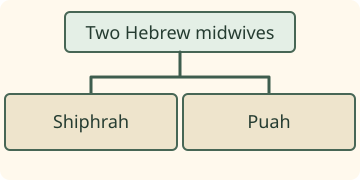

# Exodus 1 — Two midwives let the baby boys live

**About this chapter**

Jacob’s family grows in Egypt.

A new king fears the Israelites. Two midwives must decide whether to obey him.

## Jacob’s family grows in Egypt

## Exodus 1:1

Jacob also had the name Israel.

His sons went with him to Egypt. Each brought his family.

Here are their names.

## Exodus 1:2

Reuben, Simeon, Levi, and Judah went.

## Exodus 1:3

Issachar, Zebulun, and Benjamin went too.

## Exodus 1:4

Dan, Naphtali, Gad, and Asher also went.

## Exodus 1:5

There were 70 people in Jacob’s family altogether.

That number included Joseph, who already lived in Egypt.

## Exodus 1:6

In time, Joseph died. All his brothers died too.

Everyone from that generation died.

## Exodus 1:7

Their families kept growing. These people were called Israelites.

They had many children. Soon Israelites lived throughout the land.

**Pause and answer**

Which son of Jacob already lived in Egypt?

## A new king fears the Israelites

## Exodus 1:8

A new king began to rule Egypt.

He did not know Joseph.

## Exodus 1:9

He told his people, “Look how many Israelites there are!

They have grown too strong for us.

## Exodus 1:10

We must make a plan, or their numbers will keep growing.

If war comes, they might join our enemies.

They might fight us and leave Egypt.”

## Exodus 1:11

The Egyptians put men in charge to force the Israelites to work.

The Israelites built two cities, Pithom and Rameses.

Pharaoh, the king of Egypt, used them to store supplies.

## Exodus 1:12

The harder the Egyptians treated them, the more the Israelites grew in number.

They spread out. The Egyptians became afraid of them.

## Exodus 1:13

The Egyptians showed no mercy. They forced the Israelites to work.

## Exodus 1:14

They made life hard for the Israelites.

The Israelites worked with bricks and mortar, the paste that holds bricks together.

They also had to work in the fields.

The Egyptians treated them harshly in every job.

**Pause and answer**

What did Pharaoh use the two cities for?

## Shiphrah and Puah face a choice

## Exodus 1:15

The king spoke to two Hebrew midwives, Shiphrah and Puah.

**Reading help**

The Israelites were also called Hebrews.

Midwives help women give birth.

## Exodus 1:16

The king said, “When a Hebrew woman sits on the stool to give birth, look at the baby.

If the baby is a boy, kill him.

If the baby is a girl, let her live.”

## Exodus 1:17

The midwives feared God. They refused to obey the king.

Shiphrah and Puah let the boys live.

| Who | What happened |
| --- | --- |
| Pharaoh | Ordered the midwives to kill the baby boys. |
| Shiphrah and Puah | Let the baby boys live. |

Both midwives let the baby boys live.

**Pause and answer**

Why did Shiphrah and Puah let the boys live?

## The king calls the midwives back

## Exodus 1:18

The king sent for the midwives.

He asked, “Why have you let the boys live?”

## Exodus 1:19

The midwives told Pharaoh, “The Hebrew women give birth differently from Egyptian women.

They are strong. Their babies come before we arrive.”

## Exodus 1:20

God was good to the midwives.

The Israelite people continued to grow in number.

## Exodus 1:21

Because the midwives feared God, he gave them families of their own.

## Exodus 1:22

Then Pharaoh gave an order to all his people.

“Throw every newborn Hebrew boy into the Nile River.

Let the girls live.”

**Pause and answer**

Who received Pharaoh’s order at the end of the chapter?
