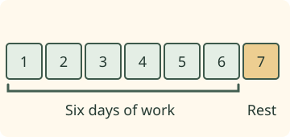

# Exodus 20 — God gives the Ten Commandments

**About this chapter**

At Mount Sinai, God speaks to the Israelites. He tells them how to worship him and how to treat each other.

## Worship the LORD

## Exodus 20:1

God spoke these words to the people.

## Exodus 20:2

“I am the LORD your God.

You were slaves in Egypt.

I brought you out of that land.

## Exodus 20:3

You must have no other gods besides me.

## Exodus 20:4

Do not make an idol for yourself.

Do not shape one like anything in the sky, on the earth or in the water below.

**Reading help**

An idol is an object people worship as a god.

## Exodus 20:5

Do not bow down to idols or worship them.

I am the LORD your God.

I want you to worship me alone.

When people hate me, I punish their families for the parents’ sin.

This reaches the third and fourth generations.

## Exodus 20:6

But I show faithful love for a thousand generations to those who love me and obey my commands.

**Pause and answer**

Who brought the people out of Egypt?

## Honor God’s name and his day of rest

## Exodus 20:7

Do not misuse the name of the LORD your God.

The LORD will punish anyone who misuses his name.

## Exodus 20:8

Remember the Sabbath day.

Keep it holy.

## Exodus 20:9

You have six days to do all your work.

## Exodus 20:10

The seventh day is a Sabbath for the LORD your God.

You must rest from work.

Your sons and daughters must rest too.

So must your servants, both men and women.

Give your farm animals rest.

People from other lands who live among you must rest too.

The seventh day is for everyone in the household to rest.

## Exodus 20:11

In six days the LORD made the heavens, the earth and the sea.

He made everything in them.

On the seventh day he rested.

That is why the LORD blessed the Sabbath.

He set that day apart as holy.

| Days | What the LORD did | What the people should do |
| --- | --- | --- |
| Days 1 through 6 | Made the world and everything in it | Do their work |
| Day 7 | Rested | Rest and let others rest |

**Pause and answer**

Who else must rest when a family rests on the Sabbath?

## How to treat other people

## Exodus 20:12

Honor your father and your mother.

Then you may live a long life in the land the LORD your God is giving you.

## Exodus 20:13

Do not murder anyone.

## Exodus 20:14

Do not commit adultery.

**Reading help**

Adultery means having sex with someone when one of you is married to someone else.

## Exodus 20:15

Do not steal.

## Exodus 20:16

Do not tell lies about your neighbor when you speak as a witness.

## Exodus 20:17

Do not covet your neighbor’s house.

Do not covet your neighbor’s wife, servants, ox or donkey.

Do not covet anything that belongs to your neighbor.”

**Reading help**

To covet means to want what belongs to someone else for yourself.

**Pause and answer**

In your own words, what does it mean to covet?

## The people ask Moses to speak

## Exodus 20:18

The people heard thunder and saw lightning.

They heard the ram’s horn.

Smoke covered the mountain.

The people shook with fear and stood far away.

## Exodus 20:19

They told Moses, “Speak to us yourself.

We will listen.

If God speaks to us, we will die!”

## Exodus 20:20

Moses answered, “Do not be afraid.

God has come to test you.

He wants you to remember how great he is.

That fear of God will help keep you from sin.”

## Exodus 20:21

The people stayed far away.

Moses went toward the thick darkness where God was.

**Pause and answer**

Who went toward the thick darkness?

## What the LORD says about altars

## Exodus 20:22

The LORD told Moses, “Give the Israelites this message from me.

‘You have seen for yourselves that I spoke to you from heaven.

## Exodus 20:23

Do not make other gods to worship alongside me.

Do not make gods out of silver or gold.

## Exodus 20:24

Make an altar of earth for me.

On it, offer your sheep, goats and cattle as burnt offerings and peace offerings.

Wherever I have you remember my name, I will come to you.

I will bless you there.

**Reading help**

An altar is a place to offer gifts to God. A burnt offering is a gift burned on the altar. A peace offering celebrates peace with God.

## Exodus 20:25

If you build me a stone altar, use uncut stones.

If you shape the stones with a tool, the altar will no longer be holy.

## Exodus 20:26

Do not climb steps to reach my altar.

That could let people see your bare body.’”

**Pause and answer**

What kind of stones could the people use for an altar?
