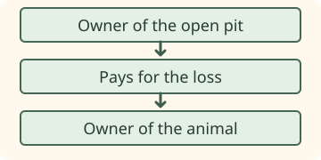

# Exodus 21 — Rules about servants, injuries and animals

**About this chapter**

The LORD gives Moses rules for ancient Israel. Each example describes what happened and what the law required.

## When a Hebrew servant can leave

## Exodus 21:1

The LORD told Moses to give Israel these rules.

## Exodus 21:2

If a man buys a Hebrew servant, the servant works for him for six years.

In the seventh year the servant goes free.

He pays nothing to leave.

**Reading help**

Here a servant is someone a master could buy. These rules describe slavery in ancient Israel.

## Exodus 21:3

If the servant came alone, he leaves alone.

If he came with a wife, she leaves with him.

## Exodus 21:4

Suppose the master gave the servant a wife.

Suppose she had sons or daughters with him.

Then the wife and children still belong to the master.

Only the man goes free.

## Exodus 21:5

The servant may say, “I love my master.

I love my wife and children.

I want to stay.”

## Exodus 21:6

Then the master must bring him before the judges.

At the door or doorpost, the master marks the servant’s ear with a pointed tool called an awl.

The servant then serves that master for life.

**Pause and answer**

When could a Hebrew servant first go free under the six-year rule?

## Rules about a daughter sold as a servant

## Exodus 21:7

Suppose a father sells his daughter as a servant.

The rule for releasing male servants does not apply to her.

## Exodus 21:8

Her master may have chosen her for himself.

If he is unhappy with her, he must let someone buy her freedom.

He has broken his promise to her.

He has no right to sell her to foreigners.

## Exodus 21:9

If he chooses her for his son, he must treat her as his own daughter.

## Exodus 21:10

If the husband takes another wife, the first wife keeps her rights.

He must give her as much food and clothing as before.

He must still share married life with her, including sex.

## Exodus 21:11

If he fails to provide these three things, she can leave.

She pays nothing for her freedom.

**Pause and answer**

What could the first wife do if her husband failed to provide for her?

## Rules about killing and kidnapping

## Exodus 21:12

If someone hits a man and kills him, the penalty is death.

## Exodus 21:13

But suppose the person had not planned the killing.

Suppose God allowed it to happen.

The LORD will choose a place where that person can run for safety.

## Exodus 21:14

Suppose someone plans to kill a neighbor and does so on purpose.

Even at the LORD’s altar, the killer cannot escape the death penalty.

## Exodus 21:15

If someone hits their father or mother, the penalty is death.

## Exodus 21:16

If someone kidnaps a man, the penalty is death.

This applies whether the kidnapper sells the man or still holds him.

## Exodus 21:17

If someone curses their father or mother, the penalty is death.

**Reading help**

Here, to curse someone means to call for harm to come to them.

**Pause and answer**

Where could someone run after an unplanned killing?

## When someone gets hurt

## Exodus 21:18

Suppose two men argue.

One hits the other with a stone or his fist.

The injured man lives but must stay in bed.

## Exodus 21:19

Later the injured man gets up.

He can walk outside with a walking stick.

Then the man who hit him faces no further punishment.

He must still pay for the work the injured man missed.

He must also see that the injured man fully recovers.

## Exodus 21:20

Suppose a master hits a servant with a stick.

If the servant dies from the blow, the master must face punishment.

This applies to both male and female servants.

## Exodus 21:21

But suppose the servant gets up after a day or two.

Then the master faces no punishment under this rule.

The law counts the servant as the master’s property.

**Pause and answer**

Who had to pay for the work the injured man missed?

## When a fight causes further harm

## Exodus 21:22

Suppose men are fighting and hit a pregnant woman.

Her baby comes early.

If no further injury follows, the man responsible owes a fine.

Her husband asks for an amount.

The court decides how much to allow.

## Exodus 21:23

But if serious harm follows, the penalty must match the harm.

The rule calls for a life for a life,

## Exodus 21:24

an eye for an eye, a tooth for a tooth, a hand for a hand, a foot for a foot,

## Exodus 21:25

a burn for a burn, a wound for a wound, and a mark from a beating for such a mark.

**Pause and answer**

Who decided how much of the requested fine to allow?

## Freedom after an injury

## Exodus 21:26

Suppose a master hits a servant and blinds one eye.

The master must free the servant for the loss of that eye.

This applies to both male and female servants.

## Exodus 21:27

Suppose the master knocks out a servant’s tooth.

The master must free the servant for that lost tooth.

This applies to both male and female servants.

**Pause and answer**

What happened to a servant who lost a tooth because the master hit them?

## When an ox hurts someone

## Exodus 21:28

Suppose an ox kills a man or woman with its horns.

The people must stone the ox to death.

No one may eat its meat.

In this case the owner faces no penalty.

## Exodus 21:29

But suppose the ox has attacked people before.

Someone warned the owner, but the owner let it run loose.

If it kills a man or woman, the rule changes.

Both the ox and its owner face death.

The people must stone the ox.

## Exodus 21:30

The owner may have a chance to pay instead.

To save his life, he must pay the whole amount demanded.

## Exodus 21:31

If the ox attacks a son or daughter with its horns, the same rule applies.

## Exodus 21:32

Suppose the ox attacks a male or female servant with its horns.

The ox’s owner must pay the servant’s master 30 shekels of silver.

The people must stone the ox to death.

**Reading help**

A shekel was a measure of weight. The people weighed silver to make payments.

**Pause and answer**

What difference did a warning make for the ox’s owner?

## Who pays for a lost animal?

## Exodus 21:33

Suppose someone opens a pit or digs a new one.

He leaves it uncovered.

An ox or donkey falls in.

## Exodus 21:34

The owner of the pit must pay the animal’s owner for the loss.

The dead animal then belongs to the owner of the pit.

Follow the payment from one owner to the other.

## Exodus 21:35

Suppose one man’s ox hurts his neighbor’s ox and it dies.

The two men must sell the living ox.

They must share the money and divide the dead animal.

## Exodus 21:36

But suppose people knew the ox often attacked with its horns.

Its owner still let it run loose.

Then the owner owes the neighbor a whole ox.

The owner of the dangerous ox keeps the dead animal.

| What happened? | Who paid for the loss? |
| --- | --- |
| An animal fell into an open pit. | The owner of the pit paid. |
| One ox killed another. | The owners shared the loss. |
| The ox was known to be dangerous and its owner let it run loose. | Its owner owed the other owner a whole ox. |

**Pause and answer**

In your own words, why did the owner of the open pit have to pay?
