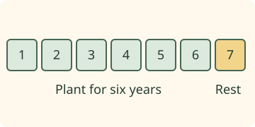

# Exodus 23 — Justice, rest and the journey ahead

**About this chapter**

The LORD tells Israel how to treat people fairly. He sets times for rest and worship. Then he tells the people who will lead them on their journey.

## Tell the truth

## Exodus 23:1

The LORD said, “Do not spread a false story.

Do not help someone do wrong by telling lies about another person.

## Exodus 23:2

Do not follow a crowd into wrongdoing.

When you speak in court, tell the truth.

Do not side with the crowd to get an unfair decision.

## Exodus 23:3

In court, do not favor someone just because they are poor.

**Pause and answer**

What should a witness do when a crowd wants an unfair decision?

## Help others and judge fairly

## Exodus 23:4

Suppose your enemy’s ox or donkey wanders away.

If you find it, take it back.

## Exodus 23:5

Suppose someone hates you.

You see their donkey lying under its heavy load.

Do not walk away.

Help the owner with the donkey.

## Exodus 23:6

Give poor people a fair hearing in court.

## Exodus 23:7

Have nothing to do with false charges.

Do not put innocent people to death.

I will hold the guilty responsible.

## Exodus 23:8

Do not accept a bribe.

A bribe blinds people who can see.

It twists even an honest person’s words.

**Reading help**

A bribe is a gift meant to buy an unfair decision. Here “blinds” means the gift keeps someone from judging fairly.

## Exodus 23:9

Do not mistreat foreigners who live among you.

You know how it feels to be a foreigner.

You once lived as foreigners in Egypt.

**Pause and answer**

What should you do if your enemy’s donkey falls under its load?

## Let the land and the workers rest

## Exodus 23:10

For six years, plant your fields and gather the crops.

## Exodus 23:11

In the seventh year, leave the land unplanted.

Let poor people eat what grows by itself.

Let wild animals eat what the people leave.

Do this with your grapevines and olive trees too.

In the seventh year, poor people can gather what grows on its own.

## Exodus 23:12

Work for six days.

On the seventh day, stop working.

Let your ox and donkey rest.

Let your female servant’s son rest and regain his strength.

Let foreigners living among you rest too.

## Exodus 23:13

Pay attention to everything I have told you.

Do not call on other gods.

Do not speak their names.

**Pause and answer**

Who could eat from the field in the seventh year?

## Three feasts each year

## Exodus 23:14

Three times each year, hold a feast for me.

## Exodus 23:15

Keep the Feast of Unleavened Bread as I commanded.

At the set time in the month of Abib, eat bread made without yeast for seven days.

That was the month you left Egypt.

Each person who comes before me must bring a gift.

## Exodus 23:16

Keep the Feast of Harvest.

Bring the first crops from the fields you planted.

At the end of the year, gather in your crops.

Then keep the Feast of Ingathering.

## Exodus 23:17

Three times each year, all your males must come before the Lord GOD.

| Feast | When the people kept it |
| --- | --- |
| Unleavened Bread | For seven days in Abib, the month Israel left Egypt |
| Harvest | When they gathered their first crops |
| Ingathering | When they gathered crops at the end of the year |

**Pause and answer**

Which feast marked the time when Israel left Egypt?

## Gifts for the LORD

## Exodus 23:18

When you offer the blood of a sacrifice to me, bring nothing made with yeast.

Do not keep fat from my feast until morning.

## Exodus 23:19

Take the best of your first crops to the house of the LORD your God.

Do not cook a young goat in its mother’s milk.

**Pause and answer**

Which part of the first crops should the people bring?

## An angel will lead the people

## Exodus 23:20

I am sending an angel ahead of you.

He will protect you on the way.

He will bring you to the place I have prepared.

## Exodus 23:21

Pay attention to the angel.

Listen to what he says.

Do not turn against him.

He carries my name and speaks with my authority.

He will not forgive you for turning against him.

## Exodus 23:22

Listen carefully to him and do everything I say.

Then I will oppose those who oppose you.

Your enemies will be my enemies.

## Exodus 23:23

My angel will lead you into the land of the Amorites, Hittites and Perizzites.

The Canaanites, Hivites and Jebusites live there too.

I will destroy those peoples.

**Pause and answer**

Who would go ahead of the people?

## Serve the LORD

## Exodus 23:24

Do not bow down to their gods.

Do not serve their gods or copy their ways of worship.

Tear down their idols.

Break the stones they use in worship.

## Exodus 23:25

Serve the LORD your God.

He will bless your bread and water.

I will take sickness away from among you.

## Exodus 23:26

In your land, no woman will be unable to have children.

No woman will lose her baby during pregnancy.

I will give you your full span of life.

**Pause and answer**

What did the LORD promise about the people’s bread and water?

## The land ahead

## Exodus 23:27

Before you arrive, I will make the nations afraid.

I will confuse every nation you meet.

I will make all your enemies turn and run.

## Exodus 23:28

I will send hornets ahead of you.

They will drive the Hivites, Canaanites and Hittites out of your way.

**Reading help**

Hornets are large insects that sting.

## Exodus 23:29

I will not drive them out in one year.

That would leave the land empty.

Wild animals would grow too numerous for you.

## Exodus 23:30

I will drive those peoples out little by little.

Your own people will grow in number until you take possession of the land.

## Exodus 23:31

I will set your borders from the Red Sea to the Sea of the Philistines.

They will also reach from the desert to the Euphrates River.

I will give you power over the people there.

You will drive them out.

## Exodus 23:32

Do not make a covenant with them or their gods.

## Exodus 23:33

Do not let them stay in your land.

They might lead you to sin against me.

Serving their gods would be a trap for you.”

**Reading help**

A covenant is a solemn agreement. A trap catches an animal and holds it. Here the trap is worshiping other gods and being drawn away from the LORD.

**Pause and answer**

In your own words, why would the LORD drive the nations out little by little?
