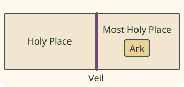

# Exodus 26 — How to make the holy tent

**About this chapter**

The LORD gives Moses the pattern for the holy tent. Curtains cover its wooden frames. Inside, another curtain divides the space into two rooms.

## Ten linen curtains

## Exodus 26:1

The LORD told Moses, “Make ten curtains for the holy tent.

Use fine linen thread with blue, purple and bright red yarn.

Work pictures of cherubim into each curtain with care.

**Reading help**

The holy tent is called the tabernacle. Cherubim are heavenly beings with wings.

## Exodus 26:2

Make every curtain the same size.

Each must be 28 cubits long and four cubits wide.

**Reading help**

A cubit was about the length from your elbow to your fingertip.

## Exodus 26:3

Join five curtains together.

Join the other five together as a second set.

## Exodus 26:4

Make blue loops along the end curtain of each set.

Put the loops on the edges that will meet.

## Exodus 26:5

Make 50 loops along each of those two edges.

Line them up in pairs across the gap.

## Exodus 26:6

Make 50 gold clasps.

Use them to fasten the loops together.

The two sets will form one covering for the holy tent.

**Pause and answer**

What joined the two sets of linen curtains?

## A second layer of curtains

## Exodus 26:7

Make 11 curtains from goat hair.

These will form a tent over the linen curtains.

## Exodus 26:8

Make all 11 the same size.

Each must be 30 cubits long and four cubits wide.

## Exodus 26:9

Join five curtains in one set.

Join six in the other set.

Fold the sixth curtain double at the front of the tent.

## Exodus 26:10

Where the two sets meet, make 50 loops along each edge.

## Exodus 26:11

Make 50 bronze clasps.

Put them through the loops to join the two sets into one tent.

| Layer | Curtains in each set | What joined the sets? |
| --- | --- | --- |
| Linen | Five and five | 50 gold clasps |
| Goat hair | Five and six | 50 bronze clasps |

**Pause and answer**

Which curtain did the workers fold at the front?

## Covers for the tent

## Exodus 26:12

Let the extra half curtain hang over the back of the holy tent.

## Exodus 26:13

The goat-hair curtains reach one cubit farther on each side.

Let the extra length hang down to cover both sides.

## Exodus 26:14

Cover the tent with ram skins dyed red.

Put a cover of fine leather over the skins.

**Pause and answer**

Which covering went over the red ram skins?

## Frames for the sides

## Exodus 26:15

Make frames from acacia wood.

Stand the frames upright to support the holy tent.

## Exodus 26:16

Make each frame ten cubits long and one and a half cubits wide.

## Exodus 26:17

Give each frame two matching wooden pegs at the bottom.

Make every frame this way.

## Exodus 26:18

Make 20 frames for the south side.

## Exodus 26:19

Put 40 silver bases under those 20 frames.

Give each frame two bases, one under each peg.

## Exodus 26:20

Make another 20 frames for the north side.

## Exodus 26:21

Make 40 silver bases for the north side.

Put two bases under each frame.

**Pause and answer**

How many bases held up one frame?

## The back corners

## Exodus 26:22

Make six frames for the back of the tent.

This end faces west.

## Exodus 26:23

Make two more frames for the back corners.

Put one at each corner.

## Exodus 26:24

At each corner, join the frames from bottom to top.

Fit the joined parts into a single ring.

Make both corners this way.

## Exodus 26:25

That makes eight frames across the back.

Make 16 silver bases, two under each frame.

**Pause and answer**

Which way did the back of the tent face?

## Bars to hold the frames together

## Exodus 26:26

Make five crossbars from acacia wood for the frames on one side.

## Exodus 26:27

Make five for the other side too.

Make five more for the back, which faces west.

## Exodus 26:28

Run the middle crossbar halfway up the frames.

It must reach from one end to the other.

## Exodus 26:29

Cover the frames with gold.

Make gold rings to hold the crossbars.

Cover the crossbars with gold too.

## Exodus 26:30

Set up the holy tent just as I showed you on the mountain.

**Pause and answer**

How far did the middle crossbar reach?

## A curtain between two rooms

## Exodus 26:31

Make a curtain called the veil.

Use blue, purple and bright red yarn with fine linen thread.

Work pictures of cherubim into it with care.

## Exodus 26:32

Hang the veil on gold hooks from four acacia posts.

Cover the posts with gold.

Stand them on four silver bases.

## Exodus 26:33

Hang the veil from the clasps.

Set the ark of the Testimony behind the veil.

The veil will separate the two rooms.

One room is the Holy Place.

The room behind the veil is the Most Holy Place.

Find the ark behind the veil.

## Exodus 26:34

Put the mercy seat on the ark of the Testimony in the Most Holy Place.

**Reading help**

The ark was the chest for the stone tablets with God’s commands. The mercy seat was its gold cover.

## Exodus 26:35

Outside the veil, put the table on the north side.

Place the lampstand opposite it on the south side.

**Pause and answer**

What stood opposite the table?

## The entrance curtain

## Exodus 26:36

Make another curtain for the entrance.

Stitch a pattern into fine linen using blue, purple and bright red yarn.

## Exodus 26:37

Make five acacia posts to hold the entrance curtain.

Cover them with gold and give them gold hooks.

Cast five bronze bases for the posts.”

**Pause and answer**

What held up the entrance curtain?
