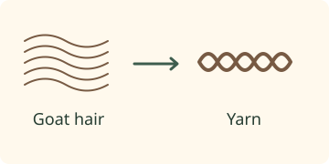

# Exodus 35 — The people bring gifts and share their skills

**About this chapter**

Moses gathers the people before work begins on the holy tent. Some bring gifts. Others spin yarn, design beautiful things or teach their skills.

## Rest on the seventh day

## Exodus 35:1

Moses gathered all the Israelites together.

He said, “Here is what the LORD commands you to do.

## Exodus 35:2

You may work for six days.

The seventh day is holy.

It is the Sabbath, a day of complete rest for the LORD.

The penalty for working that day is death.

## Exodus 35:3

Do not light a fire in your homes on the Sabbath.”

**Pause and answer**

Which day did the LORD set apart for rest?

## Bring gifts for the holy tent

## Exodus 35:4

Moses also told the people, “The LORD has given this command.

## Exodus 35:5

Bring gifts to the LORD from what you have.

Everyone who wants to give may bring a gift.

Bring gold, silver or bronze.

## Exodus 35:6

Bring blue, purple or bright red yarn.

Bring fine linen or goat hair.

## Exodus 35:7

Bring ram skins dyed red or fine leather.

Bring wood from acacia trees.

## Exodus 35:8

Bring olive oil for the lamps.

Bring spices for the anointing oil and the sweet-smelling incense.

## Exodus 35:9

Bring onyx and other precious stones.

The workers will set them on the ephod and breastpiece.

**Reading help**

The ephod was a garment the priest wore. The breastpiece lay over his chest. Workers attached precious stones to both.

**Pause and answer**

Who could bring a gift?

## Make the tent and its furnishings

## Exodus 35:10

All of you who are skilled workers, come.

Make everything the LORD has commanded.

## Exodus 35:11

Build the holy tent, called the tabernacle.

Make its outer tent and cover.

Make its clasps, frames, crossbars, posts and bases.

## Exodus 35:12

Make the ark, its carrying poles and its cover, the mercy seat.

Make the curtain that hides the ark from view.

## Exodus 35:13

Make the table, its carrying poles and all its dishes.

Prepare the Bread of the Presence for the table.

**Reading help**

The ark was a chest. The Bread of the Presence was bread kept before the LORD on the table.

## Exodus 35:14

Make the lampstand, its lamps and all its tools.

Prepare oil for the light.

## Exodus 35:15

Make the incense altar and its carrying poles.

Prepare the anointing oil and the sweet-smelling incense.

Make the curtain for the entrance to the holy tent.

**Pause and answer**

What would hide the ark from view?

## Prepare the courtyard and the priests’ clothes

## Exodus 35:16

Make the altar for burnt offerings.

Make its bronze grate, its carrying poles and its tools.

Make the washing bowl and its stand.

## Exodus 35:17

Make the curtains, posts and bases for the courtyard.

Make a curtain for the courtyard gate.

## Exodus 35:18

Make pegs and ropes for the tent and the courtyard.

## Exodus 35:19

Weave clothes for the priests to wear in the holy place.

Make holy clothes for Aaron the priest.

Make clothes for his sons to serve as priests too.”

**Pause and answer**

Who would wear the holy clothes?

## The people bring what they have

## Exodus 35:20

Then all the Israelites went away from Moses.

## Exodus 35:21

Those who wanted to help came back with gifts for the LORD.

Their gifts were for the Tent of Meeting, the work done there and the holy clothes.

## Exodus 35:22

Men and women came because they wanted to give.

They brought gold pins, earrings, rings, necklaces and other jewelry.

They lifted their gold before the LORD as a wave offering.

## Exodus 35:23

People brought the blue, purple or bright red yarn they had.

Others brought fine linen, goat hair, ram skins dyed red or fine leather goods.

## Exodus 35:24

Everyone who could give silver or bronze brought it to the LORD.

People who had acacia wood brought it for the work.

**Pause and answer**

What did the people do with their gold jewelry?

## Thread, stones and spices

## Exodus 35:25

The skilled women spun thread by hand.

They brought the blue, purple and bright red yarn and fine linen thread they had spun.

**Reading help**

To spin means to twist loose fibers together to make thread or yarn.

## Exodus 35:26

The skilled women who wanted to do so spun goat hair into yarn.

Skilled women spun the hair into yarn for the tent.

## Exodus 35:27

The leaders brought onyx and other precious stones for the ephod and breastpiece.

## Exodus 35:28

They also brought spices and olive oil.

These were for the lamps, the anointing oil and the sweet-smelling incense.

| What people brought | Where it would go |
| --- | --- |
| Onyx and other stones | On the priest’s ephod and breastpiece |
| Olive oil for light | In the lamps |
| Spices | In the anointing oil and incense |

## Exodus 35:29

The LORD had told Moses what work Israel should do.

Israelite men and women freely chose to bring gifts to the LORD for that work.

**Pause and answer**

What did the women make from goat hair?

## Two workers who can teach

## Exodus 35:30

Moses told the Israelites, “The LORD has chosen Bezalel by name.

Bezalel is Uri’s son and Hur’s grandson.

He belongs to the tribe of Judah.

## Exodus 35:31

The LORD has filled Bezalel with the Spirit of God.

He has given Bezalel skill and knowledge for many kinds of work.

## Exodus 35:32

Bezalel can design beautiful things in gold, silver and bronze.

## Exodus 35:33

He can cut precious stones to fit their holders.

He can carve wood.

He is skilled in every kind of craft.

## Exodus 35:34

The LORD has also given Bezalel and Oholiab the skill to teach others.

Oholiab is the son of Ahisamach, from the tribe of Dan.

## Exodus 35:35

The LORD has given them skill to carve designs and weave cloth.

They can stitch patterns in fine linen with blue, purple and bright red yarn.

They can plan and make all kinds of beautiful things.”

**Pause and answer**

In your own words, how could Bezalel and Oholiab help other workers learn?
