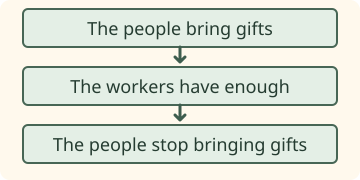

# Exodus 36 — The workers make the holy tent

**About this chapter**

The people bring so much that Moses asks them to stop. The workers use the gifts to build the holy tent.

## Moses calls the workers

## Exodus 36:1

Moses said, “The LORD gave Bezalel, Oholiab and the other workers their skills.

They know how to build his holy place.

They must do everything the LORD commanded.”

## Exodus 36:2

Moses called Bezalel and Oholiab.

He also called everyone the LORD had given skill who wanted to help.

## Exodus 36:3

Moses gave the workers all the gifts Israel had brought for building the holy place.

Each morning, people freely brought more gifts.

**Pause and answer**

Who gave the gifts to the workers?

## The workers have enough

## Exodus 36:4

All the skilled workers stopped what they were doing.

They left their work on the holy place to speak to Moses.

## Exodus 36:5

They said, “The people have brought more than we need.

We can do all the work the LORD gave us.”

## Exodus 36:6

At Moses’ command, this message went throughout the camp.

“No one needs to make anything else for the holy place.”

So the people stopped bringing gifts.

## Exodus 36:7

The workers already had more than enough for everything.

Moses told the people when the workers had everything they needed.

**Pause and answer**

Why did Moses tell the people to stop bringing gifts?

## Ten linen curtains

## Exodus 36:8

The skilled workers made ten curtains for the holy tent.

They used fine linen thread and blue, purple and bright red yarn.

They worked pictures of winged beings called cherubim into the curtains.

## Exodus 36:9

All ten curtains were the same size.

Each was 28 cubits long and four cubits wide.

**Reading help**

A cubit was about the length from your elbow to your fingertip.

## Exodus 36:10

The builder joined five curtains together.

He joined the other five into a second set.

## Exodus 36:11

He made blue loops along the edge of each set where the two sets met.

## Exodus 36:12

He made 50 loops on each of those edges.

The loops lined up in pairs.

## Exodus 36:13

He made 50 gold clasps.

They fastened the sets together to make one covering for the holy tent.

**Reading help**

A clasp is a fastener. Here each clasp holds together two loops.

**Pause and answer**

What held the two sets of linen curtains together?

## The outer coverings

## Exodus 36:14

The builder made 11 goat-hair curtains.

These formed a tent over the linen curtains.

## Exodus 36:15

Each goat-hair curtain was 30 cubits long and four cubits wide.

All 11 were the same size.

## Exodus 36:16

He joined five curtains into one set.

He joined six into another.

## Exodus 36:17

He made 50 loops on the edge of each set where the two sets met.

## Exodus 36:18

He made 50 bronze clasps.

These joined the two sets into one tent.

## Exodus 36:19

He made a covering from ram skins dyed red.

Over that went a covering of fine leather.

**Pause and answer**

Which covering went over the red ram skins?

## Frames for the sides

## Exodus 36:20

The builder made upright frames from acacia wood for the holy tent.

## Exodus 36:21

Each frame was ten cubits long and one and a half cubits wide.

## Exodus 36:22

He made two matching wooden pegs on each frame.

He made every frame this way.

## Exodus 36:23

He made 20 frames for the south side of the tent.

## Exodus 36:24

He made 40 silver bases for those 20 frames.

Each frame had two bases, one for each peg.

## Exodus 36:25

He made 20 frames for the north side.

## Exodus 36:26

He made 40 silver bases for that side too.

Two bases went under each frame.

**Pause and answer**

How many bases went under each frame?

## The back of the tent

## Exodus 36:27

He made six frames for the back of the tent.

The back faced west.

## Exodus 36:28

He made two more frames for the back corners.

One went at each corner.

## Exodus 36:29

At each corner he joined the frames from bottom to top.

The joined parts fitted into one ring.

He made both corners the same way.

## Exodus 36:30

The back had eight frames in all.

They stood on 16 silver bases, two per frame.

**Pause and answer**

Which way did the back of the tent face?

## Bars across the frames

## Exodus 36:31

The builder made five acacia crossbars for the frames on one side.

## Exodus 36:32

He made five more for the other side.

He also made five for the back, which faced west.

## Exodus 36:33

The middle crossbar ran through the middle of the frames.

It reached from one end to the other.

## Exodus 36:34

He covered the frames with gold.

He made gold rings to hold the crossbars.

He covered the crossbars with gold too.

**Pause and answer**

What held the crossbars in place?

## Two curtains on posts

## Exodus 36:35

The builder made the inner curtain, called the veil.

He used fine linen thread and blue, purple and bright red yarn.

He worked pictures of cherubim into it.

## Exodus 36:36

He made four acacia posts for the veil.

He covered the posts with gold and made gold hooks.

He made four silver bases for the posts by pouring melted silver into molds.

## Exodus 36:37

For the tent entrance, he made another curtain.

He stitched designs into fine linen with blue, purple and bright red yarn.

## Exodus 36:38

He made five posts with hooks for the entrance curtain.

He covered the post tops and bands with gold.

The five bases were bronze.

| Which curtain? | How many posts? | What were the bases made of? |
| --- | --- | --- |
| Veil inside the tent | Four | Silver |
| Curtain at the entrance | Five | Bronze |

**Pause and answer**

Using the table, describe the posts and bases for the entrance curtain.
