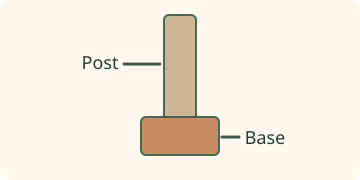

# Exodus 38 — The courtyard and the record of the metals

**About this chapter**

Bezalel makes the altar, the washing bowl and the courtyard. The Levites record how much metal the people gave for the work.

## The bronze altar

## Exodus 38:1

Bezalel built the altar for burnt offerings from acacia wood.

It was square, five cubits long and five cubits wide.

It stood three cubits high.

**Reading help**

A cubit was about the length from your elbow to your fingertip. The horns were parts that stuck up at the altar’s corners.

## Exodus 38:2

He shaped a horn at each of the four corners.

The horns and the altar formed one piece.

He covered the altar with bronze.

## Exodus 38:3

Bezalel made all the altar tools from bronze.

He made pots, shovels and bowls for sprinkling.

He made meat forks and pans for hot coals.

**Pause and answer**

What metal covered the wooden altar?

## Carrying poles and a washing bowl

## Exodus 38:4

He made a grate of bronze mesh.

It sat below the ledge, halfway up the altar.

## Exodus 38:5

He made four rings to hold the carrying poles.

One ring went at each corner of the grate.

## Exodus 38:6

He made the poles from acacia wood.

He covered them with bronze.

## Exodus 38:7

He slid the poles through the rings on the sides.

People could use the poles to carry the altar.

Bezalel built the altar from boards and left it hollow.

## Exodus 38:8

Women served at the entrance to the Tent of Meeting.

Bezalel used the bronze from their mirrors to make the washing bowl and its stand.

**Reading help**

These mirrors were made from polished metal. A woman could see her face in the shiny surface.

**Pause and answer**

Where did the bronze for the washing bowl come from?

## The sides of the courtyard

## Exodus 38:9

Then Bezalel built the courtyard.

Its south side was 100 cubits long.

Curtains of fine linen hung along that side.

## Exodus 38:10

Twenty posts stood on 20 bronze bases.

The posts had silver hooks and bands.

Each of the twenty posts on this side had its own base.

## Exodus 38:11

The north side was also 100 cubits long.

It had 20 posts and 20 bronze bases.

Its posts had silver hooks and bands.

## Exodus 38:12

The west side was 50 cubits long.

Its curtains hung on ten posts with ten bases.

The posts had silver hooks and bands.

**Pause and answer**

Which two sides were 100 cubits long?

## The courtyard entrance

## Exodus 38:13

The east side faced the sunrise.

It too was 50 cubits long.

## Exodus 38:14

On one side of the entrance, the curtains reached 15 cubits.

They hung on three posts with three bases.

## Exodus 38:15

On the other side, the curtains also reached 15 cubits.

They too hung on three posts with three bases.

## Exodus 38:16

Bezalel used fine linen thread for all the courtyard curtains.

## Exodus 38:17

The posts stood on bronze bases.

They had silver hooks and silver tops.

A silver band went around every courtyard post.

## Exodus 38:18

The entrance curtain had designs stitched in fine linen with blue, purple and bright red yarn.

It was 20 cubits long.

It stood five cubits high, like the other courtyard curtains.

## Exodus 38:19

Four posts with four bronze bases held this curtain.

The posts had silver hooks, silver bands and silver coverings on top.

## Exodus 38:20

All the pegs for the holy tent were bronze.

So were the pegs for the courtyard around it.

**Pause and answer**

How many posts held the entrance curtain?

## Who kept the record?

## Exodus 38:21

Moses told the Levites to record the materials for the holy tent where the Testimony belonged.

Ithamar led the Levites in this work.

His father was Aaron the priest.

**Reading help**

The Testimony was the name for the stone tablets with God’s commands.

## Exodus 38:22

Bezalel made everything the LORD had told Moses to make.

Bezalel was Uri’s son and Hur’s grandson.

He belonged to the tribe of Judah.

## Exodus 38:23

Oholiab worked with Bezalel.

Oholiab was Ahisamach’s son, from the tribe of Dan.

He carved designs and planned patterns.

He stitched designs in fine linen with blue, purple and bright red yarn.

**Pause and answer**

Who led the Levites as they recorded the materials?

## Gold and silver

## Exodus 38:24

The people had lifted up gold as an offering.

The gold used for the holy place weighed 29 talents and 730 shekels.

The workers used the holy tent’s standard weight for a shekel.

**Reading help**

Talents and shekels were measures of weight. A talent was much heavier than a shekel.

## Exodus 38:25

The men who took part in the count gave silver.

Together they gave 100 talents and 1,775 shekels of silver.

The same standard weight applied.

## Exodus 38:26

The count included 603,550 men aged 20 or older.

Each gave one beka of silver.

One beka was half a shekel by the holy tent’s measure.

## Exodus 38:27

The workers used 100 talents of silver to make 100 bases.

These held the frames of the holy tent and the posts for the inner curtain.

Each base took one talent of silver.

## Exodus 38:28

Bezalel used the other 1,775 shekels of silver for the posts.

He made the hooks and bands and covered the tops.

**Pause and answer**

What did the workers make with one talent of silver for each one?

## What the bronze was used for

## Exodus 38:29

The bronze the people lifted up as an offering weighed 70 talents and 2,400 shekels.

## Exodus 38:30

Bezalel used bronze for the bases at the entrance to the Tent of Meeting.

He also used it for the altar, its grate and all its tools.

## Exodus 38:31

He used bronze for the bases around the courtyard and at its gate.

He also used it for all the pegs for the tent and the courtyard.

| Metal in the record | Talents | Extra shekels |
| --- | ---: | ---: |
| Gold | 29 | 730 |
| Silver | 100 | 1,775 |
| Bronze | 70 | 2,400 |

**Pause and answer**

Name one place where Bezalel used bronze.
